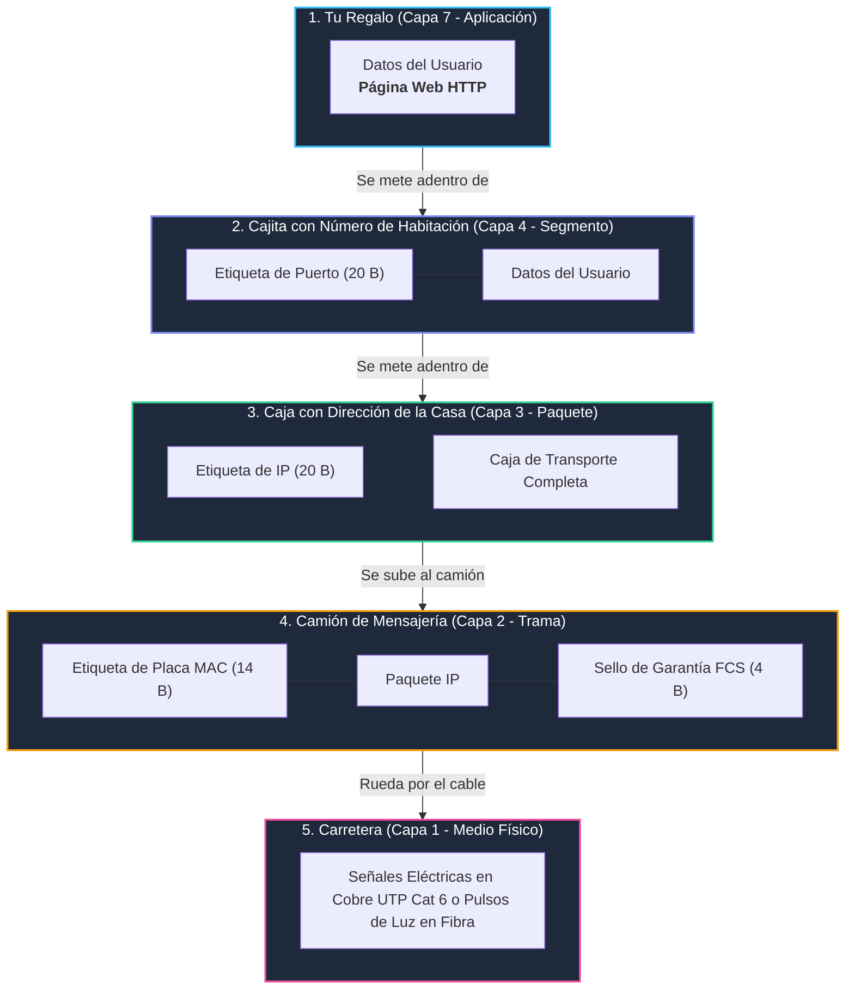
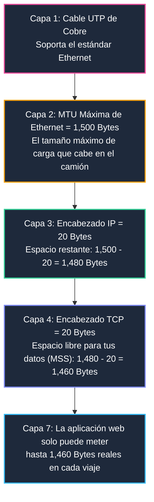
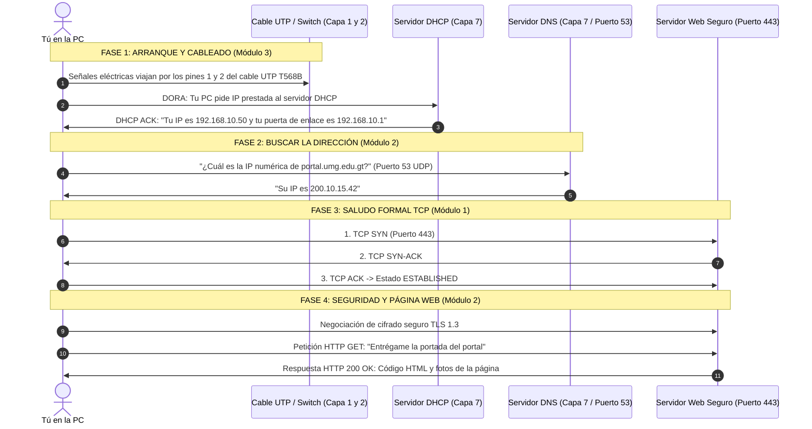

# Capítulo Maestro: Integración y Relación Entre Capas (Modelo OSI y TCP/IP)

---

### 📖 Mini Diccionario para Empezar

* **Encapsulamiento:** Es como meter una carta dentro de un sobre, luego ese sobre dentro de una caja de cartón, y luego la caja dentro de un camión de encomiendas. Conforme los datos bajan de capa, cada capa le pega su propia etiqueta con información necesaria para el viaje.
* **Desencapsulamiento:** El proceso inverso en la máquina que recibe. Va rompiendo la caja, abriendo el sobre y extrayendo la carta limpia para mostrársela a la persona.
* **Capa 1 (Física):** Los cables de cobre, la fibra óptica y los voltajes eléctricos.
* **Capa 2 (Enlace de Datos):** La tarjeta de red (NIC) y las direcciones físicas **MAC** que vienen grabadas de fábrica en el chip de tu computadora.
* **Capa 3 (Red):** Las direcciones lógicas **IP** que cambian según la red donde te conectes.
* **Capa 4 (Transporte):** Los números de **Puerto** (TCP o UDP) que identifican a tus programas.
* **Capa 7 (Aplicación):** Tu navegador web, WhatsApp o cliente de correo.

---

### 1. La Gran Analogía de las Muñecas Rusas (Matrioshkas)

Imagina que quieres mandarle un regalo por encomienda a tu amigo que vive en otro departamento:
1. **Tu regalo (Capa de Aplicación):** Es el objeto que quieres mandar (ejemplo: una taza personalizada).
2. **La caja pequeña con número de cuarto (Capa de Transporte):** Metes la taza en una cajita y le pegas una etiqueta que dice: *"Para entregar en la habitación 443"*. (Agrega el **Puerto de Destino**).
3. **La caja grande con la dirección de la casa (Capa de Red):** Metes la cajita dentro de una caja más grande y le pegas la dirección de la casa: *"Avenida Las Américas, Casa 15"*. (Agrega la **Dirección IP**).
4. **El camión de mensajería (Capa de Enlace):** El repartidor sube la caja a un camión que tiene placa y número de motor. (Agrega la **Dirección MAC** y el seguro contra golpes CRC).
5. **La carretera de asfalto (Capa Física):** Las ruedas del camión giran sobre el pavimento. (Son los voltajes eléctricos viajando por el cable UTP).

---

### 2. La Cadena de Restricciones Métricas (Del Cable a la Computadora)

¿Por qué los archivos descargados viajan típicamente en bloques de **1,460 bytes**?
Porque cada capa le descuenta un pedazo al espacio disponible para pagar por sus etiquetas:

$$\text{MTU (Tamaño máximo de la caja Ethernet)} = 1,500 \text{ bytes}$$
$$\text{Etiqueta de Capa 3 (IP)} = 20 \text{ bytes}$$
$$\text{Etiqueta de Capa 4 (TCP)} = 20 \text{ bytes}$$
$$\mathbf{MSS \text{ (Tus datos puros)}} = 1500 - 20 - 20 = \mathbf{1460 \text{ bytes}}$$

---

### 3. El Viaje de un Clic: ¿Qué pasa cuando entras al portal de la UMG?

Imagina que estás en una computadora de los laboratorios de la UMG, abres el navegador y tecleas:
$$\text{https://portal.umg.edu.gt}$$

A continuación se muestra la película completa de lo que ocurre en fracciones de segundo:

---

### 4. Guía Rápida de Diagnóstico de Fallas (Para el Examen)

| Si pasa este problema en la computadora... | ¿En qué capa está la culpa? | Explicación en palabras sencillas |
| :--- | :---: | :--- |
| **La luz de la tarjeta de red está apagada** | **Capa 1 (Física)** | El cable está roto, mal ponchado o desconectado. |
| **La PC tiene una IP que empieza por `169.254...`** | **Capa 7 (DHCP)** | El cable sirve, pero el servidor DHCP está apagado o el router no lo deja pasar (APIPA). |
| **El ping a `8.8.8.8` funciona, pero `google.com` no abre** | **Capa 7 (DNS)** | Tienes Internet perfecto, pero tu computadora no puede traducir nombres porque el DNS falló. |
| **El navegador dice: *"Tiempo de espera agotado"*** | **Capa 4 (TCP)** | La IP existe, pero un firewall tiene bloqueado el puerto 80 o 443 y no responde al saludo SYN. |
