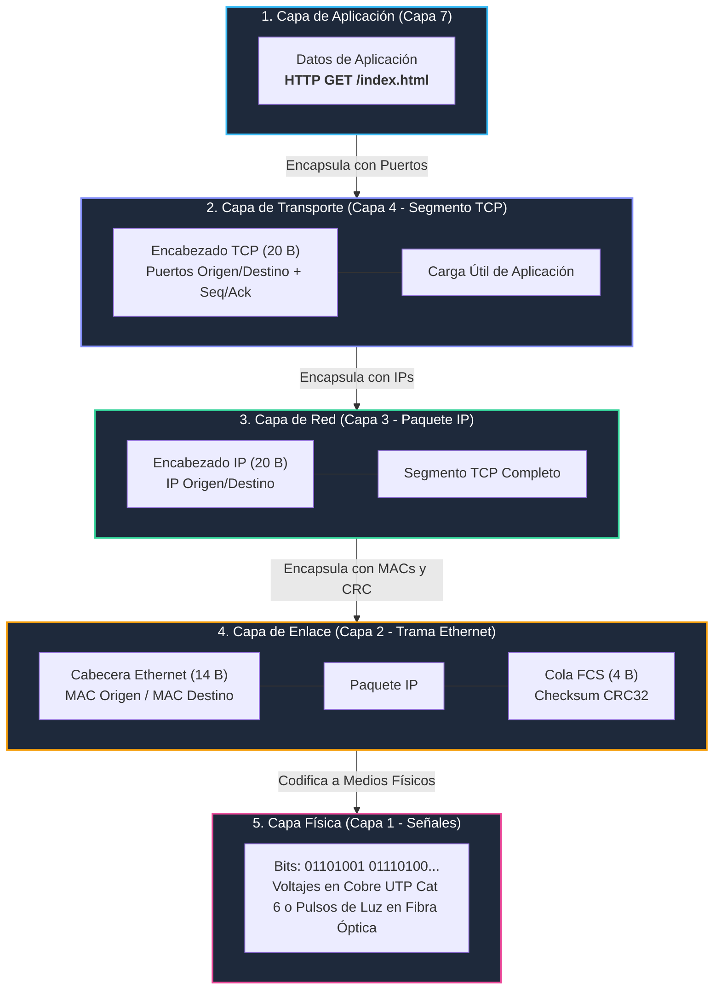
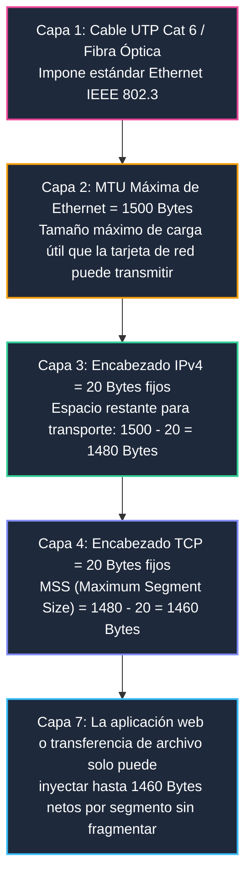
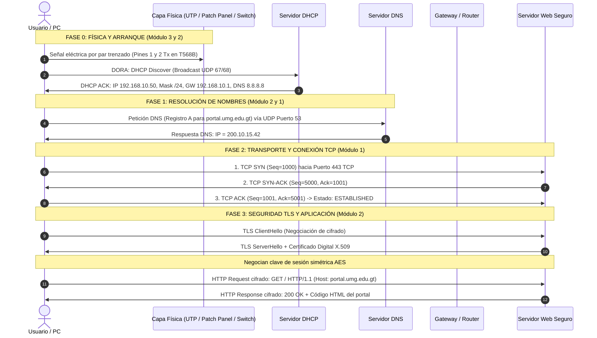

# Capítulo Maestro: Integración y Relación Entre Capas (Modelo OSI y TCP/IP)

---

### 1. El Mapa Completo de Encapsulamiento y Desencapsulamiento
Una de las fallas más comunes en exámenes de redes es estudiar las capas como islas desconectadas. En la realidad de la ingeniería, **ninguna capa puede operar sin los servicios y límites de las capas inferiores**.

A continuación se muestra cómo se empaqueta la información desde el clic del usuario hasta los electrones o pulsos de luz en el cable:

---

### 2. La Cadena de Restricciones Métricas: Del Cable a la Aplicación
¿Por qué un archivo descargado por Internet viaja típicamente en bloques de **1,460 bytes**? La respuesta demuestra la interconexión directa entre Cableado, Enlace, Red y Transporte:

#### Fórmulas de Relación Inter-Capa:
$$\text{MTU (Maximum Transmission Unit de Capa 2)} = 1500 \text{ bytes}$$
$$\text{Tamaño del Paquete IP} = \text{Encabezado IP (20 B)} + \text{Carga Útil IP}$$
$$\text{MSS (Maximum Segment Size de TCP)} = \text{MTU} - \text{Encabezado IP (20 B)} - \text{Encabezado TCP (20 B)}$$
$$\mathbf{MSS = 1500 - 20 - 20 = 1460 \text{ bytes}}$$

* **Impacto práctico:** Si un switch o router intermedio tiene una MTU reducida o túneles VPN (que añaden encabezados GRE o IPsec), y el paquete supera el límite con la bandera **DF (Don't Fragment)** activa, el router descarta el paquete y devuelve un mensaje ICMP tipo 3 código 4 (*Fragmentation Needed*). Este fenómeno se conoce como **Path MTU Discovery (PMTUD)**.

---

### 3. Anatomía de una Transacción Completa: El Viaje de un Clic

Imagina que estás en una PC de la UMG, conectada mediante un Jack RJ-45 de pared ponchado con norma T568B, abres el navegador y escribes:
$$\text{https://portal.umg.edu.gt}$$

A continuación se detalla la secuencia exacta segundo a segundo que involucra **absolutamente todos los temas de tus 3 módulos**:

---

### 4. Matriz de Dependencias Cruzadas entre Protocolos

| Si falla este componente... | ¿Qué síntoma exacto se observa en la red? | ¿En qué capa se originó el error? |
| :--- | :--- | :--- |
| **Jack RJ-45 con par abierto en pin 3** | La tarjeta de red no sincroniza enlace (*Link LED apagado*) o negocia solo a 10 Mbps en modo semidúplex. | **Capa 1 (Física / Cableado Estructurado)** |
| **Canal horizontal con longitud de 115 metros** | Paquetes descartados por CRC erróneo debido a atenuación excesiva y colisiones tardías (*Late Collisions*). | **Capa 1 / Capa 2** |
| **DHCP saturado o servidor caído** | La PC se autoasigna una IP APIPA `169.254.x.x`. No hay salida a Internet. | **Capa 7 (Aplicación DHCP)** |
| **Servidor DNS mal configurado o puerto 53 bloqueado** | Puedes hacer ping a IPs públicas (`ping 8.8.8.8` funciona), pero el navegador dice *"No se puede encontrar la dirección IP del servidor"*. | **Capa 7 (DNS) sobre Capa 4 (UDP 53)** |
| **Firewall bloqueando el puerto 443** | El ping a la IP del servidor funciona, el DNS resuelve la IP, pero la página web nunca carga y el navegador se queda en espera infinita (*Connection Timed Out* tras reintentos SYN). | **Capa 4 (Transporte TCP)** |
