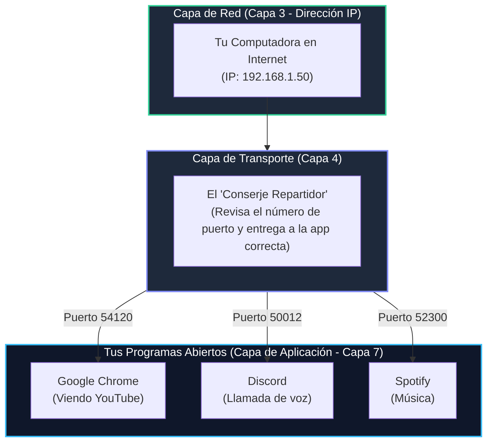
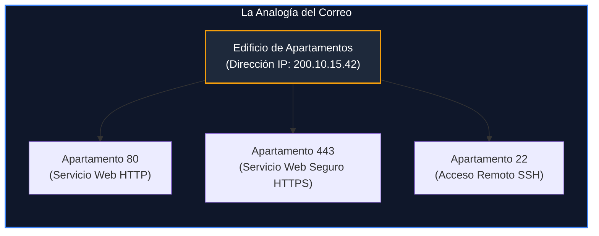
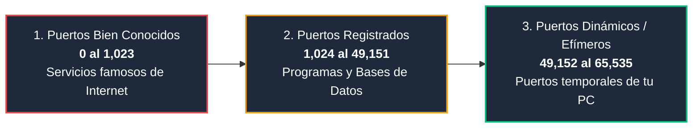
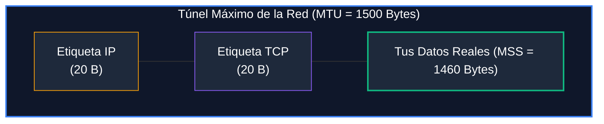

# Módulo 1: Capa de Transporte
## Tema 1.1: Fundamentos de la Capa de Transporte y Modelo de Sockets (Desde Cero)

---

### 📖 Mini Diccionario para Empezar (Sin Palabras Raras)

Antes de ver cualquier fórmula o diagrama, entendamos las palabras que siempre repiten los ingenieros:

* **Host (Dispositivo o Anfitrión):** Es cualquier computadora, celular, servidor o laptop conectada a la red.
* **Dirección IP (Internet Protocol):** Es como la dirección de tu casa en el mundo real (ejemplo: *"Calle 5, Zona 10, Edificio Los Robles"*). Le dice a Internet a qué máquina exacta deben viajar los datos.
* **Proceso / Aplicación:** Es un programa que está corriendo en la memoria de tu computadora (ejemplo: Google Chrome, Spotify, WhatsApp, o un juego).
* **Puerto de Red:** Es como el número de apartamento dentro del edificio. La IP encuentra el edificio (tu computadora), pero el **Puerto** encuentra la puerta del apartamento exacto (el programa que pidió los datos).
* **Socket (Enchufe lógico):** Es la unión de la IP + el Puerto (ejemplo: `192.168.1.15:80`). Es como escribir en una carta: *"Edificio Los Robles, Apartamento 80"*.
* **Segmento / Paquete:** Un trozo pequeño de un archivo. Si quieres enviar una foto de 10 MB, la computadora la corta en miles de pedacitos pequeños para enviarlos uno por uno.

---

### 1. ¿Qué es la Capa de Transporte y qué problema resuelve?

Imagina este problema real:
Estás en tu computadora y tienes abiertas **tres cosas al mismo tiempo**:
1. Un video de YouTube en Google Chrome.
2. Una llamada de voz con tus amigos en Discord.
3. La aplicación de Spotify reproduciendo música.

Todos esos datos entran a tu computadora por **un solo cable de red** (o por una sola antena Wi-Fi).

**La gran pregunta:**  
Cuando un pedazo de información llega desde el cable a tu tarjeta de red, **¿cómo sabe la computadora si ese pedacito es un segundo de video de YouTube, un segundo de voz de Discord o una canción de Spotify?**

La respuesta es: **La Capa de Transporte**.

#### La diferencia de oro para tu examen:
* **Capa 3 (Red - Dirección IP):** Hace la entrega **Host-to-Host** (de máquina a máquina). Se encarga de que la carta llegue a la computadora correcta, pero no le importa qué programa la pidió.
* **Capa 4 (Transporte - Números de Puerto):** Hace la entrega **Process-to-Process** (de proceso a proceso). Toma la carta que llegó a la computadora y se la entrega en la mano al programa que la estaba esperando.

---

### 2. La Gran Analogía del Edificio de Apartamentos

Para entender qué es un **Socket**, piensa en cómo te llega una carta a domicilio:

$$\begin{aligned}
\text{Dirección de la Calle} &\longleftrightarrow \text{Dirección IP (Encuentra tu computadora)} \\
\text{Número de Apartamento} &\longleftrightarrow \text{Número de Puerto (Encuentra tu programa)} \\
\text{Dirección Completa (Calle + Depto)} &\longleftrightarrow \textbf{Socket (IP + Puerto)}
\end{aligned}$$

* Si escribes solo la dirección de la calle (solo la IP), el cartero llega al edificio pero **no sabe en qué buzón dejar la carta**.
* Si escribes solo el número de apartamento (solo el puerto), el cartero tiene un número pero **no sabe en qué calle o ciudad queda**.
* Por eso se necesita el **Socket completo**: `IP : Puerto` (ejemplo: `200.10.15.42:443`).

---

### 3. ¿Cómo se comunican dos computadoras? (El Par de Sockets)

Cuando abres una página web en tu navegador:
1. **El Servidor (quien ofrece el servicio):** Tiene un puerto fijo y muy conocido para que todo el mundo lo encuentre fácilmente (ejemplo: puerto `80` para web normal o `443` para web segura).
2. **Tu Computadora (Cliente):** Para no confundir las respuestas, tu sistema operativo inventa un número de puerto temporal al azar llamado **Puerto Efímero o Dinámico** (ejemplo: `54321`).

$$\text{Tu Navegador} \quad (192.168.1.10 : 54321) \longleftrightarrow (200.10.15.42 : 443) \quad \text{Servidor Web}$$

Gracias a este invento, si abres **dos pestañas hacia el mismo sitio web**, tu computadora le inventa un puerto diferente a cada pestaña:
* **Pestaña 1:** `Puerto 54321` $\rightarrow$ habla con el servidor.
* **Pestaña 2:** `Puerto 54322` $\rightarrow$ habla con el servidor.
Cuando el servidor responde, la computadora mira el puerto de retorno y sabe con total precisión en qué pestaña mostrar cada página.

---

### 4. Los Tres Rangos de Puertos (De memoria para el examen)

Los números de puerto van del **0 al 65,535** (porque están guardados en un número de 16 bits: $2^{16} = 65,536$). Se dividen en tres grupos:

#### Los Puertos Más Preguntados en la UMG:
| Puerto | Para qué sirve | Explicación en palabras sencillas |
| :---: | :--- | :--- |
| **80** | **HTTP** | Cargar páginas web tradicionales (sin candadito verde, texto claro). |
| **443** | **HTTPS** | Cargar páginas web seguras con cifrado (con candadito verde). |
| **53** | **DNS** | La "libreta telefónica": le das el nombre `google.com` y te devuelve su IP numérica. |
| **67 / 68** | **DHCP** | El configurador automático: le da IP y máscara a tu PC cuando te conectas al Wi-Fi. |
| **20 / 21** | **FTP** | Enviar y descargar archivos pesados a un servidor. |
| **22** | **SSH** | Entrar a administrar un servidor o router por pantalla negra de forma segura y cifrada. |
| **23** | **Telnet** | Lo mismo que SSH, pero viejo e inseguro (cualquiera puede espiar tu contraseña). |
| **25** | **SMTP** | Enviar correos electrónicos desde tu cuenta hacia el mundo. |
| **110** | **POP3** | Descargar correos a tu teléfono y borrarlos del servidor. |
| **143** | **IMAP** | Leer correos sincronizados entre tu celular y tu computadora sin borrarlos. |

---

### 5. ¿Por qué los archivos se cortan en pedazos? (MTU y MSS)

Imagina que quieres enviar un camión de mudanza lleno con un ropero gigante de 3 metros de alto por una carretera que tiene un túnel cuya altura máxima es de **1.50 metros**.
* Si intentas meter el ropero entero, choca contra el túnel y se destruye.
* **Solución:** Desarmas el ropero en tablas pequeñas, metes cada tabla en una caja de menos de 1.50 metros, las pasas por el túnel y en la casa de destino las vuelves a armar con tornillos.

En redes pasa exactamente lo mismo:
* **MTU (Maximum Transmission Unit):** Es la altura máxima del túnel impuesta por el cable Ethernet (**1,500 bytes**). La tarjeta de red no puede transmitir paquetes más grandes que eso.
* **MSS (Maximum Segment Size):** Es el espacio que te queda libre para tus datos útiles dentro de la caja de 1,500 bytes, después de restar el espacio que ocupan las etiquetas de dirección:
  * Etiqueta de la Capa de Red (Encabezado IP): mide **20 bytes**.
  * Etiqueta de la Capa de Transporte (Encabezado TCP): mide **20 bytes**.
  $$\text{MSS} = 1500 - 20 - 20 = \mathbf{1460 \text{ bytes}}$$

---

### 6. Preguntas Típicas de Examen Resueltas con Sentido Común

**P1: ¿Cuál es la diferencia entre lo que hace la Capa 3 (Red) y la Capa 4 (Transporte)?**
> **R:** La Capa 3 se encarga de que los datos viajen de una computadora a otra en la red usando la dirección IP (*Host-to-Host*). La Capa 4 se encarga de entregar esos datos al programa específico dentro de la computadora que los estaba esperando usando los números de puerto (*Process-to-Process*).

**P2: ¿Qué es un Socket y da un ejemplo?**
> **R:** Es la combinación de una dirección IP y un número de puerto que identifica de forma única a una aplicación en la red. Ejemplo: `192.168.1.1:80` (identifica la página de administración del router).

**P3: ¿Qué rango numérico tienen los puertos efímeros y quién los asigna?**
> **R:** Van del **49,152 al 65,535**. Son asignados automáticamente por el sistema operativo de tu propia computadora cuando abres un programa cliente (como el navegador web) para salir a Internet.
