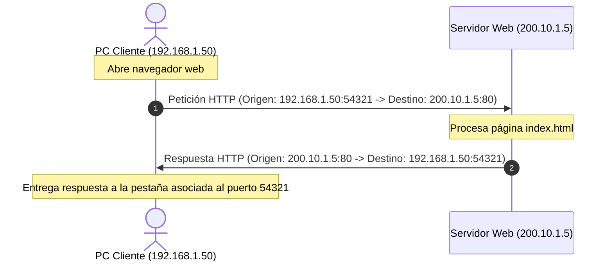

# Módulo 1: Capa de Transporte
## Tema 1.1: Fundamentos de la Capa de Transporte (Capa 4 OSI)

---

### 1. Propósito y Función Principal
La **Capa de Transporte** es la cuarta capa del modelo de referencia OSI y el núcleo del modelo TCP/IP para la comunicación entre aplicaciones. 

* **Diferencia crítica con la Capa de Red (Capa 3):**
  * La **Capa de Red (IP)** es responsable de la entrega **Host-to-Host** (de máquina a máquina a través de la infraestructura de enrutamiento). No distingue qué programa o pestaña está solicitando la información.
  * La **Capa de Transporte (TCP/UDP)** es responsable de la entrega **Process-to-Process** (de proceso a proceso o de aplicación a aplicación). Garantiza que los datos lleguen exactamente al servicio o aplicación destinataria correcta dentro de la máquina.

---

### 2. Responsabilidades Principales de la Capa 4

#### A. Seguimiento de Conversaciones Individuales (Tracking)
Cualquier host puede tener múltiples aplicaciones comunicándose en la red al mismo tiempo (ej. navegar por varias pestañas web, tener abierto Spotify, descargar un archivo y estar en una llamada de Discord). La Capa de Transporte mantiene el rastro y la independencia de cada uno de estos flujos de datos.

#### B. Segmentación y Reensamblado
* **Segmentación:** Las redes no pueden enviar un archivo completo de 2 GB en un solo bloque. La capa de transporte divide los datos provenientes de la capa de aplicación en fragmentos manejables llamados **Segmentos** (en TCP) o **Datagramas** (en UDP).
* **Reensamblado:** En el destino, la capa de transporte se encarga de recibir cada fragmento, verificar su orden y reconstruir el flujo de datos continuo original antes de pasarlo a la Capa de Aplicación.

#### C. Multiplexación y Demultiplexación
* **Multiplexación:** Permite que múltiples aplicaciones compartan la misma tarjeta de red (NIC) física e interfaz de comunicación al mismo tiempo.
* **Demultiplexación:** En el receptor, utiliza los encabezados de Capa 4 para dirigir los datos recibidos al socket y proceso de destino exacto.

---

### 3. Direccionamiento en Capa 4: Puertos y Sockets

Para saber a qué aplicación entregar la información, la Capa de Transporte utiliza **Números de Puerto** de 16 bits (rango: 0 a 65,535).

#### El Concepto de Socket
Un **Socket** es la combinación de una dirección IP (Capa 3) y un número de puerto (Capa 4):

$$\text{Socket} = \text{Dirección IP} : \text{Número de Puerto}$$

* **Ejemplo de Socket Servidor:** `192.168.1.10:80` (indica el servidor web en ese equipo).
* **Par de Sockets (Socket Pair):** Para que exista una sesión de comunicación bidireccional, se requiere tanto el socket de origen como el socket de destino:
  $$\text{Par de Sockets} = (\text{IP Origen} : \text{Puerto Origen}) \longleftrightarrow (\text{IP Destino} : \text{Puerto Destino})$$
  *Ejemplo:* `192.168.1.50:51240` $\longleftrightarrow$ `142.250.190.46:443`

---

### 4. Clasificación de Puertos según la IANA (Internet Assigned Numbers Authority)

La IANA divide los 65,536 puertos en tres rangos obligatorios para examen:

| Clasificación | Rango de Puertos | Propósito / Uso | Ejemplos Representativos |
| :--- | :--- | :--- | :--- |
| **Puertos Bien Conocidos** *(Well-Known Ports)* | **0 a 1,023** | Reservados para servicios y aplicaciones de red estándar y universales. Suelen requerir privilegios de administrador para ser abiertos. | HTTP (80), HTTPS (443), DNS (53), SSH (22), Telnet (23), DHCP (67/68), FTP (20/21). |
| **Puertos Registrados** *(Registered Ports)* | **1,024 a 49,151** | Asignados a empresas y desarrolladores para aplicaciones y procesos específicos de usuario/servidor. | MySQL (3306), MS SQL (1433), RDP Escritorio Remoto (3389), SIP VoIP (5060). |
| **Puertos Dinámicos / Privados / Efímeros** *(Dynamic/Private/Ephemeral)* | **49,152 a 65,535** | Asignados dinámicamente por el sistema operativo del cliente cuando inicia una conexión hacia un servidor. Duran solo mientras la sesión esté activa. | El puerto asignado a tu navegador web al abrir una pestaña hacia Google. |

---

### 5. Mecanismo de Puerto Origen vs. Puerto Destino

Cuando una PC cliente se conecta a un servidor:

1. **Puerto de Destino:** Es el puerto del servicio que se quiere consultar. Es estático y conocido (ej. puerto `80` para un servidor web HTTP).
2. **Puerto de Origen:** Es generado al azar por el sistema operativo del cliente dentro del rango dinámico (ej. puerto `54321`). Sirve como "dirección de retorno" para que cuando el servidor responda, los paquetes regresen a esa pestaña o proceso específico.

---

### 6. Preguntas Clave de Examen (Tipo UMG)

**P1: ¿Cuál es la diferencia principal entre el direccionamiento de Capa 3 y Capa 4?**
> **R:** La Capa 3 (IP) direcciona dispositivos de forma lógica en la red para la entrega *host-to-host*. La Capa 4 (Puertos) direcciona servicios o procesos de software específicos dentro de un dispositivo para la entrega *process-to-process*.

**P2: ¿Qué es un socket y cuál es su estructura?**
> **R:** Es el identificador único de un extremo de comunicación entre dos aplicaciones. Se compone de la dirección IP del equipo combinada con el número de puerto asignado (`IP:Puerto`).

**P3: ¿Qué rango numérico tienen los puertos efímeros o dinámicos y quién los asigna?**
> **R:** Del **49,152 al 65,535**. Son asignados automáticamente por el sistema operativo del host cliente al iniciar una solicitud hacia un servicio remoto.

**P4: Si dos clientes en la misma LAN acceden al mismo servidor web simultáneamente, ¿cómo distingue el servidor las conexiones?**
> **R:** Mediante el par de sockets (*Socket Pair*). Aunque el puerto de destino (`80`) y la IP del servidor sean idénticos, las IPs de origen o los puertos de origen generados por cada cliente serán distintos, creando pares de sockets únicos.
