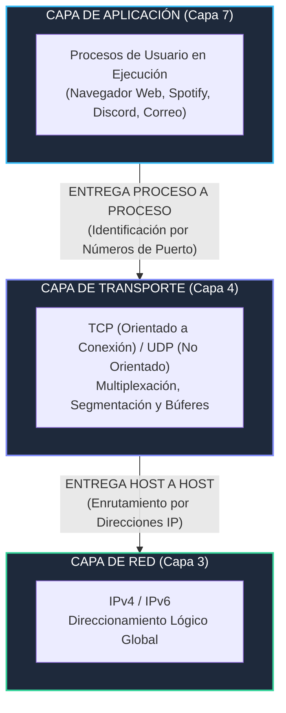
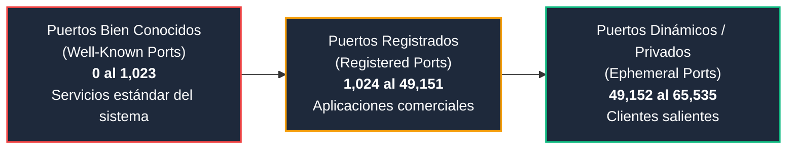
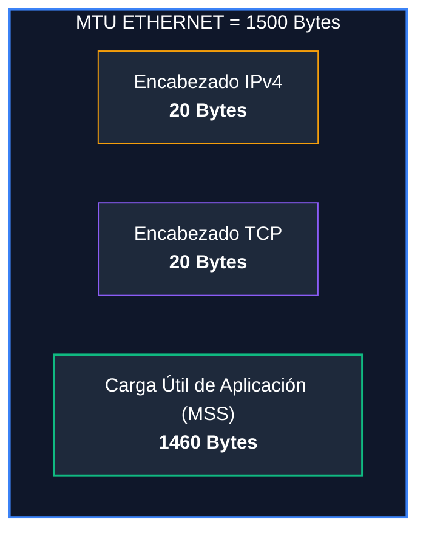
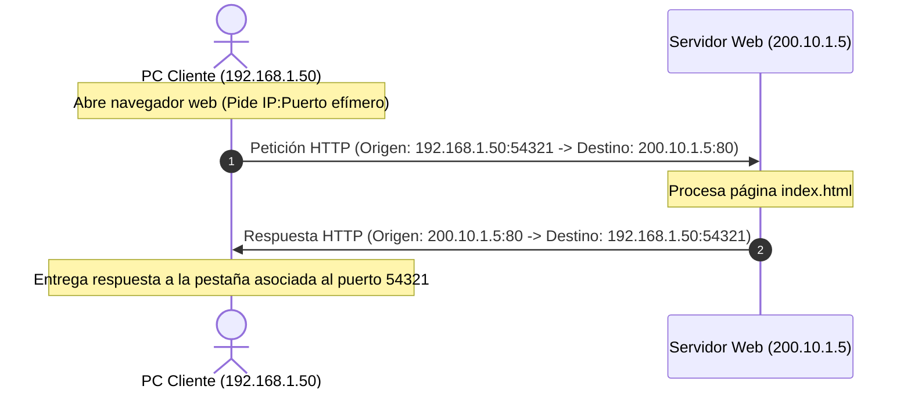

# Módulo 1: Capa de Transporte
## Tema 1.1: Fundamentos de la Capa de Transporte y Modelo de Sockets

---

### 1. Propósito y Función Principal en la Pila de Protocolos
La **Capa de Transporte** es la cuarta capa del modelo de referencia OSI y el corazón funcional de la pila TCP/IP.

* **Diferencia crítica de examen con la Capa de Red (Capa 3):**
  * **Capa 3 (IP):** Ofrece una entrega **Host-to-Host** (de máquina a máquina). Se encarga del enrutamiento a través de la topología mundial de Internet, pero es completamente ciega respecto a qué programa o pestaña dentro del host solicitó los datos.
  * **Capa 4 (TCP/UDP):** Proporciona una entrega **Process-to-Process** (de proceso a proceso). Mapea los paquetes que llegan a la tarjeta de red directamente al hilo de ejecución o proceso en memoria RAM que los está esperando mediante **Números de Puerto**.

---

### 2. Responsabilidades Arquitectónicas de la Capa 4

#### A. Seguimiento de Conversaciones Individuales (Multiplexación)
En cualquier momento, un usuario puede tener abiertas decenas de pestañas web, una llamada de Teams, un juego en línea y un cliente de correo. La Capa de Transporte garantiza que los paquetes de la llamada no se mezclen con el código HTML de la página web mediante el mecanismo de **Multiplexación** (en el emisor) y **Demultiplexación** (en el receptor).

#### B. Segmentación y Reensamblado
* Los medios físicos de transmisión (como Ethernet o Wi-Fi) tienen un límite en la cantidad de bytes que pueden transportar en un solo frame (llamado **MTU - Maximum Transmission Unit**, usualmente **1,500 bytes**).
* La capa de transporte divide los flujos continuos de datos de la capa de aplicación en bloques discretos llamados **Segmentos** (en TCP) o **Datagramas** (en UDP).
* En el host receptor, la capa de transporte recibe cada bloque, valida su integridad y los reensambla en el orden exacto para entregarlos a la aplicación como un flujo transparente.

#### C. Búferes del Kernel del Sistema Operativo
A nivel de sistema operativo (Linux, Windows, macOS), la capa de transporte gestiona dos áreas de memoria RAM por cada conexión:
1. **Send Buffer (Búfer de Envío):** Almacena los datos escritos por la aplicación hasta que la tarjeta de red pueda transmitirlos y el receptor confirme su recepción con un ACK.
2. **Receive Buffer (Búfer de Recepción):** Almacena los segmentos que llegan desde la red hasta que la aplicación tenga tiempo de procesarlos con llamadas del sistema (como `recv()` o `read()`).

---

### 3. Modelo de Sockets y Comunicación Bidireccional

#### Definición Formal de Socket
Un **Socket** es una abstracción de software del sistema operativo que representa el extremo final de un canal de comunicación bidireccional de red. Matemáticamente se define como la tupla:

$$\text{Socket} = (\text{Dirección IP}, \text{Número de Puerto})$$

#### El Par de Sockets (Socket Pair o 4-Tupla)
Para que exista una sesión de comunicación activa en Internet, se requiere identificar unívocamente ambos extremos mediante una **4-tupla**:

$$\text{4-Tupla} = (\text{IP Origen}, \text{Puerto Origen}, \text{IP Destino}, \text{Puerto Destino})$$

* **Caso de Estudio Real:**
  * Servidor Web de la UMG: `200.10.15.42:443`
  * Tu PC en tu casa: `190.56.20.100`
  * Si abres dos pestañas simultáneas hacia el mismo servidor web:
    * **Pestaña 1:** `(190.56.20.100 : 54201)` $\longleftrightarrow$ `(200.10.15.42 : 443)`
    * **Pestaña 2:** `(190.56.20.100 : 54202)` $\longleftrightarrow$ `(200.10.15.42 : 443)`
  * *Conclusión de examen:* El servidor web responde a ambas pestañas en el mismo puerto `443`, pero el sistema operativo de tu PC sabe exactamente a qué pestaña entregar los datos gracias al **Puerto de Origen efímero** único generado por el navegador.

---

### 4. Clasificación Rigurosa de Puertos según IANA (16 Bits = 65,536 Puertos)

Un número de puerto es un entero sin signo de **16 bits**, lo que da un rango posible de $0$ a $2^{16}-1$ ($0$ a $65,535$).

#### A. Puertos Bien Conocidos (Well-Known Ports: 0 a 1,023)
* Reservados para servicios universales y estandarizados por la IANA mediante RFCs.
* En sistemas Unix/Linux, solo el superusuario (`root`) puede abrir un socket de escucha en estos puertos por razones de seguridad.

| Puerto | Protocolo Capa 4 | Servicio / Nombre | Función Principal |
| :---: | :---: | :--- | :--- |
| **20 / 21** | TCP | **FTP** | Transferencia de archivos (20 Datos / 21 Control). |
| **22** | TCP | **SSH** | Shell segura, acceso remoto cifrado y SFTP. |
| **23** | TCP | **Telnet** | Terminal remota en texto plano (obsoleto por inseguro). |
| **25** | TCP | **SMTP** | Envío y retransmisión de correo electrónico. |
| **53** | UDP / TCP | **DNS** | Resolución de nombres de dominio (UDP consultas / TCP zonas). |
| **67 / 68** | UDP | **DHCP / BOOTP** | Configuración dinámica de red (67 Servidor / 68 Cliente). |
| **69** | UDP | **TFTP** | Transferencia trivial de archivos sin autenticación. |
| **80** | TCP | **HTTP** | Protocolo de transferencia de hipertexto (Web no segura). |
| **110** | TCP | **POP3** | Descarga y borrado de correos electrónicos. |
| **123** | UDP | **NTP** | Sincronización horaria de precisión en servidores y routers. |
| **143** | TCP | **IMAP** | Sincronización de correos electrónicos en servidor. |
| **161 / 162**| UDP | **SNMP** | Monitoreo y gestión de infraestructura de red. |
| **443** | TCP | **HTTPS** | Web segura cifrada mediante TLS/SSL. |

#### B. Puertos Registrados (Registered Ports: 1,024 a 49,151)
* Asignados por IANA a petición de empresas o desarrolladores para aplicaciones propietarias o estándares de la industria:
  * **1433 TCP:** Microsoft SQL Server.
  * **1521 TCP:** Base de Datos Oracle.
  * **3306 TCP:** MySQL / MariaDB.
  * **3389 TCP:** RDP (Remote Desktop Protocol de Microsoft).
  * **5060 / 5061 UDP/TCP:** SIP (Session Initiation Protocol para telefonía IP VoIP).
  * **8080 TCP:** Servidor web alternativo / Proxies HTTP (Tomcat, Spring, Node.js en desarrollo).

#### C. Puertos Dinámicos, Privados o Efímeros (Dynamic / Ephemeral Ports: 49,152 a 65,535)
* Son asignados automáticamente por la pila de red del sistema operativo a las aplicaciones cliente que inician conexiones salientes.
* Su ciclo de vida es temporal: se crean al invocar la conexión y se destruyen poco después de cerrarla.
* **Agotamiento de Puertos Efímeros (*Ephemeral Port Exhaustion*):** En servidores proxy de alto rendimiento con miles de conexiones salientes por segundo, si se agotan estos puertos (~16,384 puertos disponibles), las nuevas peticiones fallan inmediatamente con errores de conexión.

---

### 5. Relación Matemática entre MTU y MSS

1. **MTU (Maximum Transmission Unit):** Límite físico impuesto por la Capa de Enlace (Ethernet estándar = 1,500 bytes).
2. **MSS (Maximum Segment Size):** Tamaño máximo de **datos útiles de aplicación** que un emisor TCP puede meter dentro de un segmento individual sin que el paquete IP resultante deba ser fragmentado en la Capa 3:
   $$MSS = \text{MTU} - \text{Longitud Encabezado IP} - \text{Longitud Encabezado TCP}$$
   $$MSS_{\text{estándar}} = 1500 - 20 - 20 = \mathbf{1460 \text{ bytes}}$$

---

### 6. Mecanismo de Comunicación Cliente-Servidor

---

### 7. Preguntas Avanzadas de Examen (Tipo UMG)

**P1: ¿Puede un servidor con una sola dirección IP pública atender a más de 65,535 clientes simultáneos en el puerto 443?**
> **R:** **Sí, rotundamente.** Los 65,535 puertos limitan la cantidad de servicios locales o puertos efímeros de una sola máquina, pero las conexiones se diferencian por la **4-tupla**. Dado que cada cliente tiene una dirección IP distinta y un puerto de origen distinto, un solo socket de escucha en `IP_Servidor:443` puede mantener abiertas cientos de miles de conexiones concurrentes en memoria RAM.

**P2: ¿Qué sucede si el paquete que genera la Capa de Transporte supera el MTU de la tarjeta de red?**
> **R:** La Capa de Red (IP) se ve obligada a realizar **Fragmentación IP**, dividiendo el paquete en múltiples fragmentos con el mismo Identification y ajustando el campo Fragment Offset. Esto degrada gravemente el rendimiento porque si un solo fragmento se pierde en el camino, todo el paquete original debe descartarse.

**P3: ¿Qué diferencia existe entre un puerto en estado `LISTEN` y un puerto en estado `ESTABLISHED`?**
> **R:** Un puerto en `LISTEN` es un socket pasivo del servidor que no transmite datos, solo espera a que un cliente envíe un SYN para iniciar una sesión. Un socket en `ESTABLISHED` representa una conexión activa y dedicada que ya completó el Three-Way Handshake y tiene un par de sockets asociado intercambiando datos.
