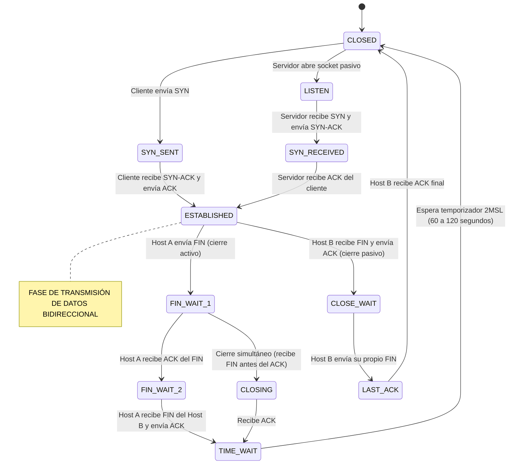
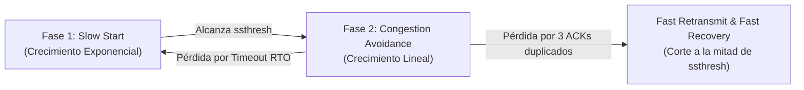

# Módulo 1: Capa de Transporte
## Tema 1.2: Protocolo TCP Exhaustivo (Estados, Algoritmos de Congestión y BDP)

---

### 1. Anatomía y Campos Críticos del Encabezado TCP (RFC 793)

El encabezado TCP tiene una longitud fija mínima de **20 bytes** (hasta 60 bytes con opciones).

```text
 0                   1                   2                   3
 0 1 2 3 4 5 6 7 8 9 0 1 2 3 4 5 6 7 8 9 0 1 2 3 4 5 6 7 8 9 0 1
+-+-+-+-+-+-+-+-+-+-+-+-+-+-+-+-+-+-+-+-+-+-+-+-+-+-+-+-+-+-+-+-+
|          Source Port          |       Destination Port        |
+-+-+-+-+-+-+-+-+-+-+-+-+-+-+-+-+-+-+-+-+-+-+-+-+-+-+-+-+-+-+-+-+
|                        Sequence Number                        |
+-+-+-+-+-+-+-+-+-+-+-+-+-+-+-+-+-+-+-+-+-+-+-+-+-+-+-+-+-+-+-+-+
|                    Acknowledgment Number                      |
+-+-+-+-+-+-+-+-+-+-+-+-+-+-+-+-+-+-+-+-+-+-+-+-+-+-+-+-+-+-+-+-+
|  Data |           |U|A|P|R|S|F|                               |
| Offset| Reserved  |R|C|S|S|Y|I|            Window             |
|       |           |G|K|H|T|N|N|                               |
+-+-+-+-+-+-+-+-+-+-+-+-+-+-+-+-+-+-+-+-+-+-+-+-+-+-+-+-+-+-+-+-+
|           Checksum            |        Urgent Pointer         |
+-+-+-+-+-+-+-+-+-+-+-+-+-+-+-+-+-+-+-+-+-+-+-+-+-+-+-+-+-+-+-+-+
|                    Options                    |    Padding    |
+-+-+-+-+-+-+-+-+-+-+-+-+-+-+-+-+-+-+-+-+-+-+-+-+-+-+-+-+-+-+-+-+
|                             Data                              |
+-+-+-+-+-+-+-+-+-+-+-+-+-+-+-+-+-+-+-+-+-+-+-+-+-+-+-+-+-+-+-+-+
```

#### Análisis Profundo de Campos de Control:
* **Sequence Number (32 bits):** Si el flag `SYN` está activo (1), este es el **ISN (Initial Sequence Number)** generado aleatoriamente. Si `SYN` es 0, es el número de secuencia acumulado del primer byte de datos del segmento.
* **Acknowledgment Number (32 bits):** Reconocimiento acumulativo (*Cumulative ACK*). Informa al emisor: *"He recibido correctamente todos los bytes hasta el número N-1; envíame el byte N a continuación"*.
* **Data Offset (4 bits):** Número de palabras de 32 bits en el encabezado. Indica dónde terminan las opciones y comienzan los datos reales. Mínimo es 5 ($5 \times 4 = 20\text{ bytes}$), máximo 15 ($15 \times 4 = 60\text{ bytes}$).
* **Flags de Control (6 bits esenciales):**
  * **URG:** Apunta a datos prioritarios que deben saltarse la cola de procesamiento normal.
  * **ACK:** Obligatorio en todos los paquetes posteriores al primer SYN. Valida el campo Acknowledgment Number.
  * **PSH (Push):** Fuerza al receptor a vaciar su búfer y entregar los datos inmediatamente a la aplicación sin esperar a acumular más bytes.
  * **RST (Reset):** Aborta una conexión de forma abrupta e inmediata (usado cuando llega un paquete a un puerto cerrado o el host colapsó).
  * **SYN:** Sincroniza números de secuencia al iniciar conexiones.
  * **FIN:** Notifica que el emisor ha terminado de enviar datos y solicita un cierre ordenado.
* **Window Size (16 bits):** Mecanismo de **Control de Flujo**. Indica cuántos bytes puede recibir el búfer del receptor antes de saturarse. Límite máximo nativo: $2^{16}-1 = 65,535\text{ bytes}$ (expandible con la opción *Window Scale*).

---

### 2. La Máquina de Estados Finitos de TCP (Los 11 Estados Oficiales)

En exámenes de ingeniería y preguntas de certificación, los estados de TCP son evaluados rigurosamente:



#### Tabla de Referencia de los 11 Estados:

| Estado TCP | ¿Quién lo experimenta? | Significado y Evento que lo Provoca |
| :--- | :---: | :--- |
| **`CLOSED`** | Ambos | Estado inicial o final cuando no existe conexión alguna. |
| **`LISTEN`** | Servidor | El servidor está a la espera pasiva de solicitudes de conexión en un puerto. |
| **`SYN-SENT`** | Cliente | El cliente envió el primer segmento `SYN` y espera el `SYN-ACK` de respuesta. |
| **`SYN-RECEIVED`** | Servidor | El servidor recibió el `SYN`, envió su `SYN-ACK` y espera el `ACK` final. |
| **`ESTABLISHED`** | Ambos | Conexión completamente abierta; los datos de aplicación fluyen bidireccionalmente. |
| **`FIN-WAIT-1`** | Iniciador del cierre | El host inició el cierre activo enviando un `FIN` y espera su `ACK`. |
| **`FIN-WAIT-2`** | Iniciador del cierre | Recibió el `ACK` a su `FIN`, pero aún espera el `FIN` del otro extremo. |
| **`CLOSE-WAIT`** | Receptor del cierre | Recibió el `FIN` del otro extremo, envió `ACK` y notifica a su aplicación local que cierre. |
| **`CLOSING`** | Ambos (raro) | Ambos extremos enviaron `FIN` casi simultáneamente. |
| **`LAST-ACK`** | Receptor del cierre | Envió su propio `FIN` hacia el iniciador y espera el último `ACK` para morir. |
| **`TIME-WAIT`** | Iniciador del cierre | Espera un periodo de **2MSL** antes del cierre definitivo para garantizar la entrega del ACK final. |

#### ¿Por qué es vital el estado `TIME-WAIT` y qué es el 2MSL?
* **MSL (Maximum Segment Lifetime):** Tiempo máximo que un paquete puede vagar por Internet antes de ser destruido por el TTL (estandarizado en 30 a 60 segundos). **2MSL = 60 a 120 segundos**.
* **Propósitos fundamentales del estado TIME-WAIT:**
  1. **Garantizar que el ACK final llegue:** Si el último `ACK` enviado por el Host A se pierde en la red, el Host B volverá a retransmitir su `FIN`. Si el Host A estuviera en `CLOSED`, rechazaría ese `FIN` con un `RST` erróneo en vez de responder con el `ACK` esperado.
  2. **Drenar paquetes fantasma viejos:** Evita que segmentos duplicados rezagados de la conexión vieja lleguen a una nueva conexión que casualmente utilice el mismo par de sockets (`IP:Puerto`).

---

### 3. Control de Congestión en TCP: Algoritmos y Fórmulas

A diferencia del **Control de Flujo** (que protege la memoria del receptor usando el campo *Window Size*), el **Control de Congestión** protege a la red intermedia (routers e infraestructura troncal) para evitar el colapso por saturación.

TCP mantiene una variable interna llamada **cwnd (Congestion Window)** que mide cuántos bytes puede inyectar a la red. El emisor nunca envía más que:

$$\text{Ventana Efectiva} = \min(\text{cwnd}, \text{Window Size del Receptor})$$



#### A. Arranque Lento (Slow Start)
* Comienza con un valor pequeño de `cwnd` (típicamente 1 a 10 MSS).
* Por cada `ACK` recibido, `cwnd` se incrementa en 1 MSS.
* **Resultado matemático:** `cwnd` **se duplica en cada RTT (crecimiento exponencial)**: $1 \rightarrow 2 \rightarrow 4 \rightarrow 8 \rightarrow 16 \dots$

#### B. Prevención de Congestión (Congestion Avoidance)
* Entra en vigor cuando `cwnd` alcanza un umbral llamado **ssthresh (Slow Start Threshold)**.
* Para no saturar bruscamente la red, `cwnd` ya no crece exponencialmente, sino **linealmente (1 MSS por cada RTT)**. Esto implementa el modelo **AIMD (Additive Increase, Multiplicative Decrease)**.

#### C. Detección y Recuperación de Pérdidas
1. **Pérdida Severa por Temporizador (RTO Timeout):**
   * Indica congestión catastrófica en la red.
   * `ssthresh` se reduce a la mitad de la ventana actual: $\text{ssthresh} = \frac{\text{cwnd}}{2}$.
   * `cwnd` se desploma a **1 MSS** y la conexión vuelve a empezar en **Slow Start**.
2. **Pérdida Leve por 3 ACKs Duplicados (Fast Retransmit & Fast Recovery - TCP Reno):**
   * Si llegan 3 ACKs idénticos pidiendo el mismo segmento perdido, significa que los paquetes posteriores sí están pasando por la red.
   * Retransmite el segmento perdido de inmediato sin esperar a que expire el temporizador RTO.
   * `ssthresh = cwnd / 2`, fija `cwnd = ssthresh + 3 MSS` y continúa en **Congestion Avoidance**, evitando caer a 1 MSS.

---

### 4. Producto Retardo-Ancho de Banda (BDP - Bandwidth-Delay Product)

El **BDP** es uno de los conceptos de ingeniería más importantes para optimizar redes de alta velocidad:

$$BDP = \text{Ancho de Banda (bits/s)} \times RTT (\text{segundos})$$

* **Significado físico:** El BDP representa el volumen total de datos que pueden estar "en tránsito" llenando el cable simultáneamente sin haber recibido aún un acuse de recibo.

#### Ejemplo de Cálculo de Examen:
Imagina un enlace de fibra óptica inter-campus de **1 Gbps** con un tiempo de ida y vuelta (**RTT**) de **20 milisegundos** ($0.020\text{ s}$):
$$BDP = 1,000,000,000\text{ bps} \times 0.020\text{ s} = 20,000,000\text{ bits}$$
$$\text{BDP en Bytes} = \frac{20,000,000}{8} = 2,500,000\text{ bytes} \approx \mathbf{2.5 \text{ MB}}$$

* **La Opción Window Scale (RFC 1323):**
  Como el campo nativo de *Window Size* de TCP solo tiene 16 bits (máximo $65,535\text{ bytes}$ o $64\text{ KB}$), una conexión TCP estándar solo podría llenar $64\text{ KB}$ de los $2.5\text{ MB}$ que soporta el enlace, dejando el **97% de la fibra óptica desperdiciada**.  
  La opción *Window Scale* permite multiplicar el valor de la ventana por potencias de 2 (hasta $2^{14}$), habilitando ventanas de recepción de hasta **1 Gigabyte**, indispensables en redes modernas.

---

### 5. Algoritmo de Nagle vs. Delayed ACKs

* **Algoritmo de Nagle (RFC 896):** Resuelve el problema del "tráfico de pequeños paquetes" (ej. en sesiones SSH donde un usuario escribe 1 letra: 1 byte de datos genera 40 bytes de cabecera IP/TCP = 97.5% de sobrecarga). Nagle retiene los datos pequeños en el búfer hasta acumular un segmento completo (1 MSS) o hasta recibir el ACK del segmento anterior.
* **Delayed ACKs:** El receptor espera hasta 200 ms antes de enviar un ACK para ver si la aplicación va a mandar datos de respuesta y así montar el ACK en ese paquete (*piggybacking*).
* **Conflicto histórico:** Si Nagle espera un ACK y el receptor espera datos para enviar el ACK, se produce un retardo de 200 ms en cada interacción. En aplicaciones en tiempo real (videojuegos, streaming), los programadores desactivan Nagle usando la opción de socket `TCP_NODELAY`.
