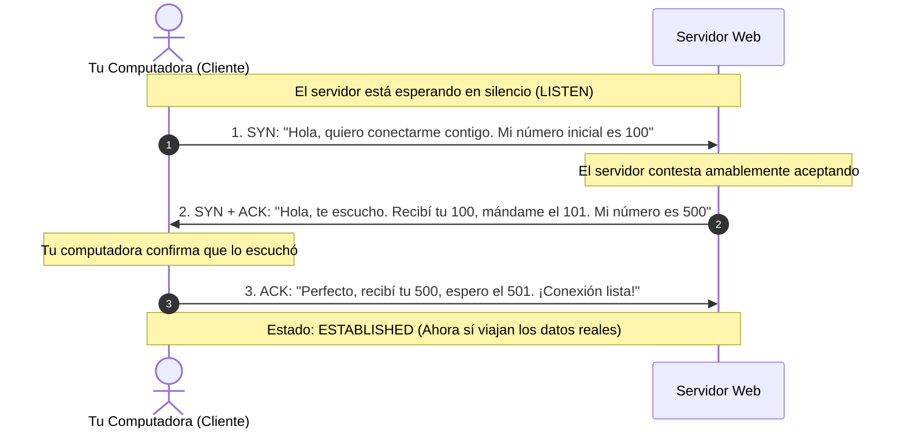
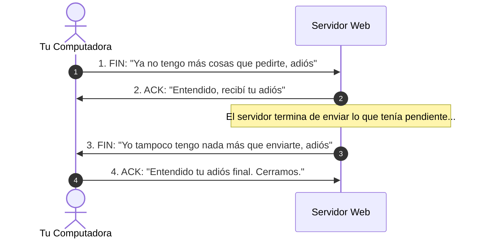
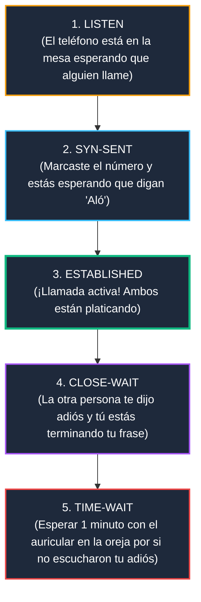
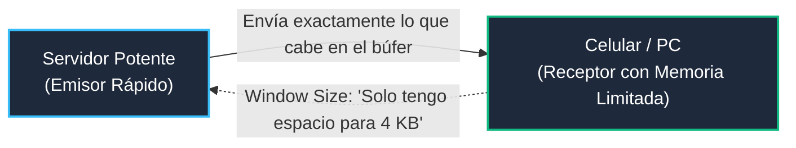

# Módulo 1: Capa de Transporte
## Tema 1.2: Protocolo TCP Explicado con Manzanas (Confiabilidad y Estados)

---

### 📖 Mini Diccionario para Empezar

* **Protocolo:** Es simplemente un conjunto de reglas de etiqueta y educación que dos computadoras acuerdan seguir para entenderse sin pelear.
* **Orientado a Conexión:** Significa que antes de enviar cualquier dato real, las dos computadoras primero se saludan, se presentan y comprueban que la línea esté abierta (como hacer una llamada telefónica antes de hablar).
* **Confiable (Reliable):** No significa que el cable nunca falle; significa que **si un paquete se pierde en el camino, TCP se da cuenta y lo vuelve a enviar automáticamente** hasta que llegue completo.
* **Banderas (Flags):** Son pequeños interruptores de Sí o No (1 o 0) en el paquete que indican la intención del mensaje: *"Quiero iniciar"* (`SYN`), *"Recibí tu mensaje"* (`ACK`), o *"Quiero terminar"* (`FIN`).
* **Sequence Number (SEQ):** Es como numerar las páginas de un libro (página 1, 2, 3...) para que si las hojas se caen al piso y se desordenan en el viaje, el receptor las pueda volver a ordenar perfectamente.
* **Acknowledgment Number (ACK):** Es el acuse de recibo. Le dice al emisor: *"Ya recibí hasta la página 5, ahora mándame la página 6"*.

---

### 1. La Gran Analogía de TCP: La Llamada Telefónica Formal

Imagina que necesitas dictarle un contrato legal importantísimo a un abogado por teléfono:
1. No levantas la bocina y empiezas a gritar el contrato en el primer segundo.
2. Primero marcas el número, esperas a que la otra persona conteste y diga: *"¿Aló?"*.
3. Tú respondes: *"Hola Licenciado, ¿me escucha bien?"*, y él te dice: *"Sí, te escucho perfecto, empieza"*.
4. Conforme le dictas cada párrafo, tú le preguntas: *"¿Anotó el párrafo 1?"*, y él responde: *"Anotado, continúa con el 2"*.
5. Si un camión pasa por la calle haciendo ruido y el abogado no escucha un párrafo, él te interrumpe y dice: *"No te escuché esa última parte, repítela"*. Tú la repites.
6. Al final, ambos se despiden educadamente antes de colgar.

**Eso es exactamente TCP (Transmission Control Protocol).** Es formal, ordenado, seguro y garantiza que ninguna palabra se pierda.

---

### 2. El Saludo de Tres Vías (Three-Way Handshake)

Antes de que puedas ver el primer video de YouTube o cargar la página de la UMG, tu navegador y el servidor realizan este saludo formal de 3 pasos:

#### Los 3 pasos explicados en lenguaje humano:
1. **Paso 1 (SYN - Synchronize):** Tu PC le toca la puerta al servidor y le dice: *"Hola, quiero hablar contigo. Mi primer número de mensaje será el 100"*. (Bandera activa: `SYN=1`).
2. **Paso 2 (SYN-ACK):** El servidor responde: *"Hola, recibí tu solicitud con el número 100, así que ahora espero tu mensaje 101 (`ACK=101`). Yo también quiero hablar contigo y mi primer número de mensaje será el 500 (`SYN=500`)"*. (Banderas activas: `SYN=1`, `ACK=1`).
3. **Paso 3 (ACK - Acknowledgment):** Tu PC contesta: *"Excelente, recibí tu número 500, así que espero tu mensaje 501 (`ACK=501`). ¡Empecemos!"*. (Bandera activa: `ACK=1`).

A partir de este instante, ambos pasan al estado **ESTABLISHED** y comienzan a transferir la página web o los datos reales.

---

### 3. La Despedida de 4 Vías (Cerrar la Conexión)

Cuando terminas de descargar la página o cierras la pestaña, no puedes colgar bruscamente; se realiza una despedida educada en 4 pasos:

---

### 4. Los Estados de TCP Explicados sin Complicaciones

En los libros de redes te muestran una "Máquina de Estados" que asusta a cualquiera. En realidad, los estados son simplemente **en qué etapa de la conversación está la computadora**:

#### ¿Por qué existe el famoso estado `TIME-WAIT` (El temporizador 2MSL)?
Imagina que te despides de tu amigo por teléfono: *"¡Bueno, adiós!"*. Pero justo en ese segundo la llamada tuvo interferencia y tu amigo no escuchó tu *"¡adiós!"*.  
Si cuelgas de inmediato y desconectas el teléfono, tu amigo se quedará esperando y volverá a marcar preguntando: *"¿Aló? ¿Te cortaste?"*.  
Por eso, TCP se queda en silencio esperando entre **60 y 120 segundos (llamado 2MSL)** antes de destruir la conexión, para asegurarse de que el otro lado recibió el último adiós sin problemas.

---

### 5. Control de Flujo: El Embudo y la Cubeta (Window Size)

Imagina que estás llenando un vaso pequeño de agua con una manguera de bomberos a toda presión: **el agua se va a derramar y el 90% se va a perder en el piso**.

En las computadoras pasa lo mismo: si un servidor ultra rápido le envía datos a una computadora vieja o a un celular con poca memoria a toda velocidad, el celular se satura y empieza a tirar paquetes a la basura.

**La solución de TCP (Window Size / Tamaño de Ventana):**
* El receptor le dice al emisor en cada paquete: *"Oye, en mi memoria solo me queda espacio para recibir 5,000 bytes. Mándame como máximo 5,000 bytes y luego detente a esperar hasta que yo los procese y te dé permiso de mandar más"*.
* De esta forma, un emisor rápido jamás inunda a un receptor lento.

---

### 6. Control de Congestión: El Tráfico en la Carretera (Slow Start)

Aquí el problema no es tu celular ni el servidor; **el problema es la carretera intermedia (los cables y routers de Internet)**.

Si todo el mundo inyecta millones de datos a la vez, los routers de Internet se saturan y colapsan como el periférico de la Ciudad de Guatemala a las 6:00 PM.

TCP usa un algoritmo inteligente llamado **Slow Start (Arranque Lento)**:
1. **Comienza con prudencia:** Primero envía 1 paquete pequeño a la red para tantear el terreno.
2. **Si pasa bien:** Envía 2 paquetes. Si pasan bien, envía 4, luego 8, luego 16... **(Crecimiento Exponencial)**.
3. **Llega al límite seguro (ssthresh):** Cuando nota que la red ya está bastante llena, deja de duplicar como loco y empieza a aumentar con cuidado de 1 en 1: 17, 18, 19...
4. **Si un paquete se pierde:** TCP deduce: *"¡Cuidado, la carretera está colapsada!"*, y **reduce inmediatamente su velocidad a la mitad** para descongestionar la red.

---

### 7. Preguntas de Examen con Sentido Común

**P1: ¿Cuáles banderas (flags) van encendidas en el segundo paso del saludo Three-Way Handshake?**
> **R:** Van encendidas las banderas **SYN** y **ACK** (`SYN=1`, `ACK=1`).

**P2: ¿Para qué sirve el campo Window Size en el encabezado TCP?**
> **R:** Sirve para el **Control de Flujo**, avisándole al emisor cuántos bytes puede recibir el receptor antes de saturar su memoria.

**P3: ¿Qué significa que TCP sea un protocolo "confiable"?**
> **R:** Significa que garantiza que todos los datos lleguen completos y en orden, usando números de secuencia (`SEQ`), acuses de recibo (`ACK`) y retransmitiendo automáticamente cualquier paquete que se haya perdido en la red.
