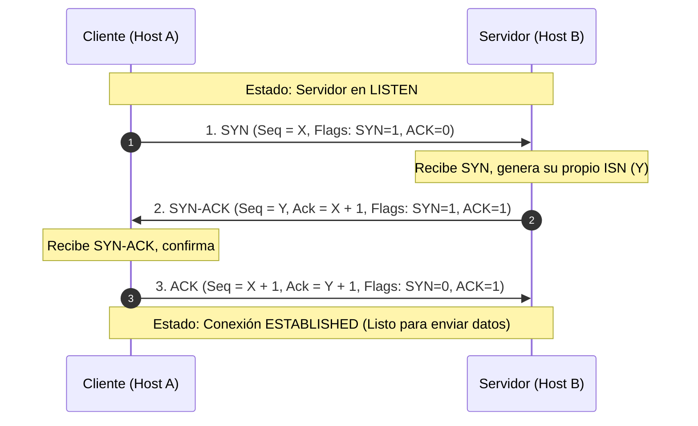
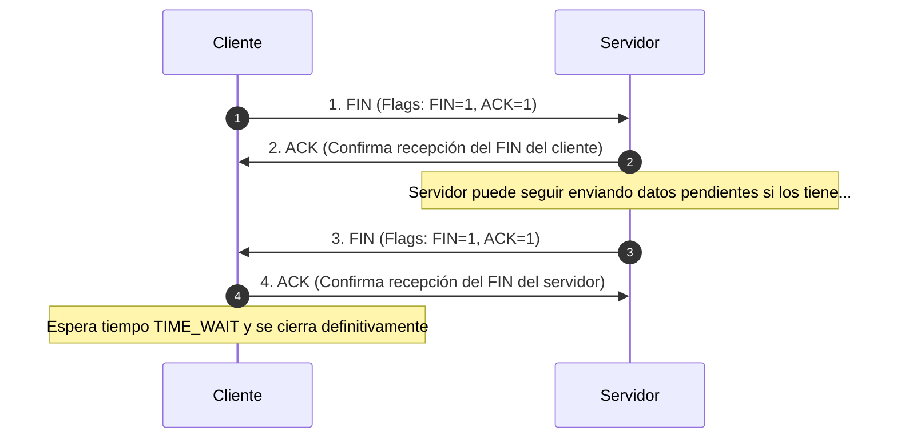

# Módulo 1: Capa de Transporte
## Tema 1.2: Protocolo TCP (Transmission Control Protocol - RFC 793)

---

### 1. ¿Qué es TCP y cuáles son sus Características?
TCP es el protocolo de capa de transporte estándar de Internet que proporciona una entrega de datos **confiable y orientada a la conexión**.

* **Orientado a conexión:** Antes de enviar datos reales de usuario, los dos dispositivos deben establecer una sesión mediante una sincronización previa (Three-Way Handshake).
* **Confiabilidad:** Garantiza que cada segmento enviado llegue intacto. Si un segmento se pierde o se daña, el emisor lo retransmite automáticamente.
* **Control de Flujo:** Regula la velocidad a la que el emisor transmite para no saturar la memoria o capacidad de procesamiento del receptor.
* **Control de Congestión:** Detecta si la red intermedia (routers e infraestructura) está saturada y reduce dinámicamente la tasa de envío.
* **Entrega en Orden:** Dado que los paquetes IP pueden viajar por distintas rutas y llegar desordenados, TCP los reordena antes de entregarlos a la aplicación.
* **Comunicación Full-Duplex:** Ambas partes pueden transmitir y recibir simultáneamente sobre la misma conexión lógica.

---

### 2. Estructura del Encabezado TCP (TCP Header)
El encabezado TCP tiene una longitud fija mínima de **20 bytes** (160 bits), que puede extenderse hasta **60 bytes** si incluye el campo opcional (*Options*).

```text
 0                   1                   2                   3
 0 1 2 3 4 5 6 7 8 9 0 1 2 3 4 5 6 7 8 9 0 1 2 3 4 5 6 7 8 9 0 1
+-+-+-+-+-+-+-+-+-+-+-+-+-+-+-+-+-+-+-+-+-+-+-+-+-+-+-+-+-+-+-+-+
|          Source Port          |       Destination Port        |
+-+-+-+-+-+-+-+-+-+-+-+-+-+-+-+-+-+-+-+-+-+-+-+-+-+-+-+-+-+-+-+-+
|                        Sequence Number                        |
+-+-+-+-+-+-+-+-+-+-+-+-+-+-+-+-+-+-+-+-+-+-+-+-+-+-+-+-+-+-+-+-+
|                    Acknowledgment Number                      |
+-+-+-+-+-+-+-+-+-+-+-+-+-+-+-+-+-+-+-+-+-+-+-+-+-+-+-+-+-+-+-+-+
|  Data |           |U|A|P|R|S|F|                               |
| Offset| Reserved  |R|C|S|S|Y|I|            Window             |
|       |           |G|K|H|T|N|N|                               |
+-+-+-+-+-+-+-+-+-+-+-+-+-+-+-+-+-+-+-+-+-+-+-+-+-+-+-+-+-+-+-+-+
|           Checksum            |        Urgent Pointer         |
+-+-+-+-+-+-+-+-+-+-+-+-+-+-+-+-+-+-+-+-+-+-+-+-+-+-+-+-+-+-+-+-+
|                    Options                    |    Padding    |
+-+-+-+-+-+-+-+-+-+-+-+-+-+-+-+-+-+-+-+-+-+-+-+-+-+-+-+-+-+-+-+-+
|                             data                              |
+-+-+-+-+-+-+-+-+-+-+-+-+-+-+-+-+-+-+-+-+-+-+-+-+-+-+-+-+-+-+-+-+
```

#### Descripción Detallada de los Campos:
1. **Source Port (16 bits):** Puerto de origen de la aplicación emisora.
2. **Destination Port (16 bits):** Puerto de destino del servicio receptor.
3. **Sequence Number (32 bits):** Número de secuencia del primer byte de datos en este segmento. Permite reordenar los segmentos desordenados.
4. **Acknowledgment Number (32 bits):** Número de acuse de recibo. Indica el número del **próximo byte que el receptor espera recibir** (reconocimiento acumulativo). Solo es válido si la bandera `ACK` está activa.
5. **Data Offset / Header Length (4 bits):** Especifica el tamaño del encabezado en palabras de 32 bits (mínimo 5 = 20 bytes).
6. **Reserved (6 bits o 4 bits según extensiones RFC):** Reservado para uso futuro.
7. **Control Bits / Banderas (Flags) (6 bits principales):**
   * **URG (Urgent):** Si vale 1, el campo *Urgent Pointer* es significativo (datos prioritarios).
   * **ACK (Acknowledgment):** Si vale 1, el campo *Acknowledgment Number* es válido. Todos los paquetes tras el primer SYN llevan ACK=1.
   * **PSH (Push):** Solicita al receptor que pase los datos inmediatamente a la aplicación sin esperar a llenar el búfer.
   * **RST (Reset):** Reinicia abruptamente una conexión rechazada o rota.
   * **SYN (Synchronize):** Sincroniza los números de secuencia iniciales durante el establecimiento de conexión.
   * **FIN (Finish):** Informa que el emisor no tiene más datos que enviar y solicita cerrar la conexión.
8. **Window Size (16 bits):** Tamaño de ventana de recepción. Número de bytes que el receptor está dispuesto a aceptar antes de requerir un ACK (Control de Flujo).
9. **Checksum (16 bits):** Verificación de redundancia para comprobar si el encabezado o los datos sufrieron daños en tránsito.
10. **Urgent Pointer (16 bits):** Apunta al último byte de datos urgentes si el flag URG está activo.
11. **Options (0 - 40 bytes):** Parámetros opcionales como el MSS (*Maximum Segment Size*), escala de ventana, etc.

---

### 3. Establecimiento de la Conexión: Handshake de 3 Vías (Three-Way Handshake)

Antes de transmitir datos útiles, el cliente y el servidor deben negociar sus números de secuencia iniciales (ISN - *Initial Sequence Number*):



* **Paso 1 (SYN):** El cliente envía un segmento con el flag `SYN=1` y un número de secuencia aleatorio inicial `Seq = X`.
* **Paso 2 (SYN + ACK):** El servidor responde reconociendo la petición del cliente (`Ack = X + 1`), activando el flag `ACK=1`, y enviando su propia sincronización con su propio número inicial `Seq = Y` y flag `SYN=1`.
* **Paso 3 (ACK):** El cliente confirma la recepción del servidor enviando `Ack = Y + 1` con el flag `ACK=1`. La conexión queda en estado **ESTABLISHED**.

---

### 4. Terminación de la Conexión (Four-Way Handshake)

El cierre de conexión en TCP es independiente en cada sentido (cierre de dos vías para cada dirección):



---

### 5. Mecanismos de Confiabilidad y Control de Flujo

#### A. Reconocimiento Positivo y Retransmisión (PAR)
* Si el emisor no recibe un `ACK` para un segmento transmitido antes de que expire el temporizador **RTO** (*Retransmission Timeout*), TCP asume que el segmento se perdió y lo retransmite.
* **Fast Retransmit:** Si el emisor recibe **3 ACKs duplicados** para el mismo segmento, no espera al temporizador y lo retransmite de inmediato.

#### B. Ventana Deslizante (Sliding Window - Control de Flujo)
* El receptor anuncia en cada segmento cuánto espacio libre tiene en su búfer mediante el campo **Window Size**.
* Si el receptor se satura, reduce el *Window Size* hasta llegar a **0** (*Zero Window*), lo que ordena al emisor detenerse temporalmente hasta que el búfer se libere.

---

### 6. Preguntas Clave de Examen (Tipo UMG)

**P1: ¿Cuál es el tamaño mínimo y máximo del encabezado TCP?**
> **R:** Mínimo **20 bytes** (sin opciones) y máximo **60 bytes** (con 40 bytes de opciones).

**P2: Si el Host A envía un segmento con `Seq = 3000` y una carga útil de 500 bytes de datos, ¿qué valor de `Ack` debe responder el Host B?**
> **R:** Debe responder `Ack = 3500`. En TCP, el número de ACK indica el siguiente byte esperado ($3000 + 500 = 3500$).

**P3: ¿Qué flags de TCP están activos en el segundo paso del Three-Way Handshake?**
> **R:** Están activos los flags **SYN** y **ACK** (`SYN=1`, `ACK=1`).

**P4: ¿Para qué sirve el mecanismo de la Ventana Deslizante (*Window Size*)?**
> **R:** Para el **Control de Flujo**, evitando que un emisor rápido inunde de datos a un receptor lento o con poco búfer de memoria disponible.
