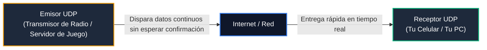
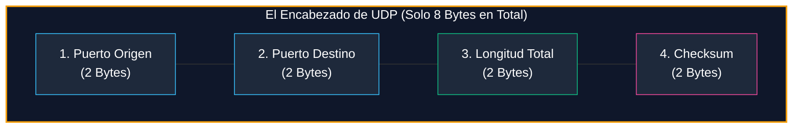

# Módulo 1: Capa de Transporte
## Tema 1.3: Protocolo UDP Explicado con Manzanas (Velocidad y Tiempo Real)

---

### 📖 Mini Diccionario para Empezar

* **No Orientado a Conexión (Connectionless):** Significa que el emisor dispara los datos hacia la red de inmediato, sin pedir permiso, sin saludar antes y sin comprobar si el receptor está encendido o listo para recibir.
* **Mejor Esfuerzo (Best-Effort Delivery):** El protocolo hace su mejor intento de entregar los datos, pero **no te promete nada**. Si un paquete se pierde, se daña o llega tarde, a UDP no le importa en lo más mínimo y continúa como si nada hubiera pasado.
* **Sobrecarga (Overhead):** El "peso extra" que le agregas a tus datos. Imagina enviar una carta de 1 línea adentro de una caja de madera con 3 candados y 10 sellos de cera (mucha sobrecarga, como TCP) vs. enviar una postal sin sobre (mínima sobrecarga, como UDP).
* **Latencia / Retardo:** El tiempo en milisegundos que tarda un mensaje en viajar desde tu computadora hasta el servidor y regresar.

---

### 1. La Gran Analogía de UDP: La Radio FM o el Megáfono

Imagina a un locutor de radio transmitiendo un partido de fútbol en vivo por FM:
1. El locutor habla por el micrófono a toda velocidad relatando la jugada del gol.
2. Si tu carro entra en un túnel durante 4 segundos y la señal se llena de estática, **te perdiste esos 4 segundos de la narración**.
3. El locutor no se va a callar, no va a detener la transmisión para todo el país, ni va a rebobinar la cinta para repetirte la jugada cuando salgas del túnel. La transmisión continúa en vivo.

**Eso es UDP (User Datagram Protocol).** Es veloz, no pide confirmación de nadie, no pierde tiempo en saludos y prioriza lo que está pasando en este milisegundo exacto por encima de la perfección del pasado.

---

### 2. La Pregunta del Millón: Si UDP pierde datos, ¿por qué alguien querría usarlo?

Cualquier estudiante que ve esto por primera vez piensa: *"¡Vaya porquería de protocolo! ¿Por qué usaríamos algo que pierde información?"*.

Existen dos razones fundamentales:

#### Razón 1: Aplicaciones en Tiempo Real (Juegos en Línea y Videollamadas)
Imagina que estás en una llamada por Zoom o jugando *Call of Duty* o *Fortnite*:
* Si un paquete con la posición de tu personaje se pierde por 100 milisegundos:
  * **Si usáramos TCP:** La pantalla se congelaría, tu computadora se detendría a esperar a que el servidor retransmita la posición vieja, y cuando por fin llegue, verías a tu personaje teletransportarse al pasado.
  * **Al usar UDP:** El juego simplemente descarta esa milésima de segundo perdida y dibuja de inmediato la posición nueva. Es preferible que un microsegundo de voz suene como un "clic" en la llamada antes que detener toda la conversación con 1 segundo de retraso.

#### Razón 2: Preguntas y Respuestas Rápidas (El caso del DNS)
* Para consultar la libreta telefónica de Internet (**DNS**):
  * Tu PC solo quiere preguntar: *"¿Cuál es la IP de `google.com`?"*.
  * El servidor solo responde: *"Es `142.250.190.46`"*.
* **Con TCP:** Tendrías que enviar 3 paquetes para saludarse, 1 para preguntar, 1 para contestar y 4 para despedirse (**9 paquetes en total** para una sola pregunta).
* **Con UDP:** Mandas 1 paquete con la pregunta y te responden con 1 paquete con la respuesta (**2 paquetes en total**). Es un ahorro del 400% de tiempo y recursos.

---

### 3. El Encabezado de UDP: Un Envoltorio Diminuto

Mientras que el paquete de TCP lleva un encabezado pesado y lleno de opciones de **20 a 60 bytes**, el encabezado de UDP es tan simple que solo mide **8 bytes** (dividido en solo 4 datos):

1. **Puerto de Origen (2 bytes):** ¿Quién manda el paquete?
2. **Puerto de Destino (2 bytes):** ¿A qué servicio o programa va dirigido?
3. **Longitud (2 bytes):** ¿Cuántos bytes mide en total este datagrama (encabezado + datos)?
4. **Checksum (2 bytes):** Una pequeña suma matemática de comprobación para ver si el mensaje no se corrompió eléctricamente en el cable.

---

### 4. ¿Qué es el Checksum y cómo funciona en palabras sencillas?

El **Checksum** es como el dígito verificador al final de tu número de tarjeta bancaria o el último dígito del NIT/DPI:
* El emisor hace una suma matemática rápida con todos los números del paquete y anota el resultado en la casilla *Checksum*.
* Cuando el receptor recibe el paquete, vuelve a hacer la misma suma matemática:
  * Si el resultado coincide: el paquete está sano y salvo.
  * Si el resultado no coincide: significa que un cable defectuoso o una interferencia electromagnética cambió algún bit en el camino, y **el receptor tira el paquete a la basura de inmediato**.

---

### 5. Servicios Importantes que usan UDP (De memoria para el examen)

| Servicio | Puerto | ¿Por qué utiliza UDP en lugar de TCP? |
| :--- | :---: | :--- |
| **DNS** | **53** | Consultas ultra rápidas de un solo paquete de pregunta y uno de respuesta. |
| **DHCP** | **67 / 68** | Para darle IP a tu PC cuando se conecta al Wi-Fi (aún no tienes IP para hacer un saludo TCP). |
| **TFTP** | **69** | Para pasarle archivos de configuración sencillos a routers y switches Cisco. |
| **VoIP / RTP** | **5004 / 5060** | Llamadas de voz y videollamadas en tiempo real (Zoom, WhatsApp, Discord). |
| **NTP** | **123** | Poner en hora exacta el reloj de servidores y routers (no tolera retardos de acuse de recibo). |

---

### 6. Preguntas Típicas de Examen Resueltas con Sentido Común

**P1: ¿Cuánto mide el encabezado de un paquete UDP?**
> **R:** Mide exactamente **8 bytes** fijos (a diferencia de TCP que mide mínimo 20 bytes).

**P2: ¿Qué hace UDP si un paquete se pierde en el camino?**
> **R:** No hace absolutamente nada. No se da cuenta, no pide retransmisión y no avisa al emisor; continúa enviando los paquetes siguientes sin detenerse.

**P3: ¿Por qué una llamada de voz por Internet (VoIP) prefiere usar UDP antes que TCP?**
> **R:** Porque en la voz en tiempo real es preferible perder un milisegundo imperceptible de audio antes que detener la llamada por 300 ms esperando una retransmisión que causaría desfase, saltos y ecos en la conversación.
