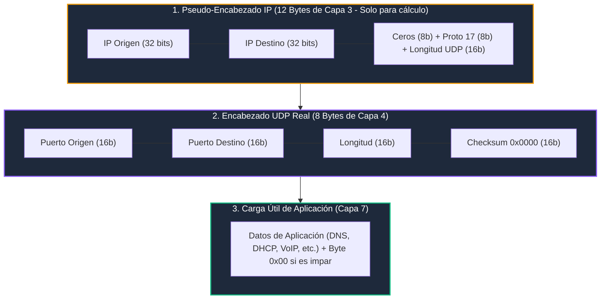

# Módulo 1: Capa de Transporte
## Tema 1.3: Protocolo UDP Exhaustivo (Pseudo-Encabezado, Checksum y Protocolos de Tiempo Real)

---

### 1. Filosofía de Diseño del Protocolo UDP (RFC 768)

UDP (*User Datagram Protocol*) es el epítome de la simplicidad y el rendimiento en redes. Fue diseñado bajo el principio *End-to-End*: la red intermedia y la capa de transporte no deben gastar ciclos de CPU en verificar estados o reordenar datos; si la aplicación necesita confiabilidad, que la programe ella misma.

El encabezado UDP tiene una longitud inmutable de **8 bytes** (64 bits), dividido en 4 campos exactos de 16 bits:

| Fila de 32 Bits | Bits 0 – 15 | Bits 16 – 31 |
| :---: | :--- | :--- |
| **Palabra 1 (Bytes 0-3)** | **Puerto de Origen** (*Source Port* - 16 bits) | **Puerto de Destino** (*Destination Port* - 16 bits) |
| **Palabra 2 (Bytes 4-7)** | **Longitud del Datagrama** (*Length* - 16 bits) | **Checksum** (*Suma de verificación* - 16 bits) |
| **Carga Útil** | **Datos de la Aplicación** (Longitud variable: 0 a 65,527 bytes) | |

---

### 2. El Cálculo del Checksum de UDP y el "Pseudo-Encabezado"

Una de las preguntas teóricas más sutiles y elegantes de examen es:  
*¿Por qué el Checksum de UDP protege campos que en realidad pertenecen a la Capa de Red (IP)?*

Para calcular el Checksum de 16 bits, el emisor construye un **Pseudo-Encabezado IP conceptual** de 12 bytes que se antepone temporalmente al encabezado UDP:

#### Algoritmo del Checksum (Complemento a 1 de 16 bits):
1. Se unen todos los bloques de 16 bits del Pseudo-Encabezado, el Encabezado UDP y los Datos (agregando un byte de relleno `0x00` al final si la longitud total en bytes es impar).
2. Se suman en aritmética de complemento a 1 (si hay acarreo, se suma al bit menos significativo).
3. Se invierten todos los bits (operación NOT binaria) y el resultado se escribe en el campo *Checksum*.
4. **Propósito de ingeniería:** Si un router defectuoso altera la dirección IP de destino o el número de protocolo en la Capa 3, el receptor de Capa 4 detecta la corrupción al verificar el checksum y descarta el paquete antes de entregarlo a una aplicación errónea.

---

### 3. UDP y el Peligro de la Fragmentación IP

En TCP, el mecanismo de negociación de MSS evita que los segmentos superen la MTU. **En UDP no existe MSS ni negociación**:
* Si una aplicación inyecta un datagrama UDP de 4,000 bytes hacia el socket:
  * Como la MTU estándar de Ethernet es **1,500 bytes**:
    * Encabezado IPv4 = 20 bytes.
    * Encabezado UDP = 8 bytes.
    * Carga útil máxima de UDP sin fragmentar = $1500 - 20 - 8 = \mathbf{1472 \text{ bytes}}$.
* **Consecuencia crítica:** El paquete de 4,000 bytes será fragmentado por el kernel en **3 paquetes IP distintos**. Si en el camino a través de Internet un router intermedio pierde un solo fragmento de los tres, **la Capa 3 del receptor descarta todos los demás fragmentos**, causando una pérdida total del 100% del mensaje. Por esta razón, los protocolos basados en UDP (como DNS o TFTP) diseñan sus mensajes para no superar jamás los 512 o 1,472 bytes.

---

### 4. Protocolos Modernos Construidos sobre UDP

Hoy en día, UDP no solo se usa para tareas simples; las aplicaciones más avanzadas del mundo se construyen sobre UDP para evadir la rigidez de TCP:

#### A. RTP / RTCP (Real-Time Transport Protocol - RFC 3550)
* Estándar para transmisión de audio y video en tiempo real (VoIP, Zoom, WebRTC, Discord).
* **RTP (Puerto par, ej. 5004 UDP):** Lleva la carga útil de medios e incluye números de secuencia de 16 bits y marcas de tiempo (*Timestamps*) para que el receptor pueda sincronizar los labios con la voz y compensar el *Jitter* (variación de retardo).
* **RTCP (Puerto impar siguiente, ej. 5005 UDP):** Canal de control que monitorea la calidad de la llamada (paquetes perdidos, latencia) y le avisa al emisor para que baje la resolución de la cámara si la conexión empeora.

#### B. QUIC (Quick UDP Internet Connections - RFC 9000 / Base de HTTP/3)
* Creado por Google y estandarizado por el IETF como el cimiento de **HTTP/3**.
* **¿Por qué usa UDP?** Porque cambiar la pila TCP requeriría actualizar los kernels de todos los routers del planeta (*Ossification* de Internet).
* QUIC implementa dentro de UDP en el espacio de usuario:
  * Cifrado TLS 1.3 integrado desde el primer paquete.
  * Conexión en 0-RTT (*Zero Round Trip Time* para reconexiones).
  * **Eliminación del Head-of-Line Blocking:** Si se pierde un paquete en una pestaña, solo se pausa ese flujo, mientras las demás pestañas continúan cargando a máxima velocidad sobre la misma conexión UDP.
