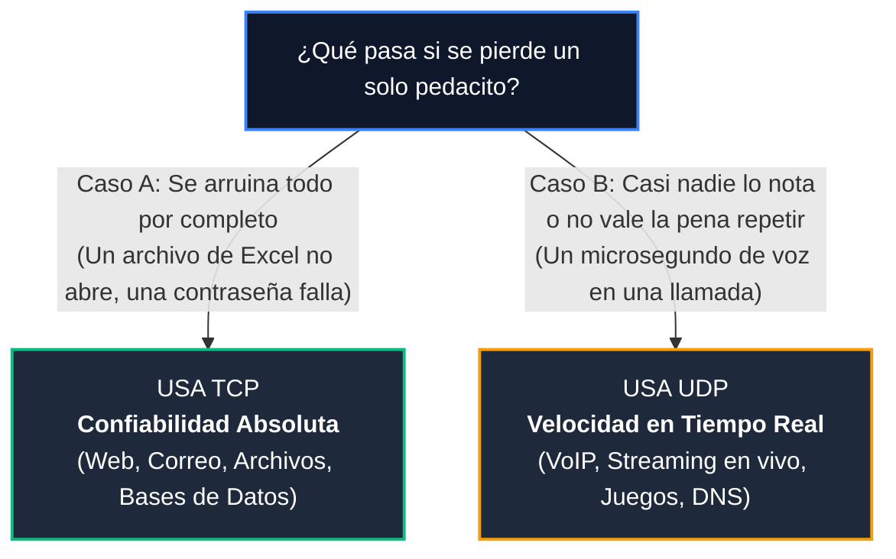

# Módulo 1: Capa de Transporte
## Tema 1.4: Comparativa TCP vs. UDP y Guía Definitiva para el Examen

---

### 1. La Gran Comparativa en Palabras Simples

Para no enredarte en el examen, imagínalos como dos tipos de personas con personalidades opuestas:

* **TCP es el Abogado Formal:** Es súper educado, primero saluda y pide permiso para hablar, anota cada palabra que le dices, te hace firmar un acuse de recibo por cada página, y si no entendió una frase, te detiene y te hace repetirla hasta que todo quede perfecto.
* **UDP es el Locutor de Radio:** Toma el micrófono y empieza a hablar a toda velocidad. No le importa si tienes tu radio encendida o apagada, no te pide confirmación de si lo escuchaste, y si parpadeas, no se va a detener a repetir nada.

| Característica | TCP (El Abogado Formal) | UDP (El Locutor de Radio) |
| :--- | :--- | :--- |
| **¿Saluda antes de hablar?** | **Sí**, hace un saludo de 3 pasos (*Three-Way Handshake*). | **No**, dispara los datos directamente sin saludar. |
| **¿Garantiza que todo llegue?** | **Sí**, si algo se pierde lo retransmite hasta que llegue. | **No**, si algo se pierde se queda perdido para siempre. |
| **¿Entrega las cosas en orden?** | **Sí**, numera las partes y las reordena al final. | **No**, las cosas llegan en el orden en que caigan. |
| **Tamaño de su etiqueta (Cabecera)** | Pesada: **20 a 60 bytes**. | Liviana: Solo **8 bytes**. |
| **Velocidad y Latencia** | Más lento, porque pasa pidiendo confirmación de todo. | **Ultra rápido**, no espera confirmación de nadie. |
| **¿A quién le puede hablar?** | Solo **Unicast** (de una persona a otra persona, 1 a 1). | **Unicast, Multicast y Broadcast** (a 1, a varios o a todos). |
| **Nombre técnico de su paquete** | **Segmento**. | **Datagrama**. |

---

### 2. La Regla Mnemotécnica para Examen: ¿Cuándo se usa TCP y cuándo UDP?

Hazte esta simple pregunta de sentido común:

$$\textbf{¿Qué pasa si se pierde un solo pedacito de los datos?}$$

* **Usa TCP si:** Estás descargando un programa `.exe`, un PDF del banco, una página web o enviando un correo. Si a un programa le falta un solo byte, el archivo se corrompe y no abre.
* **Usa UDP si:** Estás en una videollamada de Zoom o jugando en línea. Si un paquete de audio se pierde, prefieres que se escuche un microsegundo de silencio y seguir hablando en vivo, en vez de congelar la llamada 1 segundo esperando que se repita la frase vieja.

---

### 3. Mapeo Rápido de Protocolos de Examen

| Protocolo | ¿TCP o UDP? | Puerto | ¿Por qué usa ese protocolo? |
| :--- | :---: | :---: | :--- |
| **HTTP / HTTPS** | **TCP** | 80 / 443 | Una página web no puede perder botones ni texto. |
| **SSH / Telnet** | **TCP** | 22 / 23 | Los comandos que escribes en un router deben llegar exactos. |
| **FTP** | **TCP** | 20 / 21 | Si descargas un instalador de software, no le puede faltar nada. |
| **Correo (SMTP / IMAP)** | **TCP** | 25 / 143 | Un correo no debe perder letras ni archivos adjuntos. |
| **DNS (Consultas)** | **UDP** | 53 | Una sola pregunta corta y una sola respuesta corta. |
| **DHCP** | **UDP** | 67 / 68 | La PC todavía no tiene IP para poder negociar un saludo TCP. |
| **VoIP / Streaming (RTP)**| **UDP** | Varios | Lo que importa es la fluidez en vivo sin congelamientos. |

---

### 4. Ejercicio de Examen Explicado Paso a Paso

**Problema Típico:**  
*La Computadora A se conecta al Servidor B usando TCP. En el saludo inicial, la Computadora A elige como número de secuencia inicial (`ISN`) el número **1,000**. El Servidor B elige como su número inicial el **5,000**.*  
*Indica qué números llevan los paquetes del saludo de 3 vías (Three-Way Handshake).*

**Solución con Manzanas:**
1. **Paso 1 (La PC saluda):**  
   La PC envía su número:  
   $$\text{Seq} = \mathbf{1000}, \quad \text{Flags}: \text{SYN}$$
2. **Paso 2 (El Servidor responde y suma +1):**  
   El servidor dice: *"Anoté tu 1,000; ahora espero tu 1,001"*. Y manda su propio número 5,000:  
   $$\text{Seq} = \mathbf{5000}, \quad \text{Ack} = \mathbf{1001}, \quad \text{Flags}: \text{SYN, ACK}$$
3. **Paso 3 (La PC confirma y suma +1):**  
   La PC dice: *"Anoté tu 5,000; ahora espero tu 5,001"*:  
   $$\text{Seq} = \mathbf{1001}, \quad \text{Ack} = \mathbf{5001}, \quad \text{Flags}: \text{ACK}$$

*(¡Regla de oro: El saludo consume exactamente 1 número en cada sentido!)*
