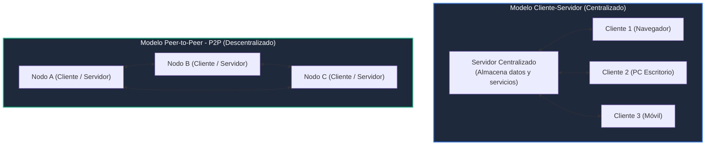

# Módulo 2: Capa de Aplicación
## Tema 2.1: Modelos de Red y Servicios en la Capa de Aplicación

---

### 1. El Rol de la Capa de Aplicación (Capa 7 OSI / Capa de Aplicación TCP/IP)
La Capa de Aplicación es la capa más cercana al usuario final. Proporciona la interfaz entre los programas de software humanos (navegadores web, clientes de correo, terminales) y la red de comunicación subyacente.

* **Diferencia crítica de examen:**
  * **La Aplicación:** Es el software con interfaz gráfica que el usuario utiliza (ej. Google Chrome, Microsoft Outlook, FileZilla).
  * **El Servicio/Protocolo de Aplicación:** Son las reglas y formatos estándar que usa la aplicación para comunicarse a través de la red (ej. HTTP/HTTPS, SMTP/IMAP, FTP). Un navegador es la aplicación; HTTP es el protocolo de Capa 7.

---

### 2. Modelos Arquitectónicos de Red

En la Capa de Aplicación existen dos modelos de diseño fundamentales para estructurar la comunicación:

#### A. Modelo Cliente-Servidor (Client-Server Model)
* **Definición:** Los roles están rígidamente separados. Existe un **Servidor** (dispositivo siempre encendido con dirección IP fija o accesible por DNS) que aloja recursos y escucha peticiones, y múltiples **Clientes** que solicitan información.
* **Características:**
  * El flujo de comunicación siempre es iniciado por el cliente.
  * El servidor responde bajo demanda y aplica políticas de autenticación y autorización.
  * Administración centralizada: las copias de seguridad, parches y seguridad se gestionan en el servidor.
* **Ventajas:** Alta seguridad, control central de datos, fácil escalabilidad de almacenamiento.
* **Desventajas:** El servidor es un punto único de falla (*Single Point of Failure*); si el servidor colapsa, ningún cliente accede al servicio. Alto costo de infraestructura.
* **Ejemplos clásicos:** Navegación Web (Servidor Apache/Nginx $\leftrightarrow$ Navegador), Consultas de Base de Datos, Servidores de Correo.

#### B. Modelo Punto a Punto (Peer-to-Peer - P2P)
* **Definición:** No existen servidores dedicados ni clientes fijos. Cada nodo (*peer*) en la red actúa simultáneamente como **cliente y servidor**.
* **Redes P2P vs. Aplicaciones P2P:**
  * **Redes P2P puras:** Todos los dispositivos tienen privilegios idénticos y comparten recursos directamente sin ningún servidor intermediario (ej. un grupo de trabajo básico de Windows compartiendo una impresora).
  * **Aplicaciones P2P (Híbridas):** Utilizan un servidor centralizado únicamente para localizar a los miembros o rastrear archivos (como el *tracker* en BitTorrent), pero la transferencia real de datos ocurre directamente entre los nodos.
* **Ventajas:** Redundancia distribuida (si un nodo se apaga, otros suplen el recurso), costo casi nulo de infraestructura centralizada, escalabilidad masiva de ancho de banda.
* **Desventajas:** Difícil de administrar, seguridad deficiente, descentralización de datos, alto consumo de recursos locales.
* **Ejemplos:** BitTorrent, redes de criptomonedas (Bitcoin/Ethereum), llamadas directas en Skype antiguo.

---

### 3. Preguntas Clave de Examen (Tipo UMG)

**P1: ¿Cuál es la diferencia entre una aplicación y un servicio de capa de aplicación?**
> **R:** La aplicación es el programa que interactúa con el usuario final (ej. Mozilla Firefox), mientras que el servicio/protocolo de capa de aplicación define las reglas de sintaxis y diálogo para transmitir los datos por la red (ej. HTTP).

**P2: ¿Por qué el modelo Cliente-Servidor es preferido en entornos corporativos frente a P2P?**
> **R:** Porque ofrece control de acceso centralizado, copias de seguridad unificadas, cumplimiento normativo y una seguridad mucho más estricta sobre los recursos empresariales.

**P3: En una red P2P, ¿qué rol desempeña cada dispositivo durante una sesión de transferencia?**
> **R:** Desempeña un rol dual: actúa como cliente cuando descarga partes del archivo desde otros pares, y actúa como servidor cuando comparte las partes ya descargadas hacia otros nodos.
