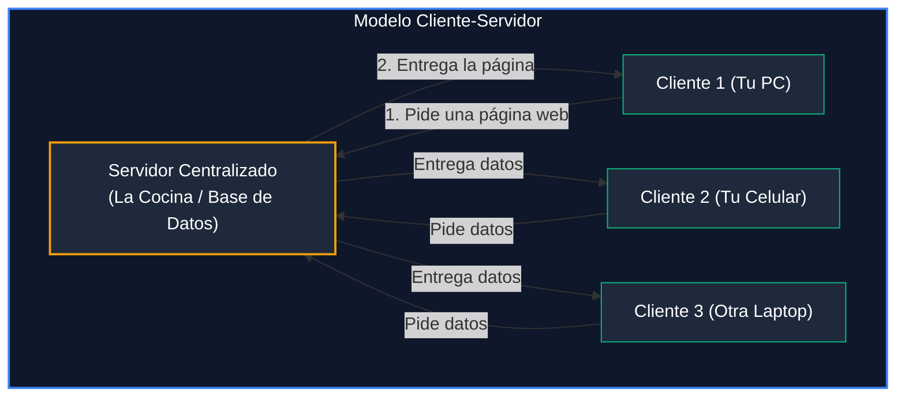
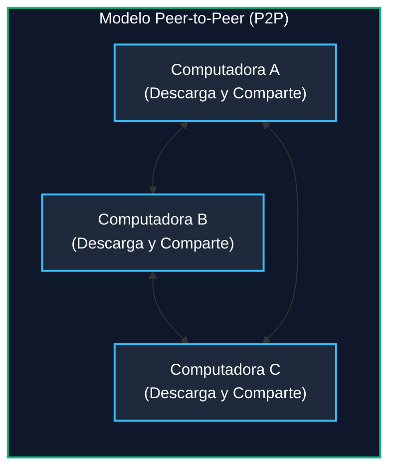

# Módulo 2: Capa de Aplicación
## Tema 2.1: Modelos de Red y Servicios (Explicado desde Cero)

---

### 📖 Mini Diccionario para Empezar

* **Capa de Aplicación (Capa 7):** Es la capa donde viven los programas que tú y yo tocamos todos los días (el navegador web, el WhatsApp, el reproductor de música, la terminal de comandos).
* **Cliente:** Es el dispositivo o programa que **pide algo** (ejemplo: tu teléfono pidiendo un video en TikTok).
* **Servidor:** Es una computadora potente que está siempre encendida, esperando que alguien le pida información para **entregarla** (ejemplo: las computadoras de Google o Netflix).
* **Peer (Par o Igual):** Es una computadora común y corriente que no es ni jefa ni sirvienta de nadie; puede pedir cosas y también compartir cosas al mismo tiempo.

---

### 1. Modelo Cliente-Servidor: La Analogía del Restaurante

Piensa en cómo funciona un restaurante formal:
1. **Tú eres el Cliente:** Te sientas en la mesa, abres el menú y le pides una hamburguesa al mesero.
2. **La Cocina es el Servidor:** La cocina tiene las materias primas, prepara la hamburguesa y te la lleva a la mesa.
3. **Regla básica:** Tú nunca entras a la cocina a freír tu propia carne, y la cocina nunca viene a tu casa sin que la hayas llamado. La comunicación siempre la inicia el cliente.

* **Ventajas:** Todo está ordenado en un solo lugar. Si quieres hacer una copia de seguridad o poner un antivirus, solo lo haces en el servidor.
* **El gran peligro:** Si la cocina se incendia (el servidor se cae o se apaga), **ningún cliente puede comer** (*Punto único de falla*).

---

### 2. Modelo Peer-to-Peer (P2P): La Fiesta de Traje

Piensa en una fiesta de amigos donde no hay meseros ni anfitrión único:
* Un amigo lleva las gaseosas.
* Otro amigo lleva las pizzas.
* Otro amigo lleva las bocinas para la música.
* **Todos comen de lo que todos llevaron y todos comparten lo que tienen.**

En las redes **Peer-to-Peer (P2P)** pasa lo mismo:
No hay un servidor central gigante. Cuando descargas un archivo grande por **BitTorrent** o compras una criptomoneda:
* Tu computadora descarga el 10% del archivo desde la computadora de una persona en Japón.
* Al mismo tiempo, tu computadora le comparte el 5% que ya descargó a otra persona en Argentina.
* Eres **cliente y servidor a la vez**.

* **Ventaja:** Si la computadora de Japón se apaga, no importa; sigues descargando desde la de Argentina o Brasil. No hay un punto único de falla.
* **Desventaja:** No hay nadie a cargo de la seguridad y es muy difícil de controlar o respaldar.

---

### 3. Diferencia entre "Aplicación" y "Protocolo de Aplicación"

Esta es una pregunta trampa típica de examen:

* **La Aplicación:** Es el programa con botones y ventanas que tú usas (ejemplo: Google Chrome o Mozilla Firefox).
* **El Protocolo de Aplicación:** Son las reglas y el idioma que usa ese programa para hablar con el mundo (ejemplo: **HTTP**).

$$\textbf{Google Chrome} \text{ es la aplicación;} \quad \textbf{HTTP} \text{ es el idioma que habla por dentro.}$$

---

### 4. Preguntas Típicas de Examen

**P1: ¿Cuál es el rol de un dispositivo en una red Peer-to-Peer (P2P)?**
> **R:** Desempeña un rol dual: actúa como cliente cuando descarga recursos de otros nodos y como servidor cuando comparte los recursos que ya posee.

**P2: ¿Por qué los bancos y universidades prefieren el modelo Cliente-Servidor?**
> **R:** Porque ofrece control de acceso centralizado, copias de seguridad en un solo lugar y una seguridad mucho más estricta sobre la información confidencial.
