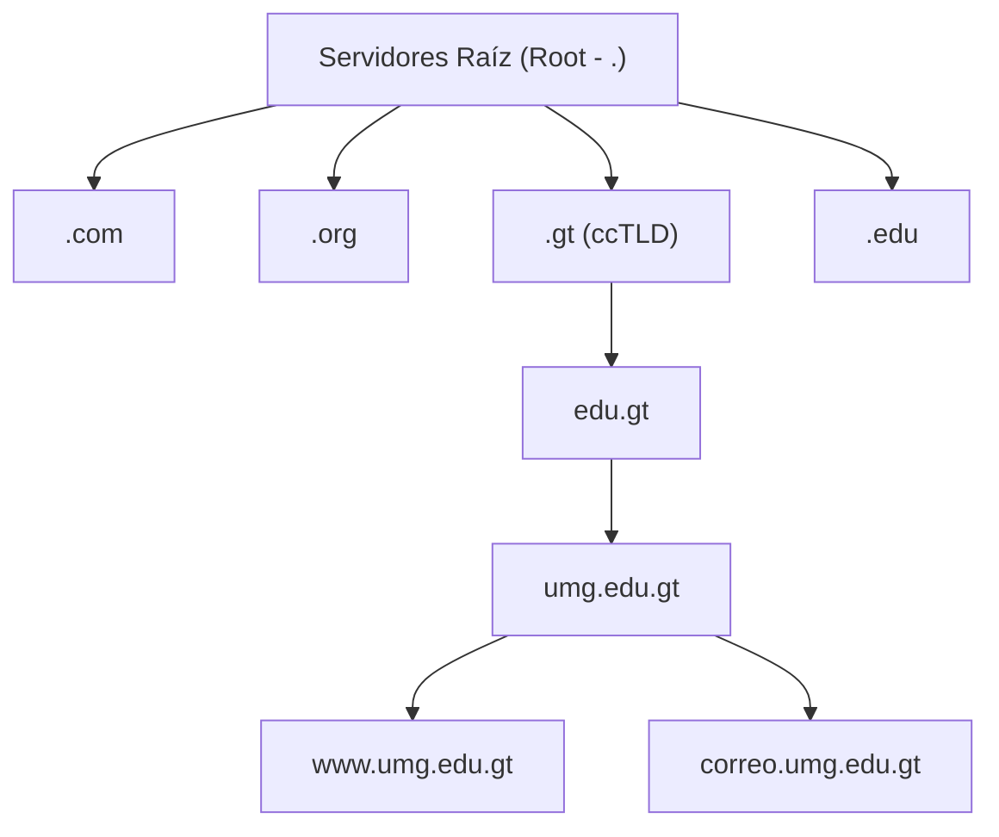
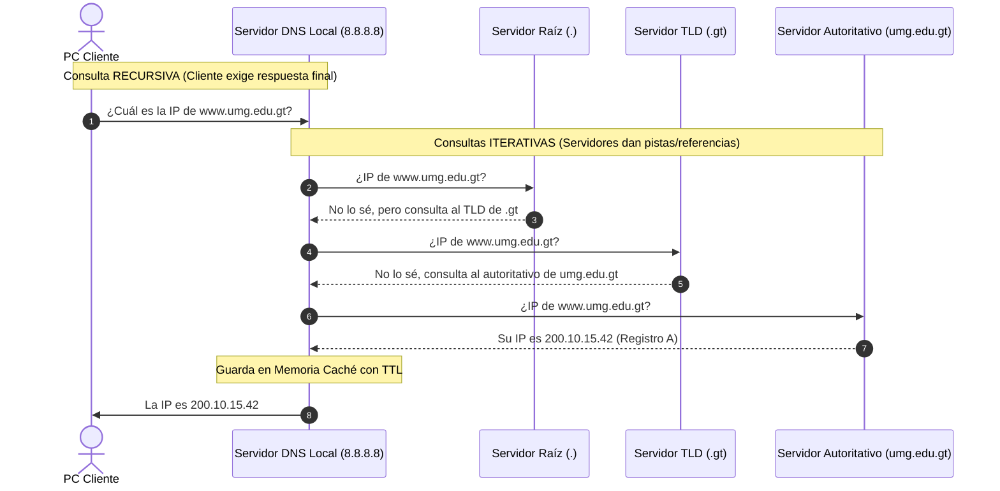

# Módulo 2: Capa de Aplicación
## Tema 2.2: DNS (Domain Name System - RFC 1034 / 1035)

---

### 1. ¿Qué es DNS y cuál es su Propósito?
El **Sistema de Nombres de Dominio (DNS)** es la libreta telefónica de Internet. Traduce nombres de dominio legibles para humanos (ej. `www.umg.edu.gt`) a direcciones IP numéricas comprensibles para las máquinas (ej. `200.10.15.42`).

* **Puerto Estándar:** **Puerto 53**.
* **Transporte Híbrido (Muy preguntado en examen):**
  * **UDP en Puerto 53:** Utilizado para **consultas y respuestas estándar de clientes** (debido a su rapidez y baja sobrecarga, mensajes menores a 512 bytes).
  * **TCP en Puerto 53:** Utilizado para **transferencias de zona (Zone Transfers)** entre servidores DNS primarios y secundarios, o respuestas con extensión EDNS0 que superan los 512 bytes (requiere confiabilidad estricta).

---

### 2. Estructura Jerárquica del Árbol de Dominios

El espacio de nombres de DNS tiene una estructura de árbol invertido:

1. **Dominio Raíz (*Root*):** Representado por un punto final (`.`). En el mundo existen 13 grupos de servidores raíz gestionados por IANA/ICANN (nombrados de la letra `A` a la `M`), replicados con tecnología *Anycast* en cientos de ubicaciones globales.
2. **TLD (*Top-Level Domain* - Dominio de Nivel Superior):**
   * *gTLD (Genéricos):* `.com`, `.org`, `.net`, `.info`.
   * *ccTLD (Código de País):* `.gt` (Guatemala), `.mx` (México), `.es` (España).
3. **SLD (*Second-Level Domain* - Dominio de Segundo Nivel):** Nombres registrados por entidades u organizaciones bajo un TLD (ej. `umg.edu.gt`, `google.com`).
4. **FQDN (*Fully Qualified Domain Name*):** Nombre completo y absoluto que especifica la ubicación exacta del host en el árbol jerárquico hasta la raíz (ej. `servidor1.umg.edu.gt.`).

---

### 3. Tipos de Servidores DNS

* **DNS Resolver / Servidor Recursivo:** Servidor intermediario (suele ser el configurado en tu router por el ISP o servidores públicos como `8.8.8.8` de Google o `1.1.1.1` de Cloudflare). Recibe la petición del cliente y hace todo el trabajo de rastreo en Internet hasta encontrar la respuesta.
* **Servidor Raíz (Root Server):** No conoce las IPs de los sitios web, pero sabe qué servidores administran cada TLD (ej. redirige a los servidores del `.gt`).
* **Servidor TLD (TLD Server):** Conoce qué servidores autoritativos administran los dominios de segundo nivel registrados en su zona.
* **Servidor Autoritativo (Authoritative Server):** Es el servidor que tiene la respuesta final y definitiva. Contiene los archivos de zona originales con los registros del dominio consultado.

---

### 4. Consultas Recursivas vs. Iterativas

* **Consulta Recursiva:** El cliente le exige al servidor DNS local: *"Búscame la respuesta final y no regreses hasta que la tengas"*.
* **Consulta Iterativa:** El servidor le dice al solicitante: *"Yo no tengo la IP exacta, pero pregúntale a este otro servidor que sabe más que yo"*.

---

### 5. Tipos de Registros DNS de Examen (Resource Records - RR)

| Tipo de Registro | Nombre Completo | Función Exacta | Ejemplo Real |
| :--- | :--- | :--- | :--- |
| **A** | *Address Record (IPv4)* | Mapea un nombre de host a una dirección **IPv4 de 32 bits**. | `www.umg.edu.gt -> 200.10.15.42` |
| **AAAA** | *IPv6 Address Record* | Mapea un nombre de host a una dirección **IPv6 de 128 bits**. | `www.google.com -> 2800:3f0:4002:805::2004` |
| **CNAME** | *Canonical Name* | Crea un **alias** o sobrenombre que apunta a otro nombre canónico. | `portal.umg.edu.gt -> www.umg.edu.gt` |
| **MX** | *Mail Exchanger* | Especifica el servidor de **correo electrónico** del dominio con una prioridad numérica. | `umg.edu.gt MX 10 mail.umg.edu.gt` |
| **NS** | *Name Server* | Delega la zona DNS a los servidores autoritativos del dominio. | `umg.edu.gt NS ns1.umg.edu.gt` |
| **PTR** | *Pointer Record* | Búsqueda **inversa**: traduce una dirección IP a un nombre de dominio (zona `in-addr.arpa`). | `42.15.10.200.in-addr.arpa -> www.umg.edu.gt` |
| **SOA** | *Start of Authority* | Define información administrativa de la zona (número de serie, contacto, TTL de refresco). | Primer registro obligatorio de toda zona. |
| **TXT** | *Text Record* | Contiene cadenas de texto libre para validaciones (ej. SPF, DKIM para evitar spam de correo). | `v=spf1 include:_spf.google.com ~all` |

---

### 6. Memoria Caché y TTL (Time-To-Live)
Para no saturar a los servidores mundiales en cada clic, las resoluciones DNS se guardan en la memoria caché local de la PC y del servidor recursivo durante un tiempo llamado **TTL (Time to Live)** medido en segundos. Al expirar el TTL, la entrada se descarta y debe consultarse nuevamente.

* Comando en Windows para ver la caché local: `ipconfig /displaydns`
* Comando en Windows para vaciar la caché: `ipconfig /flushdns`
* Herramienta universal para probar resoluciones: `nslookup <nombre_o_ip>`
