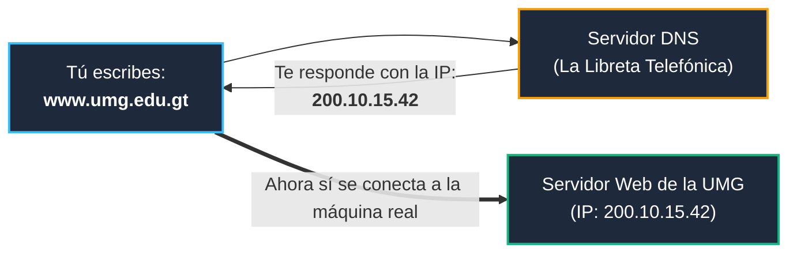
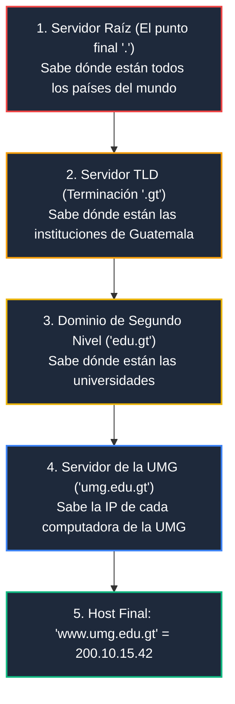

# Módulo 2: Capa de Aplicación
## Tema 2.2: DNS Explicado con Manzanas (La Libreta de Contactos de Internet)

---

### 📖 Mini Diccionario para Empezar

* **DNS (Domain Name System):** Es el sistema que traduce nombres fáciles de recordar por humanos (como `umg.edu.gt`) a números que entienden las computadoras (como `200.10.15.42`).
* **Nombre de Dominio:** El nombre legible de un sitio web (ejemplo: `google.com`, `facebook.com`).
* **TLD (Top-Level Domain):** La terminación del nombre. Puede ser por país (`.gt` para Guatemala, `.mx` para México) o por tipo de organización (`.com` comercial, `.edu` educativo, `.gob` gobierno).
* **IP (Dirección IP):** El número real donde está físicamente guardada la página web en un servidor.
* **TTL (Time To Live):** Tiempo en segundos que tu computadora guarda una respuesta en su memoria para no volver a preguntar lo mismo a cada segundo.

---

### 1. La Gran Analogía: La Agenda de Contactos de tu Teléfono

Piensa en cómo usas tu teléfono todos los días:
* Si quieres llamar a tu mamá, no tecleas de memoria su número de 8 dígitos `502 4589 1234`.
* Simplemente abres tu agenda, buscas el nombre **"Mamá"** y presionas llamar.
* Por dentro, tu teléfono busca qué número telefónico le corresponde a ese nombre y marca los dígitos.

**DNS hace exactamente eso para todo el planeta:**
Los seres humanos somos pésimos recordando números largos como `142.250.190.46`, pero somos excelentes recordando nombres como `google.com`. Cada vez que escribes un nombre en el navegador, **DNS busca en su libreta de contactos y te entrega la IP en menos de 20 milisegundos**.

* **Puerto Estándar:** Puerto **53**.
* **¿Usa TCP o UDP?**
  * Usa **UDP en el puerto 53** para las preguntas normales de tu computadora (porque es una sola pregunta rápida).
  * Usa **TCP en el puerto 53** solo cuando dos servidores DNS se copian bases de datos gigantescas entre sí (*Transferencia de Zona*).

---

### 2. La Jerarquía de Nombres (Se lee de derecha a izquierda)

En Internet, los nombres no se leen como en español; **se leen de derecha a izquierda**, desde lo más general hasta la máquina específica:

$$\text{www} \ . \ \text{umg} \ . \ \text{edu} \ . \ \mathbf{gt} \ .$$

---

### 3. Consulta Recursiva vs. Consulta Iterativa (El Mesero vs. El Empleado Perezoso)

¿Cómo viaja una pregunta de DNS por el mundo? Existen dos formas de preguntar:

#### A. Consulta Recursiva (La del Mesero Atento):
* Cuando estás en un restaurante, le dices al mesero: *"Tráigame un café con leche"*.
* Tú te quedas sentado en tu silla. El mesero camina a la cocina, busca el café, busca la leche, lo prepara y **te lo trae servido en la mano**.
* **En redes:** Es la que hace tu PC hacia su servidor DNS local (ej. `8.8.8.8` de Google). Tu PC le exige al DNS: *"Consígueme la IP final y no regreses hasta que la tengas"*.

#### B. Consulta Iterativa (El Empleado Perezoso de la Ferretería):
* Vas a una ferretería gigante y preguntas: *"¿Dónde están los tornillos?"*.
* El empleado te dice: *"Yo no sé, pero pregúntele al del pasillo 4"*. Vas al pasillo 4 y ese te dice: *"No sé, pregúntele al encargado del fondo"*.
* **En redes:** Es la que hacen los servidores entre sí. El servidor raíz le dice al DNS local: *"Yo no sé la IP de la UMG, pero aquí tienes la dirección del servidor de Guatemala (`.gt`), ve y pregúntale a él"*.

---

### 4. Los Tipos de Registros DNS (Preguntas Clásicas de Examen)

Dentro de la libreta de contactos de DNS existen diferentes tipos de fichas llamadas **Registros**:

| Registro | Nombre Completo | ¿Para qué sirve en palabras sencillas? | Ejemplo Real |
| :---: | :--- | :--- | :--- |
| **A** | *Address (IPv4)* | Traduce un nombre a una dirección **IPv4 normal** de números. | `umg.edu.gt -> 200.10.15.42` |
| **AAAA** | *Address (IPv6)* | Lo mismo, pero para direcciones **IPv6 modernas y largas**. | `google.com -> 2800:3f0:...` |
| **CNAME** | *Canonical Name* | Es un **apodo o alias** que apunta a otro nombre. | `portal.umg.edu.gt` apunta a `www.umg.edu.gt` |
| **MX** | *Mail Exchanger* | Dice a qué servidor deben enviarse los **correos electrónicos**. | `umg.edu.gt MX -> mail.umg.edu.gt` |
| **PTR** | *Pointer* | Hace lo contrario (**Búsqueda Inversa**): le das la IP y te dice el nombre. | `200.10.15.42 -> www.umg.edu.gt` |
| **TXT** | *Text* | Guarda texto de seguridad para evitar que personas malas envíen correos falsos haciéndose pasar por la universidad. | Reglas contra Spam (*SPF / DKIM*). |

---

### 5. Preguntas Típicas de Examen

**P1: ¿Qué puerto y protocolo de transporte utiliza DNS para las consultas de los usuarios?**
> **R:** Utiliza el puerto **53** sobre el protocolo **UDP** (por su rapidez y bajo consumo de recursos).

**P2: ¿Para qué sirve un registro tipo "CNAME" en DNS?**
> **R:** Sirve para crear un alias o sobrenombre que apunta a otro nombre de dominio principal (por ejemplo, hacer que `ftp.miempresa.com` apunte a `www.miempresa.com`).

**P3: ¿Qué diferencia hay entre un registro "A" y un registro "AAAA"?**
> **R:** El registro `A` almacena una dirección **IPv4** (de 32 bits), mientras que el registro `AAAA` almacena una dirección **IPv6** (de 128 bits).
