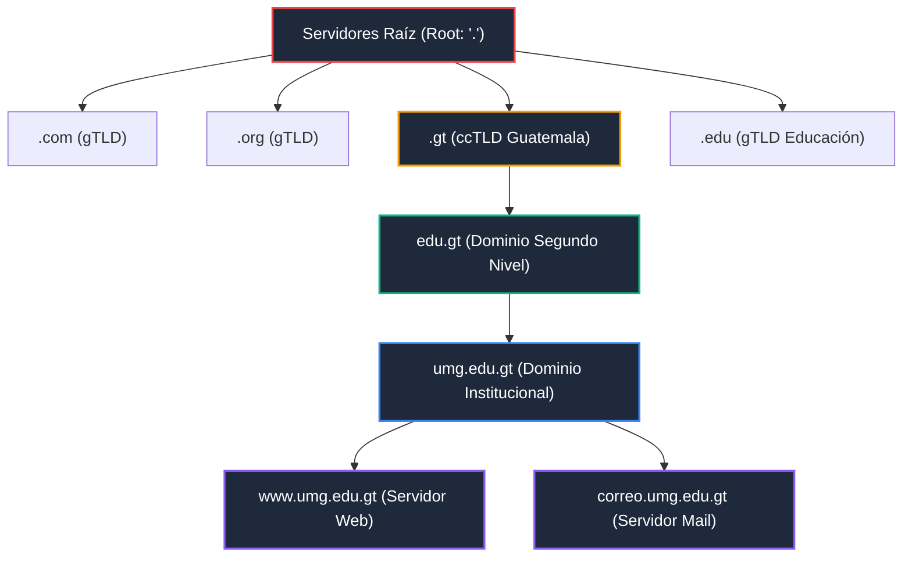
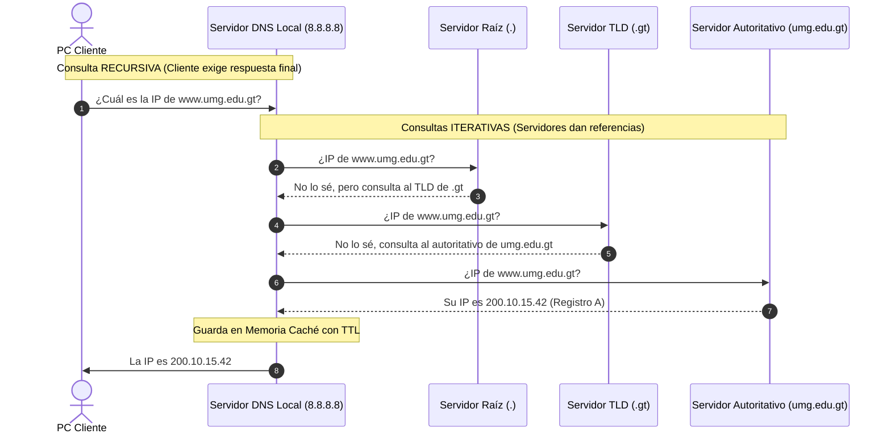

# Módulo 2: Capa de Aplicación
## Tema 2.2: DNS Exhaustivo (Formato de Mensaje, Archivos de Zona BIND y Seguridad DNSSEC)

---

### 1. Formato Binario del Mensaje DNS (RFC 1035)

Tanto las preguntas como las respuestas DNS utilizan una estructura idéntica encapsulada dentro de un datagrama UDP (o segmento TCP si supera los 512 bytes). El encabezado fijo mide **12 bytes**:

| Fila de 32 Bits | Bits 0 – 15 | Bits 16 – 31 |
| :---: | :--- | :--- |
| **Palabra 1 (Bytes 0-3)** | **Transaction ID** (16 bits) | **Banderas de Control**: `QR` (1b), `Opcode` (4b), `AA` (1b), `TC` (1b), `RD` (1b), `RA` (1b), `Z` (3b), `RCODE` (4b) |
| **Palabra 2 (Bytes 4-7)** | **QDCOUNT** (Número de preguntas - 16 bits) | **ANCOUNT** (Número de respuestas - 16 bits) |
| **Palabra 3 (Bytes 8-11)**| **NSCOUNT** (Servidores de autoridad - 16 bits) | **ARCOUNT** (Registros adicionales - 16 bits) |
| **Carga de Datos** | **Sección de Pregunta** (*Question Section*) | |
| **Carga de Datos** | **Sección de Respuesta** (*Answer Section*) | |
| **Carga de Datos** | **Sección de Autoridad** (*Authority Section*) | |
| **Carga de Datos** | **Sección Adicional** (*Additional Section*) | |

#### Análisis de Banderas y Campos Críticos (Wireshark / Examen):
* **Transaction ID (16 bits):** Número identificador generado por el cliente. La respuesta del servidor debe incluir exactamente el mismo ID para evitar falsificaciones.
* **QR (Query/Response - 1 bit):** `0` = Pregunta (*Query*); `1` = Respuesta (*Response*).
* **AA (Authoritative Answer - 1 bit):** Si vale `1`, la respuesta proviene del servidor que es dueño legal de la zona, no de una copia en caché.
* **TC (Truncated - 1 bit):** Si vale `1`, la respuesta superó los 512 bytes de UDP y fue recortada. Esto le ordena al cliente **reintentar la consulta inmediatamente usando TCP en el puerto 53**.
* **RD (Recursion Desired - 1 bit):** Petición del cliente solicitando resolución recursiva.
* **RA (Recursion Available - 1 bit):** Notificación del servidor indicando si soporta recursión.
* **RCODE (Response Code - 4 bits):**
  * `0`: *No Error* (Éxito).
  * `2`: *Server Failure* (Error interno del servidor).
  * `3`: *NXDOMAIN* (El dominio consultado no existe en Internet).
  * `5`: *Refused* (El servidor se niega a responder por políticas o lista blanca).

---

### 2. Estructura Jerárquica del Árbol de Dominios

El espacio de nombres de DNS tiene una estructura de árbol invertido:

1. **Dominio Raíz (*Root*):** Representado por un punto final (`.`). En el mundo existen 13 grupos de servidores raíz gestionados por IANA/ICANN (nombrados de la letra `A` a la `M`), replicados con tecnología *Anycast* en cientos de ubicaciones globales.
2. **TLD (*Top-Level Domain* - Dominio de Nivel Superior):**
   * *gTLD (Genéricos):* `.com`, `.org`, `.net`, `.info`.
   * *ccTLD (Código de País):* `.gt` (Guatemala), `.mx` (México), `.es` (España).
3. **SLD (*Second-Level Domain* - Dominio de Segundo Nivel):** Nombres registrados por entidades u organizaciones bajo un TLD (ej. `umg.edu.gt`, `google.com`).
4. **FQDN (*Fully Qualified Domain Name*):** Nombre completo y absoluto que especifica la ubicación exacta del host en el árbol jerárquico hasta la raíz (ej. `servidor1.umg.edu.gt.`).

---

### 3. Consultas Recursivas vs. Iterativas

* **Consulta Recursiva:** El cliente le exige al servidor DNS local: *"Búscame la respuesta final y no regreses hasta que la tengas"*.
* **Consulta Iterativa:** El servidor le dice al solicitante: *"Yo no tengo la IP exacta, pero pregúntale a este otro servidor que sabe más que yo"*.

---

### 4. Tipos de Registros DNS de Examen (Resource Records - RR)

| Tipo de Registro | Nombre Completo | Función Exacta | Ejemplo Real |
| :--- | :--- | :--- | :--- |
| **A** | *Address Record (IPv4)* | Mapea un nombre de host a una dirección **IPv4 de 32 bits**. | `www.umg.edu.gt -> 200.10.15.42` |
| **AAAA** | *IPv6 Address Record* | Mapea un nombre de host a una dirección **IPv6 de 128 bits**. | `www.google.com -> 2800:3f0:4002:805::2004` |
| **CNAME** | *Canonical Name* | Crea un **alias** o sobrenombre que apunta a otro nombre canónico. | `portal.umg.edu.gt -> www.umg.edu.gt` |
| **MX** | *Mail Exchanger* | Especifica el servidor de **correo electrónico** del dominio con una prioridad numérica. | `umg.edu.gt MX 10 mail.umg.edu.gt` |
| **NS** | *Name Server* | Delega la zona DNS a los servidores autoritativos del dominio. | `umg.edu.gt NS ns1.umg.edu.gt` |
| **PTR** | *Pointer Record* | Búsqueda **inversa**: traduce una dirección IP a un nombre de dominio (zona `in-addr.arpa`). | `42.15.10.200.in-addr.arpa -> www.umg.edu.gt` |
| **SOA** | *Start of Authority* | Define información administrativa de la zona (número de serie, contacto, TTL de refresco). | Primer registro obligatorio de toda zona. |
| **TXT** | *Text Record* | Contiene cadenas de texto libre para validaciones (ej. SPF, DKIM para evitar spam de correo). | `v=spf1 include:_spf.google.com ~all` |

---

### 5. Vulnerabilidades Clásicas y la Solución DNSSEC

* **Envenenamiento de Caché DNS (DNS Cache Poisoning / Ataque de Kaminsky):**  
  Como UDP no tiene estado ni verificación de conexión previa, un atacante inunda a un servidor DNS recursivo con miles de respuestas falsas adivinando el `Transaction ID` de 16 bits y el puerto de origen. Si acierta antes de que llegue la respuesta legítima, el servidor DNS guardará la IP del atacante en su memoria caché, redirigiendo a todos los usuarios bancarios o institucionales a páginas fraudulentas.
* **DNSSEC (Domain Name System Security Extensions - RFC 4033):**  
  Añade autenticación criptográfica de origen e integridad de datos a las respuestas DNS mediante firmas digitales basadas en criptografía de clave pública:
  * **RRSIG (Resource Record Signature):** Cada registro DNS va firmado con una firma criptográfica.
  * **DNSKEY:** Clave pública del servidor que los clientes usan para validar la firma `RRSIG`.
  * **DS (Delegation Signer):** Huella digital (hash) de la clave del servidor hija almacenada en el servidor padre (crea una **Cadena de Confianza** ininterrumpida desde la raíz de Internet `.` hacia abajo).
