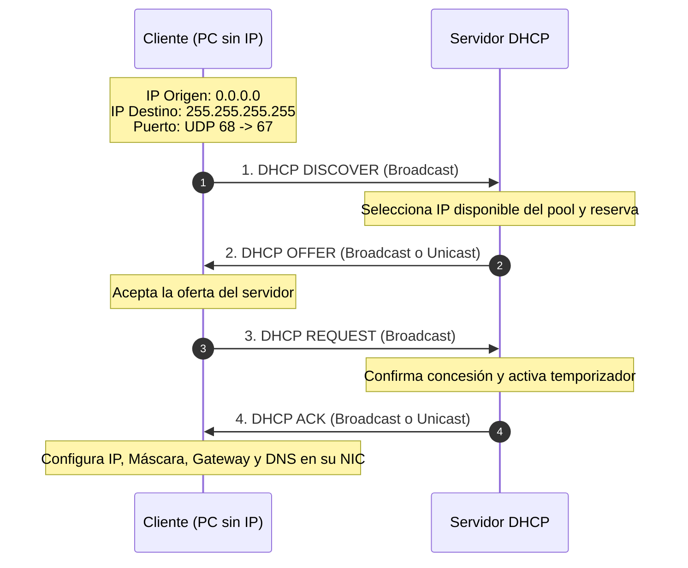

# Módulo 2: Capa de Aplicación
## Tema 2.3: DHCP (Dynamic Host Configuration Protocol - RFC 2131)

---

### 1. ¿Qué es DHCP y cuál es su Propósito?
DHCP es el protocolo cliente-servidor que **automatiza la asignación de parámetros de red** a los dispositivos que se conectan a una red local (LAN).

* **Puertos y Protocolo de Transporte:**
  * Utiliza **UDP**.
  * **Puerto 67 (Servidor DHCP):** Escucha peticiones de los clientes.
  * **Puerto 68 (Cliente DHCP):** Escucha respuestas del servidor.
* **Beneficios frente a la configuración estática:**
  * Elimina errores humanos (como IPs duplicadas).
  * Simplifica la administración en redes móviles (ej. laptops y celulares que cambian de sala).
  * Reutiliza direcciones IP mediante el mecanismo de **concesión temporal (Lease Time)**.

---

### 2. El Ciclo de Concesión: El Proceso DORA (Indispensable para Examen)

Cuando una PC configurada en modo DHCP se enciende y conecta a la red, ejecuta 4 pasos secuenciales conocidos por el acrónimo **DORA**:

#### Explicación Detallada de cada Fase:

1. **D - DHCP Discover (Descubrimiento):**
   * El cliente **no tiene dirección IP asignada**, por lo que coloca como IP origen `0.0.0.0`.
   * Envía un mensaje en **Broadcast (`255.255.255.255`)** a través del puerto UDP `67` para localizar si existe algún servidor DHCP en la red local. Incluye su dirección MAC física en la carga útil.
2. **O - DHCP Offer (Oferta):**
   * El servidor DHCP recibe el broadcast, busca en su rango libre (*Pool*) una dirección IP disponible, la reserva temporalmente y le envía una propuesta al cliente.
   * La oferta incluye: IP propuesta, Máscara de subred, Gateway por defecto, Servidores DNS y Tiempo de concesión (*Lease Time*).
3. **R - DHCP Request (Solicitud):**
   * El cliente elige una de las ofertas recibidas (si hay varios servidores DHCP) y envía un mensaje formal solicitando esa IP.
   * **¿Por qué este mensaje es Broadcast?** Para notificar a todos los demás servidores DHCP de la red que su oferta fue rechazada y que pueden devolver esas IPs a sus pools de disponibles.
4. **A - DHCP Acknowledgment / ACK (Reconocimiento):**
   * El servidor elegido confirma la asignación definitiva, guarda el registro en su tabla de arrendamientos y arranca el contador de tiempo (*Lease Time*). A partir de este momento, el cliente puede comunicarse libremente.
   * *Si la IP ya no está disponible por error, el servidor enviaría un **DHCP NAK** (Negative ACK), obligando al cliente a reiniciar el proceso DORA.*

---

### 3. Temporizadores de Renovación de Arrendamiento (T1 y T2)

La IP no se le regala al cliente para siempre; se le "alquila" durante un tiempo llamado **Lease Time** (ej. 24 horas, 8 días):

* **Temporizador T1 (50% del Lease):** Al cumplirse la mitad del tiempo de concesión, el cliente envía un mensaje **DHCP Request en modo Unicast directo al mismo servidor** que le dio la IP. Si el servidor responde con un ACK, el tiempo se reinicia al 100%.
* **Temporizador T2 (87.5% del Lease):** Si el servidor original no respondió en T1 (por ejemplo, porque se cayó o está apagado), al llegar al 87.5% del tiempo el cliente entra en modo pánico y envía un **DHCP Request en Broadcast** para que cualquier otro servidor DHCP activo en la red le renueve la concesión.
* **Expiración (100% del Lease):** Si nadie responde al 100%, el cliente debe liberar la IP inmediatamente (`0.0.0.0`), pierde la conexión y debe empezar desde cero con un nuevo `DHCP Discover`.

---

### 4. Parámetros que Entrega el Servidor DHCP (DHCP Options)

Un servidor DHCP entrega mucho más que una simple IP:
- **Option 1:** Máscara de subred (*Subnet Mask*).
- **Option 3:** Enrutador por defecto (*Default Gateway*).
- **Option 6:** Servidores de nombres de dominio (*DNS Servers*).
- **Option 15:** Nombre de dominio local (ej. `miempresa.local`).
- **Option 51:** Tiempo de concesión (*IP Address Lease Time*).

---

### 5. El Agente de Retransmisión DHCP (DHCP Relay Agent / IP Helper-Address)

* **Problema:** Los Routers **bloquean por defecto los mensajes de Broadcast**. Como el mensaje `DHCP Discover` es un broadcast (`255.255.255.255`), los clientes de la Subred B jamás podrían alcanzar al servidor DHCP ubicado en la Subred A.
* **Solución (DHCP Relay):** Se configura el Router para que intercepte esos broadcasts en la interfaz local y los reenvíe como un mensaje **Unicast normal** directamente a la IP del servidor DHCP.
  * *En routers Cisco, esto se activa en la interfaz con el comando:* `ip helper-address <IP_DEL_SERVIDOR_DHCP>`.

---

### 6. Direccionamiento APIPA (Automatic Private IP Addressing)
Si una máquina Windows está configurada en DHCP pero ningún servidor DHCP responde al proceso DORA, el sistema operativo se autoasigna una dirección del rango **APIPA**:
* **Rango APIPA:** `169.254.0.1` a `169.254.255.254` (Máscara `/16` o `255.255.0.0`).
* **Síntoma en examen:** Si una PC en Packet Tracer o en un caso real tiene una IP `169.254.x.x`, significa que **falló la comunicación con el servidor DHCP**. Permite comunicarse en la misma subred local, pero **no tiene salida a Internet ni Default Gateway**.
