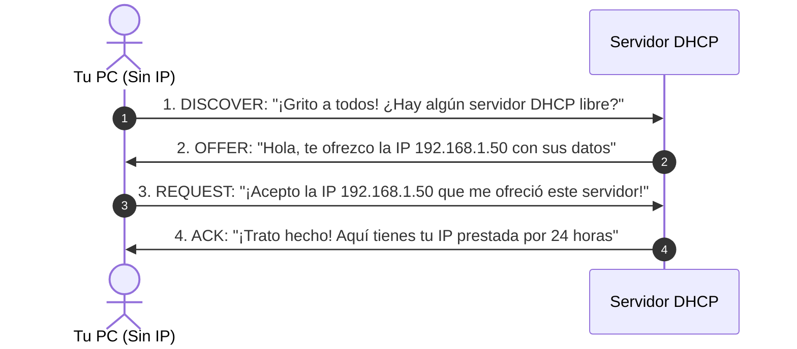

# Módulo 2: Capa de Aplicación
## Tema 2.3: DHCP Explicado con Manzanas (El Asignador Automático de IPs)

---

### 📖 Mini Diccionario para Empezar

* **DHCP (Dynamic Host Configuration Protocol):** Es el programa encargado de darle automáticamente una dirección IP, máscara y puerta de enlace a tu computadora en cuanto te conectas a la red.
* **IP Estática:** Configurar los números a mano uno por uno en la computadora (como hacían en los años 90).
* **IP Dinámica:** La computadora pide los números prestados automáticamente al conectarse.
* **Pool (Piscina o Rango de IPs):** La lista de direcciones libres que el servidor tiene guardadas para prestar (ejemplo: de la `192.168.1.10` a la `192.168.1.200`).
* **Lease Time (Tiempo de Concesión):** El tiempo que te prestan la IP (ejemplo: 24 horas o 7 días). Pasado ese tiempo, debes renovarla o devolverla.
* **Broadcast (Difusión a todos):** Gritar un mensaje en voz alta para que lo escuchen absolutamente todas las computadoras conectadas a la red local (`255.255.255.255`).

---

### 1. La Gran Analogía: El Estacionamiento del Centro Comercial

Imagina que entras con tu carro al parqueo de Miraflores o Portales:
* No eres dueño de ningún parqueo para toda la vida.
* Al llegar a la talanquera, una máquina automática te entrega un ticket con un espacio libre (ejemplo: *"Estacionamiento B-14"*).
* Haces tus compras durante 2 horas, sales del centro comercial y ese espacio queda libre para que otro vehículo que venga detrás lo pueda ocupar.

**DHCP hace exactamente lo mismo:**
Si tuvieras que escribir a mano la IP, la máscara, el router y el DNS cada vez que vas a un restaurante, a la universidad o a la casa de un amigo, nadie usaría Wi-Fi. **DHCP te entrega tu "ticket de red" en menos de 1 segundo de forma totalmente transparente**.

* **Puertos de Red:** Utiliza el protocolo **UDP** en el **Puerto 67 (Servidor)** y **Puerto 68 (Tu PC Cliente)**.

---

### 2. El Ciclo DORA Explicado Paso a Paso (Pregunta Fija de Examen)

Cuando enciendes tu computadora o conectas tu celular al Wi-Fi, se ejecutan cuatro pasos cuyas iniciales forman la palabra **D-O-R-A**:

#### Los 4 pasos explicados como un diálogo real:

1. **D - DHCP Discover (Descubrimiento):**
   * Tu PC recién encendida **no tiene dirección IP todavía** (usa como origen `0.0.0.0`).
   * Como no sabe dónde está el servidor, manda un grito a toda la red local en modo **Broadcast (`255.255.255.255`)**: *"¡Hola a todos! ¿Hay algún servidor DHCP que me preste una IP?"*.
2. **O - DHCP Offer (Oferta):**
   * El servidor DHCP escucha el grito, busca en su lista una IP que nadie esté usando y le responde: *"Hola, tengo disponible la IP `192.168.1.50`. También te ofrezco la máscara `/24`, la puerta de enlace `192.168.1.1` y el DNS `8.8.8.8`"*.
3. **R - DHCP Request (Solicitud formal):**
   * Tu PC recibe la oferta y vuelve a gritar a toda la red: *"¡Atención todos! Elijo formalmente la IP `192.168.1.50` que me ofreció el Servidor 1"*.
   * **¿Por qué grita a todos otra vez?** Para que si había otros servidores DHCP que también le hicieron ofertas, sepan que perdieron y puedan regresar esas IPs a su lista de disponibles.
4. **A - DHCP ACK (Reconocimiento final):**
   * El servidor seleccionado contesta: *"¡Perfecto! La IP `192.168.1.50` queda registrada a nombre de tu tarjeta de red por 24 horas. Ya puedes navegar"*.

---

### 3. ¿Qué es APIPA (169.254.x.x) y por qué sale en los exámenes?

Imagina que llegas al centro comercial y la máquina de tickets está rota o apagada. Como no hay nadie que te dé un lugar, te vas a un rincón solo y te estacionas donde puedes.

* **APIPA (Automatic Private IP Addressing):** Si una computadora tiene configurado DHCP pero **ningún servidor le responde**, Windows se inventa una IP de emergencia que siempre empieza por:

$$\mathbf{169.254.X.X} \quad (\text{Máscara } 255.255.0.0)$$

* **El síntoma clave en el laboratorio o examen:** Si pasas el mouse sobre una PC en Packet Tracer y ves que tiene una IP `169.254.x.x`, significa que **el DHCP falló** (el cable está desconectado, el servidor está apagado o el router bloqueó el mensaje). Con esa IP puedes hablar con la PC de al lado si tiene la misma falla, pero **nunca podrás salir a Internet**.

---

### 4. El Router y el DHCP Relay (ip helper-address)

Los Routers tienen una regla sagrada: **jamás dejan pasar los gritos (Broadcasts) de una red a otra para evitar saturar el mundo de ruido**.

* **El problema:** Si el servidor DHCP está en el Edificio Central y tú estás en el Edificio 2, tu grito `DHCP Discover` chocará contra el Router y morirá ahí.
* **La solución (DHCP Relay):** Le decimos al Router: *"Cuando escuches un grito de DHCP, no lo mates; conviértelo en una carta privada (Unicast) y llévasela directamente al servidor DHCP en el otro edificio"*.
* En los routers Cisco, esto se activa con el comando: `ip helper-address <IP_DEL_SERVIDOR>`.

---

### 5. Preguntas Típicas de Examen

**P1: ¿Cuáles son los 4 pasos del proceso de asignación de DHCP?**
> **R:** Son **Discover**, **Offer**, **Request** y **Acknowledge (ACK)**, conocidos por las siglas **DORA**.

**P2: Si una computadora enciende y muestra la dirección IP `169.254.10.5`, ¿qué ocurrió?**
> **R:** Falló la comunicación con el servidor DHCP. Al no recibir respuesta al mensaje DHCP Discover, el sistema operativo se autoasignó una dirección del rango de emergencia **APIPA**.

**P3: ¿Qué puertos UDP utiliza el protocolo DHCP?**
> **R:** Utiliza el puerto **67 para el Servidor** y el puerto **68 para el Cliente**.
