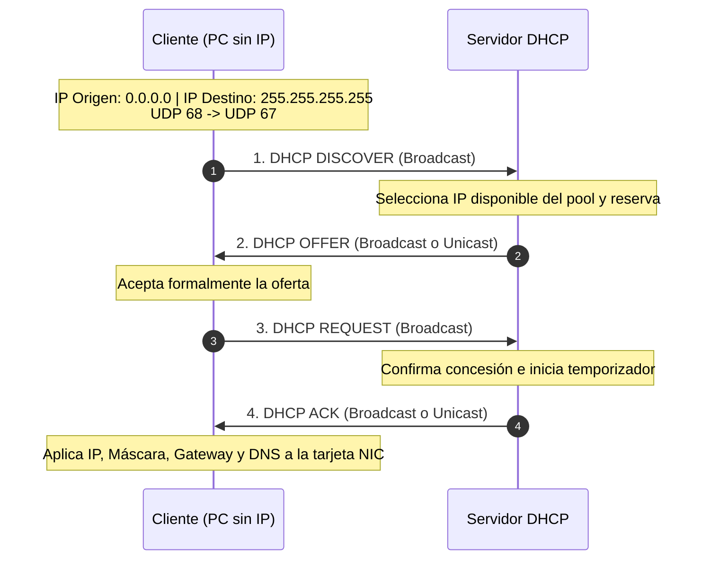
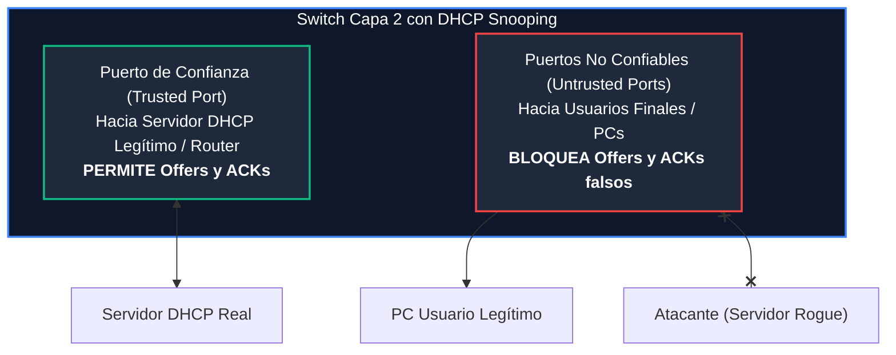

# Módulo 2: Capa de Aplicación
## Tema 2.3: DHCP Exhaustivo (Trama BOOTP/DHCP, Transición DORA y DHCP Snooping)

---

### 1. Anatomía Binaria de la Trama DHCP / BOOTP (RFC 2131)

DHCP es una extensión directa del protocolo histórico **BOOTP**. Su formato de mensaje encapsulado en UDP (puertos 67 servidor / 68 cliente) tiene una longitud mínima de **240 bytes** más el campo de opciones.

En una cuadrícula de **32 bits**, sus campos se distribuyen de la siguiente forma:

| Fila de 32 Bits | Bytes 0 – 1 | Bytes 2 – 3 |
| :---: | :--- | :--- |
| **Palabra 1 (Bytes 0-3)** | `op` (1B: 1=Req, 2=Reply) \| `htype` (1B) | `hlen` (1B: MAC=6) \| `hops` (1B) |
| **Palabra 2 (Bytes 4-7)** | **Transaction ID (`xid`)** (4 bytes completos) | |
| **Palabra 3 (Bytes 8-11)**| **Seconds elapsed (`secs`)** (2B) | **Flags de difusión** (2B: Broadcast Flag) |
| **Palabra 4 (Bytes 12-15)**| **Client IP Address (`ciaddr`)** (4 bytes completos - IP actual si renueva) | |
| **Palabra 5 (Bytes 16-19)**| **Your IP Address (`yiaddr`)** (4 bytes completos - IP ofrecida por servidor) | |
| **Palabra 6 (Bytes 20-23)**| **Next Server IP (`siaddr`)** (4 bytes completos - Servidor TFTP/PXE) | |
| **Palabra 7 (Bytes 24-27)**| **Relay Gateway IP (`giaddr`)** (4 bytes completos - IP del router DHCP Relay) | |
| **Bytes 28 – 43** | **Client Hardware Address (`chaddr`)** (16 bytes - Dirección MAC física) | |
| **Bytes 44 – 107** | **Server Host Name (`sname`)** (64 bytes opcionales) | |
| **Bytes 108 – 235**| **Boot File Name (`file`)** (128 bytes opcionales para arranque en red) | |
| **Bytes 236 – 239**| **Magic Cookie** (`0x63 0x82 0x53 0x63` - 4 bytes fijos que inician las opciones) | |
| **Bytes 240+** | **Opciones DHCP** (Tipo de mensaje, Máscara, Gateway, DNS, Lease Time) | |

#### Descripción Rigurosa de Campos de Examen:
1. **`op` (Message Opcode - 1 byte):** `1` = BOOTREQUEST (enviado por cliente); `2` = BOOTREPLY (enviado por servidor).
2. **`htype` / `hlen` (Hardware Type / Length - 1 byte c/u):** Para Ethernet, `htype = 1` y `hlen = 6` (6 bytes = 48 bits de dirección MAC).
3. **`hops` (1 byte):** Contador incrementado por los routers DHCP Relay. Si supera 16 saltos, el paquete se descarta para evitar bucles.
4. **`xid` (Transaction ID - 4 bytes):** Identificador pseudoaleatorio generado por el cliente para correlacionar la respuesta con su petición.
5. **`ciaddr` (Client IP Address - 4 bytes):** Dirección IP actual del cliente. **Solo es distinta de 0.0.0.0 cuando el cliente renueva una IP ya asignada**.
6. **`yiaddr` (Your IP Address - 4 bytes):** La dirección IP que el servidor le está otorgando al cliente.
7. **`siaddr` (Next Server IP Address - 4 bytes):** Dirección IP del servidor TFTP que el cliente debe consultar para arrancar por red (PXE boot).
8. **`giaddr` (Gateway / Relay IP Address - 4 bytes):** ¡Pregunta fija de examen! Cuando un router actúa como **DHCP Relay Agent** (`ip helper-address`), escribe la IP de su interfaz local en este campo para que el servidor DHCP sepa de **qué subred física debe extraer la IP del pool**.
9. **`chaddr` (Client Hardware Address - 16 bytes):** Dirección MAC de la tarjeta de red del cliente.
10. **Magic Cookie (4 bytes):** Los 4 bytes fijos `0x63 0x82 0x53 0x63` que indican el inicio del área de opciones DHCP.

---

### 2. El Ciclo de Concesión: El Proceso DORA

#### Matriz de Estados de Campos en el Proceso DORA:

| Campo del Paquete | 1. DHCP DISCOVER | 2. DHCP OFFER | 3. DHCP REQUEST | 4. DHCP ACK |
| :--- | :---: | :---: | :---: | :---: |
| **`op`** | 1 (Request) | 2 (Reply) | 1 (Request) | 2 (Reply) |
| **IP Origen (Capa 3)** | `0.0.0.0` | `IP_Servidor` | `0.0.0.0` | `IP_Servidor` |
| **IP Destino (Capa 3)** | `255.255.255.255` | `255.255.255.255` o Unicast | `255.255.255.255` | `255.255.255.255` o Unicast |
| **`ciaddr` (Client IP)** | `0.0.0.0` | `0.0.0.0` | `0.0.0.0` | `0.0.0.0` |
| **`yiaddr` (Your IP)** | `0.0.0.0` | **IP Asignada (ej. .10)** | `0.0.0.0` | **IP Asignada (ej. .10)** |
| **`chaddr` (Client MAC)** | MAC de la PC | MAC de la PC | MAC de la PC | MAC de la PC |
| **Option 53 (Tipo)** | `1` (Discover) | `2` (Offer) | `3` (Request) | `5` (ACK) |

---

### 3. Seguridad en Capa 2: Ataques DHCP y DHCP Snooping

Dado que DHCP no incluye autenticación nativa, las redes locales son vulnerables a dos ataques letales:

#### A. Ataque de Inanición DHCP (DHCP Starvation Attack)
* Un atacante ejecuta una herramienta (como *Yersinia*) que envía millones de mensajes `DHCP Discover` falsificados con direcciones MAC ficticias en `chaddr`.
* **Efecto:** Agota en cuestión de segundos todo el rango (*Pool*) de direcciones IP del servidor legítimo. Los usuarios reales no pueden obtener IP.

#### B. Servidor DHCP Malicioso (Rogue DHCP Server / Man-in-the-Middle)
* Tras agotar el servidor legítimo, el atacante enciende su propio servidor DHCP en la red.
* Entrega a las víctimas su propia IP como **Default Gateway** y sus propios servidores DNS.
* **Efecto:** Todo el tráfico bancario, contraseñas y correos de los usuarios pasa a través de la computadora del atacante antes de salir a Internet.

#### C. La Solución Cisco: DHCP Snooping

1. **Trusted Ports (Puertos de Confianza):** Puertos conectados hacia el servidor DHCP legítimo o enlaces troncales hacia el Router. Se les permite reenviar todos los mensajes DHCP.
2. **Untrusted Ports (Puertos No Confiables):** Todos los puertos de acceso donde se conectan usuarios finales. **El switch descarta y bloquea automáticamente cualquier mensaje `DHCP Offer` o `DHCP ACK` que provenga de un puerto no confiable**, impidiendo la existencia de servidores DHCP piratas.
3. **DHCP Snooping Binding Database:** El switch construye una tabla segura en memoria que mapea `MAC + IP Asignada + Puerto Físico + VLAN`, la cual sirve como base para evitar ataques de suplantación de ARP (*Dynamic ARP Inspection - DAI*).
