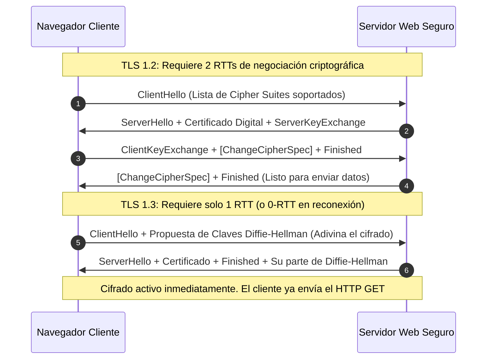

# Módulo 2: Capa de Aplicación
## Tema 2.4: Evolución de Protocolos Web (HTTP/1.1, HTTP/2, HTTP/3 y Cifrado TLS 1.3)

---

### 1. La Evolución Histórica de la Web: Del Texto Plano al Transporte Binario

| Parámetro | HTTP/1.0 (1996) | HTTP/1.1 (1997 - RFC 2616/7230) | HTTP/2 (2015 - RFC 7540) | HTTP/3 (2022 - RFC 9114) |
| :--- | :--- | :--- | :--- | :--- |
| **Transporte Capa 4** | TCP | TCP | TCP | **QUIC sobre UDP** |
| **Manejo de Conexiones** | 1 conexión TCP por cada objeto individual (Cierre inmediato tras recibir) | **Persistent Connections (`Keep-Alive`)** y *Pipelining* teórico | **1 sola conexión TCP multiplexada** para todos los recursos del dominio | Conexión UDP única independiente de cambios de IP/red |
| **Formato de Mensaje** | Texto plano legible | Texto plano legible | **Binario estructurado (Frames)** | **Binario estructurado (Frames QPACK)** |
| **Compresión de Cabeceras**| Ninguna | Ninguna | **HPACK** (Diccionario dinámico de cabeceras) | **QPACK** (Adaptado para evitar bloqueos en UDP) |
| **Bloqueo Head-of-Line**| Crítico | **Presente en Capa de Aplicación** (peticiones en fila FIFO) | Resuelto en Capa de Aplicación, pero **presente en Capa de Transporte TCP** | **Completamente Eliminado** en todas las capas |

---

### 2. El Problema del Bloqueo Head-of-Line (HoL Blocking) y cómo se resolvió

Este es el concepto arquitectónico más preguntado en cursos avanzados de redes:

#### A. En HTTP/1.1 (Bloqueo en Capa de Aplicación):
* Aunque `Keep-Alive` permitía reutilizar el socket TCP sin cerrarlo, las peticiones debían responderse en estricto orden secuencial (**FIFO**).
* Si una página web solicita un archivo HTML, un script pesado `script.js` y 10 imágenes, y el procesamiento del `script.js` tarda 2 segundos en el servidor, **las 10 imágenes quedan totalmente congeladas en cola** esperando que termine el script.
* *Solución improvisada de los navegadores:* Abrir hasta 6 conexiones TCP simultáneas en paralelo por dominio, lo que multiplicaba el consumo de memoria en los servidores.

#### B. En HTTP/2 (Multiplexación Binaria sobre 1 Conexión TCP):
* Divide los mensajes en fragmentos binarios llamados **Frames** (marcardos con un *Stream ID*).
* Permite intercalar imágenes, CSS y scripts sobre el mismo socket TCP sin esperar a que termine el anterior.
* **El nuevo problema (HoL en Capa de Transporte):** Si en la red intermedia de Internet se pierde un solo paquete TCP (un fragmento de una imagen), **el stack TCP del kernel congela todo el búfer de recepción** para retransmitir ese fragmento perdido, frenando a todos los demás *streams* independientes.

#### C. En HTTP/3 (QUIC sobre UDP):
* Al abandonar TCP y correr sobre datagramas UDP, cada *stream* es completamente independiente a nivel de transporte. Si se pierde un paquete del *stream* de la imagen, el navegador sigue reproduciendo el audio y renderizando el texto sin ningún retraso.

---

### 3. Cifrado TLS: Comparativa del Handshake TLS 1.2 vs. TLS 1.3

HTTPS utiliza **TLS (Transport Layer Security)**. La versión **TLS 1.3 (RFC 8446)** revolucionó la seguridad al eliminar algoritmos criptográficos débiles y reducir a la mitad la latencia de conexión:

* **TLS 1.2:** Demoraba **2 RTT completos** solo para acordar la clave de cifrado (sumados al 1 RTT previo del Three-Way Handshake TCP, totalizaba **3 RTTs** antes de enviar el primer byte útil).
* **TLS 1.3:** Reduce la negociación a **1 solo RTT** al enviar las propuestas criptográficas (*Key Share*) en el mismo primer mensaje `ClientHello`.
* **0-RTT Resumption (Early Data):** Si el cliente ya había visitado el sitio web previamente, puede enviar datos de aplicación cifrados en el mismísimo primer paquete de la conexión, logrando carga instantánea.
