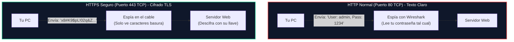
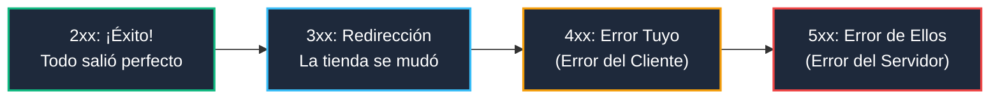

# Módulo 2: Capa de Aplicación
## Tema 2.4: Servicios Web (HTTP, HTTPS y Códigos de Error Explicados Fácil)

---

### 📖 Mini Diccionario para Empezar

* **HTTP (HyperText Transfer Protocol):** El protocolo para cargar páginas web en texto plano sin seguridad.
* **HTTPS (HTTP Secure):** Lo mismo, pero envuelto en una capa de seguridad y cifrado (**TLS/SSL**) para que nadie pueda espiar lo que haces.
* **Cifrado:** Convertir un texto legible (como tu contraseña *"umg2026"*) en un revoltijo incomprensible de letras y números (`a8F#9x!z01...`) para que solo el destinatario con la clave matemática pueda leerlo.
* **Certificado Digital:** El "DPI" o pasaporte digital de un sitio web. Garantiza que cuando entras a tu banco realmente estás en la máquina del banco y no en la de un estafador.
* **Código de Estado (Status Code):** Un número de 3 dígitos que el servidor te devuelve para decirte si tu petición tuvo éxito o qué fue lo que falló.

---

### 1. HTTP vs. HTTPS: La Postal vs. La Caja Fuerte

| Parámetro | HTTP (No Seguro) | HTTPS (Seguro y Cifrado) |
| :--- | :--- | :--- |
| **Puerto Estándar** | **Puerto 80 TCP** | **Puerto 443 TCP** |
| **La Analogía** | **Una Tarjeta Postal:** Cualquier cartero, empleado del ISP o persona conectada a tu mismo Wi-Fi puede leer lo que escribiste en el camino. | **Una Caja Fuerte con Candado:** Solo el servidor y tú tienen la llave. Quien espíe el cable solo verá datos ilegibles. |
| **En el Navegador** | Muestra una advertencia roja: *"Sitio no seguro"*. | Muestra un **candadito gris o verde** de conexión segura. |
| **Uso actual** | Obsoleto. Casi prohibido en sitios reales. | **Obligatorio** en todo Internet (bancos, redes sociales, correo). |

---

### 2. Los Métodos HTTP (Lo que le pides al servidor que haga)

Cuando tu navegador habla con el servidor web, utiliza pequeños comandos llamados **Métodos o Verbos**:

* **`GET` (Dame):** Pide un recurso sin modificar nada. Cuando entras a ver una foto o leer una noticia, tu navegador hace un `GET`.
* **`POST` (Toma y guarda):** Envía información al servidor para procesarla. Cuando escribes tu usuario y contraseña en el login y presionas *"Iniciar Sesión"*, tu navegador hace un `POST`.
* **`PUT` (Actualiza):** Reemplaza un archivo existente por uno nuevo.
* **`DELETE` (Borra):** Solicita eliminar un recurso del servidor.

---

### 3. Los Códigos de Estado Explicados con la Vida Real

Cuando el servidor te responde, incluye un código de 3 dígitos. La primera cifra te dice la categoría del resultado:

#### Los Códigos Fijos de Examen:
* **`200 OK`:** ¡Todo perfecto! El servidor encontró la página y te la muestra en pantalla.
* **`301 Moved Permanently`:** La página se mudó de dirección para siempre. El navegador te lleva automáticamente a la nueva dirección web.
* **`401 Unauthorized`:** El guardia te detiene en la puerta: *"Debes ingresar tu usuario y contraseña primero"*.
* **`403 Forbidden`:** El guardia sabe quién eres, pero te dice: *"Tú no tienes permiso de entrar a esta oficina restringida"*.
* **`404 Not Found` (El más famoso de Internet):** Escribiste mal la dirección web o la página fue borrada del servidor. El archivo no existe.
* **`500 Internal Server Error`:** Al cocinero se le quemó la cocina. El servidor web falló internamente por un error de programación o base de datos.
* **`503 Service Unavailable`:** El servidor está saturado con demasiados usuarios a la vez o está apagado por mantenimiento temporal.

---

### 4. Preguntas Típicas de Examen

**P1: ¿Qué puerto y protocolo de transporte utiliza una conexión HTTPS segura?**
> **R:** Utiliza el puerto **443** sobre el protocolo **TCP**.

**P2: ¿Cuál es la diferencia entre un código de error `404` y un código de error `500`?**
> **R:** El error `404 Not Found` es un error del cliente (el archivo o URL solicitada no existe en el servidor). El error `500 Internal Server Error` es un error del servidor (la máquina falló internamente al procesar la solicitud).

**P3: ¿Qué método HTTP se utiliza cuando un usuario llena un formulario con su contraseña y hace clic en "Ingresar"?**
> **R:** El método **POST** (porque envía datos en el cuerpo del mensaje para ser procesados por el servidor).
