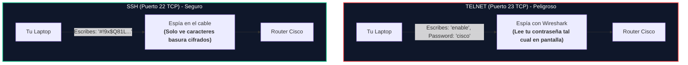
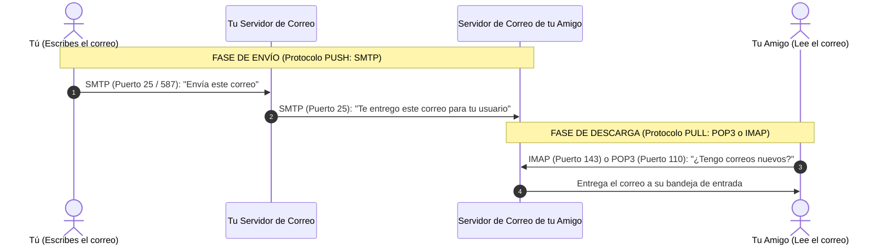

# Módulo 2: Capa de Aplicación
## Tema 2.5: Transferencia de Archivos, Terminal Remota y Correo Electrónico

---

### 📖 Mini Diccionario para Empezar

* **Acceso Remoto / Terminal:** Entrar a controlar una computadora, router o switch a través de una pantalla negra de comandos desde tu casa sin tener que estar físicamente parado frente a la máquina.
* **Texto Plano (Plaintext):** Texto normal sin protección; cualquiera que lo mire con un programa espía lo puede leer de inmediato.
* **Cifrado:** Texto protegido matemáticamente que solo tú y la otra máquina pueden descifrar.
* **Protocolo Push (Empujar):** Mandar cosas hacia adelante (como enviar un correo).
* **Protocolo Pull (Jalar):** Descargar o jalar cosas que están guardadas esperándote en un buzón.

---

### 1. Transferencia de Archivos: FTP vs. TFTP

| Característica | FTP (File Transfer Protocol) | TFTP (Trivial File Transfer Protocol) |
| :--- | :--- | :--- |
| **La Analogía** | **Un Camión de Mudanzas Profesional:** Con chofer calificado, lista de inventario firmada y candado con llave. | **Lanzar una piedra con una nota:** Muy liviano y rápido, sin identificaciones ni inventario. |
| **Protocolo Capa 4** | **TCP** (Orientado a conexión, confiable). | **UDP** (Sin conexión, sin confirmación). |
| **Puertos de Red** | **Puerto 21 (Control) y Puerto 20 (Datos)**. | **Puerto 69**. |
| **¿Pide Contraseña?** | **Sí**, requiere usuario y contraseña. | **No**, no tiene autenticación. |
| **Uso Principal** | Subir páginas web a un servidor o compartir archivos entre empresas. | Cargar o respaldar el sistema operativo de red (**Cisco IOS**) en routers y switches. |

---

### 2. Acceso Remoto por Terminal: Telnet vs. SSH

Imagina que estás en tu casa y necesitas entrar a configurar un Router de la UMG:

* **Telnet (Puerto 23 TCP):** Es antiquísimo. Manda todo en texto plano. **Prohibido usarlo en la vida real** porque cualquiera en la red puede robarte las contraseñas de los switches y routers.
* **SSH - Secure Shell (Puerto 22 TCP):** Cifra absolutamente toda la sesión. Es el **estándar mundial obligatorio** para administrar equipos Cisco, servidores Linux y routers.

---

### 3. El Correo Electrónico: ¿Cómo viaja un mensaje?

El correo electrónico no funciona con un solo protocolo; necesita un protocolo para **enviar** y otro protocolo para **recibir**:

#### A. Protocolo de Envío: SMTP (Simple Mail Transfer Protocol)
* **¿Qué hace?** Es el cartero. Empuja el correo desde tu computadora hacia tu servidor, y de tu servidor al servidor del destinatario.
* **Puertos:** Puerto **25 TCP** (entre servidores) y puerto **587 TCP** (cuando mandas un correo desde tu celular con clave).

#### B. Protocolos de Recepción: POP3 vs. IMAP (La Gran Diferencia)

* **POP3 (Puerto 110 TCP - Descarga y Borra):**
  * Funciona como el casillero físico de tu casa: el cartero deja la carta, tú abres el casillero, te llevas la carta a tu mesa y **el casillero queda vacío**.
  * Si lees el correo en tu computadora de escritorio, se descarga a tu disco duro y se borra de Internet. Cuando más tarde abras tu celular, **¡el correo ya no estará!**.
* **IMAP (Puerto 143 TCP - Sincronizado en la Nube):**
  * Funciona como una vitrina de exhibición: el correo se queda guardado para siempre en el servidor.
  * Si abres el correo en tu computadora, tu teléfono y tu tablet saben al mismo tiempo que ya lo leíste. Si creas una carpeta en tu celular, aparece automáticamente en tu computadora. **Es el protocolo que usamos todos hoy en día.**

---

### 4. Preguntas Típicas de Examen

**P1: ¿Cuál es la diferencia principal entre Telnet y SSH?**
> **R:** Telnet envía toda la información (incluyendo contraseñas) en texto plano sin cifrar por el puerto 23 TCP, mientras que SSH cifra completamente toda la sesión de terminal por el puerto 22 TCP.

**P2: Si un usuario quiere revisar sus correos desde varios dispositivos a la vez sin perder mensajes, ¿qué protocolo debe configurar?**
> **R:** Debe configurar **IMAP** (puerto 143 TCP), ya que mantiene los correos y carpetas sincronizados centralmente en el servidor, a diferencia de POP3 que los descarga y los borra localmente.

**P3: ¿Qué protocolo de transferencia de archivos utiliza UDP en el puerto 69 y no requiere autenticación?**
> **R:** El protocolo **TFTP** (Trivial File Transfer Protocol).
