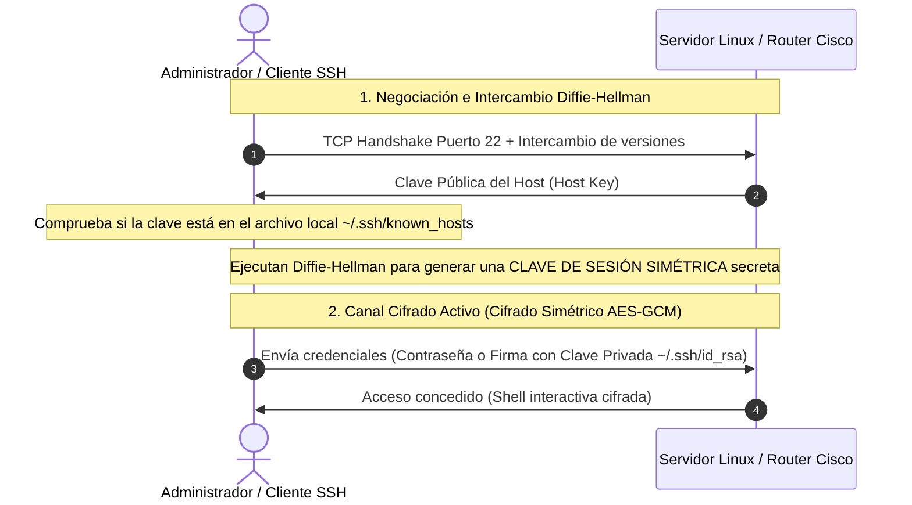
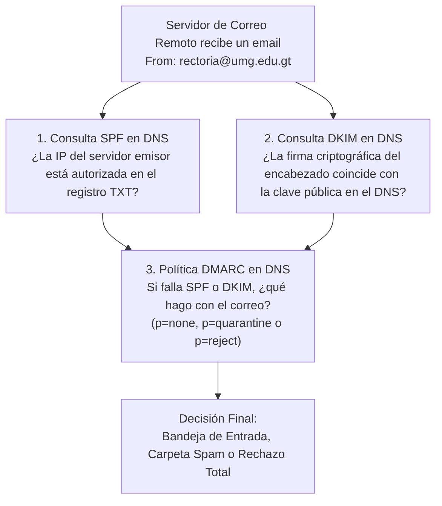

# Módulo 2: Capa de Aplicación
## Tema 2.5: Servicios Críticos de Infraestructura (FTP, SSH y Correo con SPF/DKIM/DMARC)

---

### 1. El Dilema de FTP a través de Firewalls y NAT (Modo Activo vs. Pasivo)

FTP es uno de los protocolos más antiguos de Internet (RFC 959). Su diseño de doble canal genera serios conflictos con los firewalls modernos si no se comprende su arquitectura:

#### A. Modo Activo (Active FTP)
1. El cliente se conecta desde un puerto dinámico `N` hacia el **puerto 21 TCP del servidor** (Canal de Control) y envía el comando:  
   `PORT IP_Cliente, Puerto_Datos_M` (donde $M = N+1$).
2. Para transmitir los datos, **el servidor inicia una conexión TCP inversa desde su puerto 20 TCP hacia el puerto M del cliente**.
* **Falla clásica en examen:** Si el cliente está detrás de un router doméstico o firewall con NAT (como casi todos hoy en día), **el firewall del cliente bloquea la conexión entrante del servidor en el puerto M**, considerándola un ataque no solicitado. El comando `LIST` o la descarga se congela indefinidamente.

#### B. Modo Pasivo (Passive FTP - PASV)
1. El cliente se conecta al puerto 21 del servidor y envía el comando `PASV`.
2. El servidor abre un puerto dinámico no privilegiado en su propio sistema (ej. `Puerto 49500`) y se lo envía al cliente.
3. **El cliente es quien inicia la conexión de datos** hacia el puerto `49500` del servidor.
* **Ventaja:** Como ambas conexiones (control y datos) son iniciadas hacia afuera por el cliente, los firewalls con seguimiento de estado (*Stateful Inspection*) permiten la salida sin problemas. Es el modo configurado por defecto en todos los navegadores y clientes modernos como FileZilla.

---

### 2. Criptografía en SSH (Secure Shell - Puerto 22 TCP)

SSH reemplazó a Telnet y a los comandos Berkeley r-services (`rlogin`, `rsh`) porque garantiza confidencialidad, integridad y autenticación mutua mediante un esquema criptográfico híbrido:



1. **Autenticación del Servidor (`known_hosts`):** Evita ataques *Man-in-the-Middle*. Si la huella digital (*fingerprint*) del servidor cambia repentinamente, SSH emite la famosa alerta roja: `WARNING: REMOTE HOST IDENTIFICATION HAS CHANGED!`.
2. **Intercambio Diffie-Hellman:** Permite que cliente y servidor acuerden una clave secreta compartida a través de un canal inseguro sin que nadie que espíe el cable pueda deducirla.
3. **Cifrado de Sesión:** Tras acordar la clave secreta, todo el tráfico (comandos, contraseñas, salidas de terminal) se cifra con algoritmos simétricos ultra veloces como **AES-256-GCM** o **ChaCha20-Poly1305**.

---

### 3. El Trío de Seguridad del Correo Electrónico (SPF, DKIM y DMARC)

El protocolo de envío de correo **SMTP (Puerto 25/587)** no tiene ningún mecanismo para verificar la identidad del emisor; cualquiera puede enviar un paquete SMTP afirmando ser `rectoria@umg.edu.gt`. Para evitar el fraude y la suplantación (*Spoofing*), se utilizan tres tecnologías combinadas en el DNS:



1. **SPF (Sender Policy Framework - Registro TXT en DNS):**  
   El dueño del dominio publica una lista de las únicas direcciones IP autorizadas para enviar correos en su nombre:
   ```text
   umg.edu.gt.  IN  TXT  "v=spf1 ip4:200.10.15.25 include:_spf.google.com -all"
   ```
   *(El `-all` indica que cualquier servidor que no esté en esa lista debe ser rechazado).*
2. **DKIM (DomainKeys Identified Mail - Criptografía Asimétrica):**  
   El servidor emisor firma digitalmente el cuerpo del correo con su clave privada y añade el encabezado `DKIM-Signature`. El servidor receptor busca la clave pública correspondiente en el registro DNS del emisor y valida que el correo no fue alterado en tránsito.
3. **DMARC (Domain-based Message Authentication, Reporting, and Conformance):**  
   Le dice al servidor de destino qué política aplicar si fallan SPF o DKIM:
   * `p=none`: Solo monitorear y generar reportes.
   * `p=quarantine`: Enviar el correo sospechoso a la carpeta de Spam / Correo no deseado.
   * `p=reject`: Rechazar y destruir el correo inmediatamente a nivel de servidor SMTP.
