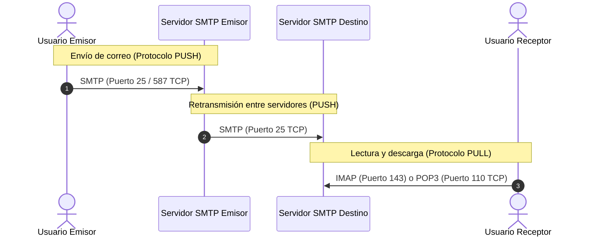

# Módulo 2: Capa de Aplicación
## Tema 2.5: Transferencia de Archivos, Acceso Remoto y Correo Electrónico

---

### 1. Protocolos de Transferencia de Archivos: FTP vs. TFTP

| Característica | FTP (File Transfer Protocol - RFC 959) | TFTP (Trivial File Transfer Protocol - RFC 1350) |
| :--- | :--- | :--- |
| **Protocolo Capa 4** | **TCP** (Orientado a conexión, confiable) | **UDP** (No orientado a conexión, no confiable) |
| **Puertos Utilizados** | **Puerto 21 (Control) y Puerto 20 (Datos)** | **Puerto 69** |
| **Autenticación** | Requiere usuario y contraseña (o anónimo) | Sin autenticación |
| **Estructura y Comandos**| Complejo (permite listar directorios, renombrar, permisos) | Muy simple (solo permite `Read` y `Write` directo) |
| **Uso Principal** | Transferencia de archivos entre servidores y usuarios | Respaldo o carga de imágenes IOS y configuraciones en routers/switches Cisco |

#### Funcionamiento de los Dos Canales de FTP:
FTP es peculiar porque utiliza **dos conexiones TCP simultáneas**:
* **Conexión de Control (Puerto 21 TCP):** Se mantiene abierta durante toda la sesión para enviar comandos de texto (`USER`, `PASS`, `LIST`, `QUIT`) y recibir respuestas del servidor.
* **Conexión de Datos (Puerto 20 TCP en modo activo):** Se abre y cierra dinámicamente cada vez que se transfiere un archivo o se lista un directorio.
  * *Modo Activo:* El cliente abre un puerto y el servidor inicia la conexión de datos desde su puerto 20 hacia el cliente (frecuentemente bloqueado por firewalls de clientes).
  * *Modo Pasivo (PASV):* El cliente solicita al servidor que abra un puerto aleatorio de datos, y es el cliente quien inicia la conexión hacia el servidor (amigable con firewalls).

---

### 2. Acceso Remoto por Terminal: Telnet vs. SSH

| Parámetro | Telnet (Telecommunications Network - RFC 854) | SSH (Secure Shell - RFC 4251) |
| :--- | :--- | :--- |
| **Puerto Estándar** | **Puerto 23 TCP** | **Puerto 22 TCP** |
| **Seguridad de Datos** | **Texto Claro (Plaintext):** Cualquier persona con Wireshark puede leer usuarios, contraseñas y comandos. | **Completamente Cifrado:** Protege la confidencialidad e integridad del tráfico de extremo a extremo. |
| **Mecanismo Criptográfico** | Ninguno. | Cifrado asimétrico (autenticación) y simétrico (sesión). |
| **Recomendación Cisco/UMG**| **Prohibido en producción.** Solo para laboratorios educativos iniciales. | **Estándar obligatorio** para administrar routers, switches y servidores. |

---

### 3. Protocolos de Correo Electrónico (E-mail)

El correo electrónico no utiliza un solo protocolo, sino una combinación de protocolos de **Envío (Push)** y de **Descarga/Acceso (Pull)**:

#### A. Protocolo de Envío: SMTP (Simple Mail Transfer Protocol - RFC 5321)
* **Función:** Envía correos desde el cliente hacia el servidor de correo emisor, y retransmite correos entre servidores de correo a través de Internet.
* **Mecanismo:** Es un protocolo de tipo **Push** (empuja los datos hacia adelante).
* **Puertos:** 
  * Puerto **25 TCP** (comunicación histórica servidor a servidor).
  * Puerto **587 TCP** (envío seguro cliente a servidor con autenticación STARTTLS).

#### B. Protocolos de Recuperación: POP3 vs. IMAP

| Característica | POP3 (Post Office Protocol v3) | IMAP (Internet Message Access Protocol) |
| :--- | :--- | :--- |
| **Puerto Estándar** | **Puerto 110 TCP** (o **995 con SSL/TLS**) | **Puerto 143 TCP** (o **993 con SSL/TLS**) |
| **Filosofía de Trabajo** | **Descarga y Borra:** Descarga los correos al almacenamiento local de la computadora y los elimina del servidor. | **Sincronización en el Servidor:** Los correos y carpetas permanecen almacenados centralmente en el servidor. |
| **Acceso multidispositivo**| Muy malo: Si lees un correo en la PC, desaparece y ya no lo ves en tu celular. | **Excelente:** Cambios, leídos, borradores y carpetas se sincronizan en tiempo real en todos tus dispositivos. |
| **Consumo de espacio** | Libera espacio en el servidor de correo. | Requiere buzones con mayor capacidad de almacenamiento en el servidor. |

---

### 4. Banco de Preguntas de Examen (Tipo UMG - Módulo 2)

**1. ¿Qué puertos utiliza el protocolo FTP y para qué sirve cada uno?**
> **R:** Utiliza el puerto **21 TCP para Control** (autenticación y envío de comandos) y el puerto **20 TCP para Datos** (transferencia real de archivos).

**2. ¿Cuál es la diferencia fundamental entre Telnet y SSH?**
> **R:** Telnet transmite toda la información (incluyendo contraseñas) en texto plano sin cifrar por el puerto 23 TCP, mientras que SSH cifra toda la sesión de terminal utilizando criptografía por el puerto 22 TCP.

**3. Si un usuario desea leer sus correos desde su laptop de oficina, su teléfono y su tablet manteniendo sincronizadas sus carpetas y correos leídos, ¿qué protocolo de recuperación debe configurar?**
> **R:** Debe configurar **IMAP** (puerto 143 / 993 TCP), ya que mantiene el estado y los correos centralizados en el servidor, a diferencia de POP3 que descarga y borra localmente.

**4. ¿Por qué el protocolo TFTP es utilizado para respaldar el sistema operativo Cisco IOS en lugar de FTP o HTTP?**
> **R:** Porque TFTP utiliza UDP (puerto 69), es extremadamente simple, no requiere autenticación y requiere una huella de memoria mínima en la memoria ROM o flash del dispositivo de red.
