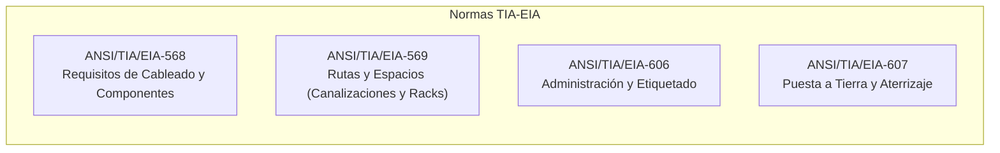

# Módulo 3: Cableado Estructurado
## Tema 3.1: Normativa y Estándares Internacionales (ANSI / TIA / EIA / ISO)

---

### 1. ¿Qué es el Cableado Estructurado?
El **Cableado Estructurado** es una infraestructura de telecomunicaciones unificada, estandarizada y modular instalada dentro de un edificio o campus. Permite transmitir voz, datos, video y sistemas de control mediante un único sistema físico planificado, eliminando el desorden de cables individuales propietarios.

---

### 2. Principales Organismos de Estandarización

* **ANSI (American National Standards Institute):** Organización sin fines de lucro que supervisa y acredita el desarrollo de normas voluntarias en los Estados Unidos.
* **TIA (Telecommunications Industry Association):** Asociación comercial que desarrolla estándares para equipos de telecomunicaciones y tecnologías de la información.
* **EIA (Electronic Industries Alliance):** Antigua alianza de organizaciones comerciales electrónicas (acreditó los estándares junto con TIA).
* **ISO / IEC (International Organization for Standardization / International Electrotechnical Commission):** Organismos globales; emiten la norma internacional equivalente **ISO/IEC 11801**.
* **IEEE (Institute of Electrical and Electronics Engineers):** Define estándares de capa de enlace y física de redes locales (ej. IEEE 802.3 para Ethernet).

---

### 3. Las Cuatro Normas Clave de Examen (Familia TIA/EIA)

En evaluaciones de redes y proyectos de infraestructura física de telecomunicaciones, debes memorizar cuatro normas primordiales:

#### A. ANSI/TIA/EIA-568: Alambrado de Telecomunicaciones para Edificios Comerciales
* **Propósito:** Especifica los requisitos mínimos de componentes, topología, distancias, rendimientos y tipos de cable para oficinas y edificios.
* **Subdivisión moderna:**
  * **568.0:** Cableado genérico para instalaciones de clientes.
  * **568.1:** Cableado de infraestructura para edificios comerciales.
  * **568.2:** Componentes y cableado de par trenzado de cobre (*Balanced Twisted-Pair*).
  * **568.3:** Componentes de cableado de fibra óptica.
* **Regla de oro:** Dicta la **topología obligatoria en Estrella Jerárquica** y el límite de **100 metros** en el canal horizontal.

#### B. ANSI/TIA/EIA-569: Rutas y Espacios de Telecomunicaciones
* **Propósito:** Estandariza el diseño arquitectónico de ductos, bandejas portacables, tuberías conduit, piso falso, cielo falso y los cuartos técnicos (MDF, IDF).
* **Reglas de diseño clave:**
  * **Factor de ocupación de tubería / canaleta:** Un ducto o canalización no debe llenarse a más del **40% de su capacidad en la instalación inicial**, permitiendo hasta un máximo de **60% para crecimiento futuro**.
  * No más de **dos curvas de 90 grados** (180 grados acumulados) continuas en un tramo de tubería conduit sin colocar una caja de paso (*Pull Box*).
  * Los cuartos de telecomunicaciones deben tener piso antiestático, iluminación adecuada (mínimo 500 lux a 1 metro sobre el suelo), temperatura controlada (18°C a 24°C) y humedad relativa entre 30% y 55%.

#### C. ANSI/TIA/EIA-606: Administración y Etiquetado de Infraestructura
* **Propósito:** Define cómo etiquetar e identificar de forma única e inequívoca cada elemento de la red: cables, tomas de pared, puertos de patch panel, gabinetes, racks y rutas.
* **Niveles de administración (Clases 1 a 4):** Desde edificios de una sola habitación hasta campus multi-edificios.
* **Requisito práctico:** Toda toma de pared (*Faceplate*) debe tener una etiqueta que indique a qué cuarto técnico (TR/IDF), rack, patch panel y número de puerto exacto se conecta (ej. `IDF1-RK01-PP02-P14`).

#### D. ANSI/TIA/EIA-607: Puesta a Tierra y Aterrizaje para Telecomunicaciones
* **Propósito:** Requisitos de conexión a tierra para proteger al personal y a los equipos de descargas electrostáticas, corrientes parásitas y transitorios electromagnéticos.
* **Componentes principales:**
  * **TMGB (Telecommunications Main Grounding Busbar):** Barra principal de tierra ubicada en la entrada o MDF.
  * **TGB (Telecommunications Grounding Busbar):** Barra de tierra secundaria en cada cuarto de telecomunicaciones (IDF), unida a la TMGB mediante un conductor de cobre grueso (Backbone de tierra / TBB).
  * Todos los racks metálicos, gabinetes, patch panels blindados y bandejas metálicas deben estar aterrizados a la barra TGB.

---

### 4. Preguntas Clave de Examen (Tipo UMG)

**P1: ¿Cuál es la norma que rige el diseño de canalizaciones, tuberías y cuartos de cómputo?**
> **R:** La norma **ANSI/TIA/EIA-569**.

**P2: ¿Cuál es el porcentaje máximo de ocupación inicial recomendado para una canaleta o ducto según TIA-569?**
> **R:** Máximo **40% de ocupación inicial** (para permitir hasta un 60% en expansiones futuras).

**P3: ¿Qué topología física exige la norma TIA/EIA-568 para el cableado estructurado?**
> **R:** Exige una **topología en Estrella Jerárquica** (todo cable horizontal debe llegar a un único punto central de consolidación o Patch Panel).
