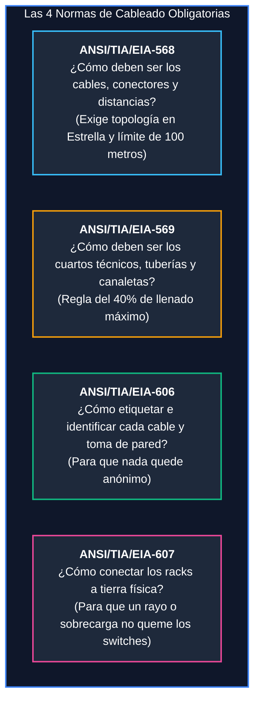

# Módulo 3: Cableado Estructurado
## Tema 3.1: Normativa y Estándares de Cableado (Explicado desde Cero)

---

### 📖 Mini Diccionario para Empezar

* **Cableado Estructurado:** Es la forma ordenada, limpia y estandarizada de meter cables en un edificio para que sirvan durante 15 o 20 años para computadoras, teléfonos, cámaras y servidores, sin que parezca un nido de pájaros desordenado.
* **Canaleta / Tubería Conduit:** Los tubos plásticos o metálicos que van pegados a la pared o escondidos en el cielo falso por donde viajan los cables protegidos del polvo y los roedores.
* **Topología en Estrella:** Significa que todos los cables de un piso viajan hacia un único punto central (como las puntas de una estrella hacia el centro). No se permite conectar cables en serie como luces de árbol navideño.
* **TIA / EIA / ANSI:** Organizaciones de ingenieros que se reunieron para escribir las "leyes y reglas del juego" de cómo instalar cables en el mundo para que los equipos de cualquier marca (Cisco, HP, Dell) funcionen igual de bien.

---

### 1. ¿Por qué necesitamos normas de cableado?

Imagina que contratas a dos electricistas diferentes para cablear un edificio de 4 pisos:
* Uno mete cables baratos sin protección.
* El otro pasa los cables de red pegados a los motores de los elevadores y a los cables de alta tensión de 220V, lo que genera una interferencia electromagnética que bota el Internet cada vez que alguien sube por el ascensor.
* Nadie etiquetó los cables: cuando una computadora falla, tienes que jalar cables a ciegas entre 500 cables idénticos de color azul.

Para evitar ese desastre, existen cuatro normas oficiales de la familia **ANSI/TIA/EIA** que debes memorizar para tu examen:

---

### 2. Las Reglas Prácticas de Cada Norma (Lo que pregunta el catedrático)

#### A. Norma ANSI/TIA/EIA-568 (Reglas de Cableado)
1. **Topología Obligatoria en Estrella Jerárquica:** Cada toma de pared de una oficina debe tener su propio cable exclusivo que viaje directo al cuarto de telecomunicaciones de su piso. Prohibido puentear cables.
2. **Límite Sagrado de 100 Metros:** La distancia total desde la computadora hasta el switch nunca debe pasar de 100 metros (90 metros en la pared + 10 metros en cables cortos).

#### B. Norma ANSI/TIA/EIA-569 (Rutas, Tuberías y Espacios)
1. **La Regla del 40% de Ocupación de Canaletas:** Al momento de instalar una canaleta o ducto de plástico, los cables solo deben ocupar hasta el **40% del espacio interior**. El 60% restante debe quedar vacío para ventilación y para poder meter más cables en el futuro si la empresa crece.
2. **Máximo 2 curvas de 90° continuas:** En un tubo cerrado no puedes hacer más de 2 vueltas de 90 grados seguidas sin poner una caja de paso de metal; de lo contrario, el cable se atasca y se rompe al jalarlo.
3. **Condiciones del cuarto técnico:** Debe tener aire acondicionado entre 18°C y 24°C, buena iluminación y puerta con llave.

#### C. Norma ANSI/TIA/EIA-606 (Etiquetado y Administración)
* Todo cable, toma de pared y puerto de switch debe tener una etiqueta impresa legible.
* Si una toma de pared dice `P1-RK1-PP2-14`, cualquier técnico sabe al instante: *"Piso 1, Rack 1, Patch Panel 2, Puerto 14"*, ahorrando horas de búsqueda.

#### D. Norma ANSI/TIA/EIA-607 (Aterrizaje y Tierra Física)
* Toda la infraestructura metálica (los racks de metal donde se atornillan los switches, las bandejas portacables del techo) debe estar conectada mediante cables de cobre verde a una barra de tierra principal (**TMGB**) para desviar descargas estáticas y rayos a la tierra sin dañar los aparatos electrónicos.

---

### 3. Preguntas Típicas de Examen

**P1: ¿Cuál es el porcentaje máximo de ocupación inicial permitido en una canaleta según la norma TIA-569?**
> **R:** Máximo **40% de ocupación inicial** (para dejar un 60% de holgura para expansiones futuras).

**P2: ¿Qué topología física exige la norma TIA-568 para el cableado estructurado?**
> **R:** Exige una **topología en Estrella Jerárquica**.

**P3: ¿Qué norma define el código de etiquetado e identificación de tomas y cables?**
> **R:** La norma **ANSI/TIA/EIA-606**.
