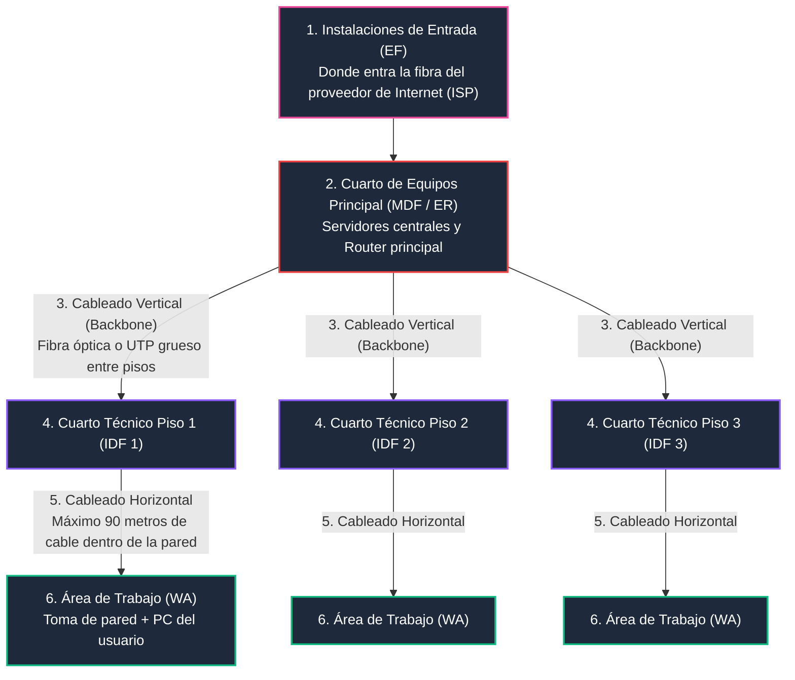
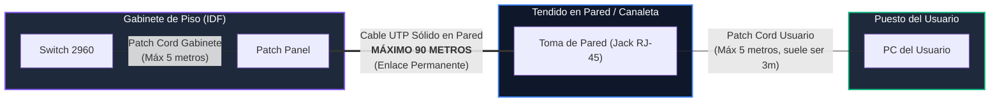

# Módulo 3: Cableado Estructurado
## Tema 3.2: Los 6 Subsistemas de Cableado (El Mapa Completo de un Edificio)

---

### 📖 Mini Diccionario de Piezas Físicas (Para que sepas qué compras)

* **Faceplate (Placa de pared):** La tapa plástica cuadrada atornillada a la pared donde enchufas el cable de red de tu computadora.
* **Jack RJ-45 (Keystone):** El cuadrito hembra que va encajado dentro de la placa de pared donde metes la espiga del cable.
* **Patch Cord (Cable de parcheo):** El cable de red corto y flexible (de 1 a 3 metros) con conectores macho en ambas puntas.
* **Patch Panel (Panel de conexiones):** Una regleta metálica de 24 o 48 puertos que se atornilla al rack. Por detrás se clavan los cables que vienen de las paredes del edificio, y por delante ofrece puertos limpios para conectar los switches con cables cortos.
* **Rack / Gabinete:** El mueble metálico (abierto como una torre o cerrado como un armario con puerta de vidrio) donde se atornillan ordenadamente los switches, routers y patch panels.
* **MDF (Main Distribution Frame / Cuarto Central):** El cuarto de cómputo principal del edificio (donde están los servidores y el router central que recibe el Internet de la calle).
* **IDF (Intermediate Distribution Frame / Cuarto de Piso):** El pequeño gabinete o cuarto técnico ubicado en cada piso para concentrar las computadoras de ese piso.

---

### 1. El Mapa de los 6 Subsistemas

La norma divide la red física de cualquier edificio en seis partes modulares e independientes:

---

### 2. Detalle de los 6 Subsistemas en Palabras Claras

1. **Instalaciones de Entrada (EF - Entrance Facility):**
   * El agujero o ducto subterráneo por donde entra el cable de fibra óptica de la empresa que te vende Internet (Claro, Tigo, etc.) desde la calle hacia el edificio.
   * Contiene el **Punto de Demarcación (Demarc)**: la cajita que marca la frontera legal (*"De la caja hacia la calle es culpa de Tigo/Claro; de la caja hacia adentro del edificio es responsabilidad de la universidad"*).
2. **Cuarto de Equipos (ER / MDF):**
   * El corazón del edificio. El cuarto frío con aire acondicionado donde están los servidores grandes y el router empresarial principal.
3. **Cableado Troncal / Vertical (Backbone):**
   * Las autopistas que suben de piso en piso uniendo los cuartitos de cada piso con el MDF central. Se usa **Fibra Óptica** o cable de cobre grueso **Cat 6A**.
4. **Cuarto de Telecomunicaciones de Piso (TR / IDF):**
   * Un gabinete o cuarto pequeño ubicado en el piso donde se reciben los cables de las oficinas de ese nivel. Contiene el **Patch Panel** y el **Switch de acceso** (ejemplo: Cisco Catalyst 2960).
5. **Cableado Horizontal (La regla métrica sagrada):**
   * Los cables que viajan por el techo o por canaletas desde el cuarto del piso hasta la pared donde está sentada la persona.
6. **Área de Trabajo (WA - Work Area):**
   * La placa de pared en el escritorio, el patch cord de 3 metros y la computadora del usuario.

---

### 3. La Regla de Oro de Distancias: 90m + 10m = 100m Máximo

Esta es la fórmula que más repiten los ingenieros en los exámenes:

$$\text{Cable en la pared (Enlace Permanente)} \le \mathbf{90 \text{ metros}}$$
$$\text{Patch Cords combinados (Gabinete + Escritorio)} \le \mathbf{10 \text{ metros}}$$
$$\mathbf{\text{Canal Total (Desde la PC hasta el Switch)}} \le \mathbf{100 \text{ metros}}$$

* **¿Por qué 100 metros y no más?** Porque la electricidad se desgasta conforme viaja por el cobre (**Atenuación**). Si el cable mide 105 o 120 metros, la señal llega tan débil que la tarjeta de red no la entiende o bota la conexión a cada rato.

---

### 4. ¿Por qué el cable de la pared es diferente al cable de tu escritorio?

* **Cable Sólido (Para la pared):** Adentro de cada hilo hay un solo alambre de cobre grueso y duro. Es perfecto para viajar 90 metros sin perder señal, pero si lo doblas muchas veces de un lado a otro como un clip de papel, el alambre se quiebra por dentro. Por eso va escondido y quieto dentro de canaletas.
* **Cable Multifilar o Stranded (Para los Patch Cords):** Adentro de cada hilo hay decenas de pelitos de cobre delgados retorcidos. Es súper flexible y aguanta que lo pises con las ruedas de tu silla todos los días sin romperse. Pero la señal se gasta más rápido, por eso **solo se usa en cables cortos de 1 a 3 metros**.

---

### 5. Preguntas Típicas de Examen

**P1: ¿Cuál es la distancia máxima permitida para el enlace permanente en cableado horizontal?**
> **R:** Máximo **90 metros** de cable sólido.

**P2: ¿Cuánto mide el canal total de extremo a extremo permitido por la norma TIA-568?**
> **R:** Máximo **100 metros** (90 m de enlace permanente en pared + 10 m de cables de parcheo).

**P3: ¿Qué diferencia hay entre un cuarto MDF y un cuarto IDF?**
> **R:** El **MDF** es el cuarto central principal del edificio donde están los servidores y la conexión al exterior. El **IDF** es un cuarto o gabinete secundario ubicado en cada piso para conectar las computadoras de ese nivel hacia el MDF.
