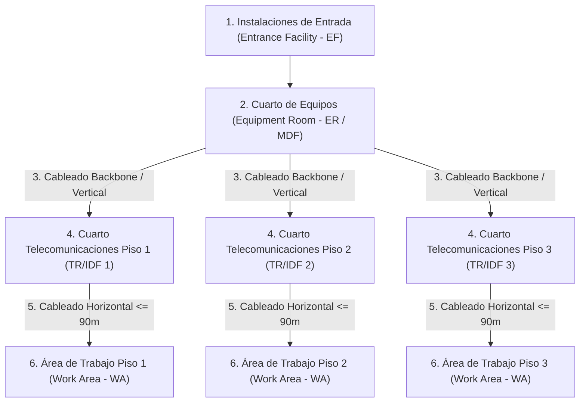

# Módulo 3: Cableado Estructurado
## Tema 3.2: Los 6 Subsistemas del Cableado Estructurado

---

### 1. Visión General de los 6 Subsistemas (Norma ANSI/TIA/EIA-568)

La norma divide la infraestructura de un edificio en seis subsistemas modulares e independientes:



---

### 2. Detalle y Función de cada Subsistema

#### 1. Instalaciones de Entrada (Entrance Facility - EF)
* **Definición:** Punto donde penetran al edificio los cables de los proveedores externos de servicios de telecomunicaciones (Internet por fibra óptica, telefonía pública PSTN, televisión por cable).
* **Componente clave:** Contiene el **Punto de Demarcación (Demarc)**, que es el límite físico y legal de responsabilidad entre el proveedor de servicios (ISP) y el propietario de la red del edificio.
* **Elementos:** Protectores contra sobretensiones eléctricas, cajas de transición y bloques de empalme.

#### 2. Cuarto de Equipos (Equipment Room - ER / MDF)
* **Definición:** El espacio centralizado más importante del edificio (frecuentemente llamado **MDF - Main Distribution Frame** o Centro de Datos).
* **Función:** Alberga los equipos de red activos de alta densidad: Routers de borde, Switches Core (Capa 3), Servidores principales (Base de datos, DNS, Web, DHCP), Firewalls y PBX IP.
* **Requisitos:** Aire acondicionado de precisión (temperatura 18°-24°C), control de humedad, sistema de extinción de incendios por gas limpio (FM-200 / Novec 1230), sistema de alimentación ininterrumpida (UPS) y control de acceso biométrico.

#### 3. Cableado de Respaldo / Troncal / Vertical (Backbone Cabling)
* **Definición:** Conecta los distintos cuartos de telecomunicaciones (TR/IDF) de cada piso hacia el cuarto de equipos principal (ER/MDF), o intercomunica distintos edificios dentro de un campus.
* **Topología:** Jerárquica en estrella de primer y segundo nivel (Backbone inter-edificios y backbone intra-edificio).
* **Medios de transmisión utilizados:**
  * **Fibra Óptica Multimodo (MMF OM3 / OM4):** Medio predilecto por su gran ancho de banda (10G/40G) e inmunidad absoluta al ruido electromagnético entre pisos.
  * **Fibra Óptica Monomodo (SMF):** Para enlaces largos entre edificios en campus (superiores a 500 m).
  * **Cobre UTP Categoría 6A:** Utilizado en distancias cortas (menos de 100m) como respaldo de cobre.

#### 4. Cuarto de Telecomunicaciones (Telecommunications Room - TR / IDF)
* **Definición:** Cuarto técnico o gabinete intermedio ubicado en cada piso del edificio (conocido como **IDF - Intermediate Distribution Frame**).
* **Función:** Es el punto de transición y consolidación donde termina el cableado horizontal de las estaciones de trabajo de ese piso y se conecta al switch de acceso de piso mediante el Patch Panel.
* **Elementos en rack:**
  * **Patch Panel modular de 24 o 48 puertos:** Donde se rematan los cables horizontales con la ponchadora de impacto.
  * **Switch de Acceso (ej. Cisco 2960):** Conecta las tomas a la red local.
  * **Organizadores de cables horizontales y verticales (Cable Managers):** Mantienen el peinado limpio de los cables.
  * **PDU (Unidad de Distribución de Energía):** Regleta para alimentar los switches.

#### 5. Cableado Horizontal (Horizontal Cabling) - ¡Reglas Métricas de Examen!
* **Definición:** Es el tendido físico que va desde el Patch Panel del TR/IDF hasta la toma de pared (*Faceplate*) del puesto de usuario.
* **Topología física:** **Estrella estricta** (prohibido puentear o conectar tomas en cadena margarita/bus).
* **Límites de distancia estrictos (La regla 90m + 10m = 100m):**

$$\text{Enlace Permanente (Permanent Link)} \le 90 \text{ metros}$$
$$\text{Patch Cords Totales (Gabinete + Área de Trabajo)} \le 10 \text{ metros}$$
$$\text{Canal Completo (Channel Link)} \le 100 \text{ metros}$$

```text
[TR/IDF]                                                       [Área de Trabajo]
Patch Panel -------- Cable Horizontal Sólido (Máx 90 m) -------- Toma / Jack RJ45
     |                                                                   |
Patch Cord (Gabinete)                                            Patch Cord (Usuario)
(Máx 5 m)                                                        (Máx 5 m)
     |                                                                   |
Switch 2960                                                         PC / Laptop
\______________________________________________________________________________/
                           CANAL TOTAL (MÁXIMO 100 METROS)
```

* **Tipo de conductor:** El cable horizontal que va dentro de tuberías y canaletas utiliza conductor **sólido** (alambre de cobre rígido de una sola hebra), ideal para ponchado y largas distancias.

#### 6. Área de Trabajo (Work Area - WA)
* **Definición:** Comprende todos los elementos desde la toma de pared hasta el dispositivo del usuario final.
* **Componentes:**
  * **Caja superficial o chalupa empotrada:** Montada en la pared o canaleta.
  * **Faceplate (Placa de pared):** De 1, 2 o 4 puertos.
  * **Jack RJ-45 hembra (Keystone):** Módulo interno ponchado con la norma T568A o T568B.
  * **Patch Cord de usuario:** Cable flexible multifilar (*stranded*) de 2 a 3 metros que une el Jack RJ-45 a la tarjeta de red de la PC.

---

### 3. Preguntas Clave de Examen (Tipo UMG)

**P1: ¿Cuál es la distancia máxima permitida para el enlace permanente en cableado horizontal de cobre?**
> **R:** **90 metros** de cable sólido (sin incluir los patch cords).

**P2: ¿Cuánto mide el canal total permitido por la norma TIA/EIA-568?**
> **R:** Un máximo absoluto de **100 metros** (90 m de enlace permanente + 10 m combinados de cables de parcheo).

**P3: ¿Qué diferencia física y constructiva existe entre el cable UTP del cableado horizontal y el cable de los Patch Cords?**
> **R:** El cableado horizontal utiliza conductores de cobre de **núcleo sólido** (rígido, menor atenuación a distancia, diseñado para ponchado en bloques IDC/PunchDown). Los Patch Cords utilizan conductores **multifilares (stranded)** formados por hilos delgados trenzados, lo que les da flexibilidad para soportar movimientos y curvas continuas sin romperse.
