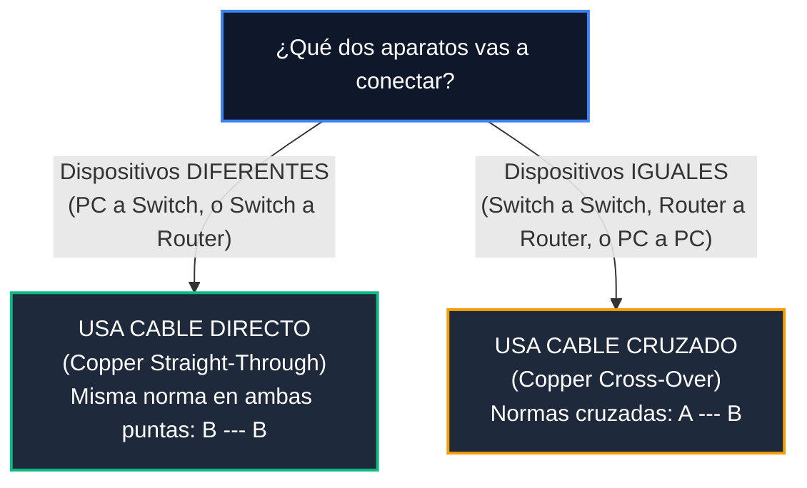

# Módulo 3: Cableado Estructurado
## Tema 3.3: Códigos de Color RJ-45 (T568A vs. T568B y Cables Directo/Cruzado)

---

### 📖 Mini Diccionario para Empezar

* **UTP (Unshielded Twisted Pair):** Cable de red de cobre sin blindaje metálico. Por dentro tiene 8 hilos de cobre trenzados en 4 parejas.
* **Conector RJ-45:** La espiga plástica transparente que tiene 8 dientitos dorados que encajan con un "clic" en la tarjeta de red de tu computadora.
* **Cable Directo (Straight-Through):** Cable que tiene el mismo orden de colores en ambas puntas (Norma B en una punta y Norma B en la otra punta).
* **Cable Cruzado (Cross-Over):** Cable que tiene una norma en una punta (Norma A) y la otra norma en la otra punta (Norma B).

---

### 1. Los 4 Pares de Colores que Vienen en el Cable

Cuando pelas la cubierta gris o azul de un cable UTP, siempre encontrarás 8 hilos enrollados en 4 parejas:

* **Par 1:** Azul / Blanco-Azul
* **Par 2:** Naranja / Blanco-Naranja
* **Par 3:** Verde / Blanco-Verde
* **Par 4:** Marrón / Blanco-Marrón

---

### 2. Normas T568A vs. T568B (El Pinout de los 8 Pines)

Mirando el conector RJ-45 de frente con la patita/clip plástico apuntando hacia abajo, los pines se cuentan del **1 al 8 de izquierda a derecha**:

| Pin | Norma T568A | Norma T568B (La más usada en Guatemala y América) |
| :---: | :--- | :--- |
| **1** | **Blanco / Verde** | **Blanco / Naranja** |
| **2** | **Verde** | **Naranja** |
| **3** | **Blanco / Naranja** | **Blanco / Verde** |
| **4** | **Azul** | **Azul** |
| **5** | **Blanco / Azul** | **Blanco / Azul** |
| **6** | **Naranja** | **Verde** |
| **7** | **Blanco / Marrón** | **Blanco / Marrón** |
| **8** | **Marrón** | **Marrón** |

#### El Truco de Memoria para no Confundirte:
Fíjate bien en la tabla:
* **Los pines 4 y 5 (Azules) y los pines 7 y 8 (Marrones) nunca se mueven; están exactamente en el mismo lugar en ambas normas.**
* **La ÚNICA diferencia entre A y B:** Se intercambian de lugar el **Verde** con el **Naranja** (Pines 1 y 2 se cambian con los Pines 3 y 6).

---

### 3. ¿Cuándo se usa Cable Directo y cuándo Cable Cruzado?

Esta es una pregunta fija de Packet Tracer y de teoría:

#### A. Cable Directo (Copper Straight-Through - Línea Negra Continua en Packet Tracer):
* **Cuándo usarlo:** Cuando conectas aparatos de **diferente tipo o capa**:
  * De tu **PC** hacia el **Switch**.
  * Del **Switch** hacia el **Router**.
  * Del **Patch Panel** hacia el **Switch**.

#### B. Cable Cruzado (Copper Cross-Over - Línea Negra Punteada en Packet Tracer):
* **Cuándo usarlo:** Cuando conectas aparatos del **mismo tipo o capa**:
  * De un **Switch** a otro **Switch** (ejemplo: unir el Switch del Piso 1 con el Switch del Piso 2).
  * De un **Router** a otro **Router**.
  * De una **PC directa a otra PC** sin switch intermedio.
  * *Excepción clásica:* De una **PC directo al Router** (como ambos transmiten por los mismos pines 1 y 2, requieren cable cruzado si no hay switch).

---

### 4. Preguntas Típicas de Examen

**P1: ¿Cuáles pares de colores se intercambian entre las normas T568A y T568B?**
> **R:** Se intercambian el **Par Verde** (pines 1 y 2) con el **Par Naranja** (pines 3 y 6). Los pares Azul y Marrón se mantienen idénticos.

**P2: ¿Qué tipo de cable físico debes seleccionar en Packet Tracer para conectar el Switch del Piso 1 con el Switch del Piso 2?**
> **R:** Un cable cruzado (**Copper Cross-Over**), porque estás conectando dos dispositivos iguales de Capa 2.

**P3: ¿Qué tipo de cable se usa para conectar una computadora a una toma de pared RJ-45?**
> **R:** Un cable directo (**Copper Straight-Through**).
