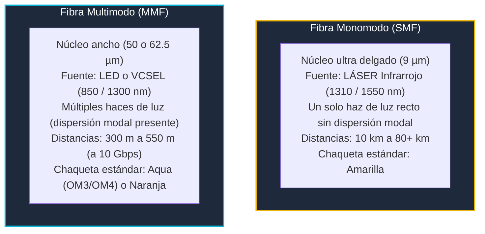

# Módulo 3: Cableado Estructurado
## Tema 3.4: Medios Físicos, Código de 12 Colores de Fibra (TIA-598-C) y Balance Óptico

---

### 1. El Código de 12 Colores para Fibra Óptica (Norma TIA-598-C)

En cables de fibra óptica multifibra (ej. cables exteriores de tubo holgado o *Loose Tube* con 24, 48 o 72 hilos), los hilos de vidrio son tan delgados que no se pueden numerar con texto impreso. La norma **TIA-598-C** establece un código cromático estricto de **12 colores** que debe memorizarse en orden:

```mermaid
flowchart LR
    subgraph TIA598 ["Código de 12 Colores Universal (TIA-598-C)"]
        direction LR
        C1["1. Azul"] --> C2["2. Naranja"] --> C3["3. Verde"] --> C4["4. Marrón"]
        C4 --> C5["5. Gris"] --> C6["6. Blanco"] --> C7["7. Rojo"] --> C8["8. Negro"]
        C8 --> C9["9. Amarillo"] --> C10["10. Violeta"] --> C11["11. Rosa"] --> C12["12. Aqua"]
    end

    style C1 fill:#1d4ed8,stroke:#93c5fd,color:#fff
    style C2 fill:#ea580c,stroke:#fed7aa,color:#fff
    style C3 fill:#15803d,stroke:#bbf7d0,color:#fff
    style C4 fill:#78350f,stroke:#fde68a,color:#fff
    style C5 fill:#64748b,stroke:#cbd5e1,color:#fff
    style C6 fill:#f8fafc,stroke:#94a3b8,color:#000
    style C7 fill:#b91c1c,stroke:#fca5a5,color:#fff
    style C8 fill:#020617,stroke:#64748b,color:#fff
    style C9 fill:#ca8a04,stroke:#fef08a,color:#000
    style C10 fill:#7e22ce,stroke:#e9d5ff,color:#fff
    style C11 fill:#db2777,stroke:#fbcfe8,color:#fff
    style C12 fill:#0d9488,stroke:#99f6e4,color:#fff
```

#### Tabla de Identificación Mnemotécnica:
| Posición | Color | Abreviatura TIA | Posición | Color | Abreviatura TIA |
| :---: | :--- | :---: | :---: | :--- | :---: |
| **1** | **Azul** | BL (*Blue*) | **7** | **Rojo** | RD (*Red*) |
| **2** | **Naranja** | OR (*Orange*) | **8** | **Negro** | BK (*Black*) |
| **3** | **Verde** | GR (*Green*) | **9** | **Amarillo** | YL (*Yellow*) |
| **4** | **Marrón** | BR (*Brown*) | **10** | **Violeta** | VI (*Violet*) |
| **5** | **Gris / Pizarra**| SL (*Slate*) | **11** | **Rosa** | RS (*Rose*) |
| **6** | **Blanco** | WH (*White*) | **12** | **Aqua / Turquesa** | AQ (*Aqua*) |

#### Identificación Bidimensional en Cables de Tubo Holgado:
En un cable de 24 hilos que contiene 2 tubos plásticos amortiguadores con 12 fibras cada uno:
* **Tubo 1 (Azul):** Aloja las fibras de la 1 a la 12 (utilizando los 12 colores en orden).
* **Tubo 2 (Naranja):** Aloja las fibras de la 13 a la 24 (utilizando nuevamente los 12 colores en orden).

* **Pregunta Clásica de Examen UMG:**
  * *¿En qué tubo y de qué color es la fibra número 16?*
    * Tubo 1 = Fibras 1 a 12 (Azul).
    * Tubo 2 = Fibras 13 a 24 (Naranja).
    * Fibra 16 está en el **Tubo Naranja**.
    * Posición dentro del tubo: $16 - 12 = 4$ $\rightarrow$ El cuarto color del código es **Marrón**.
    * **Respuesta:** **Tubo Naranja, Fibra Marrón**.

---

### 2. Clasificación de Fibras Multimodo (Categorías OM)

| Estándar | Diámetro del Núcleo | Ancho de Banda Modal Mínimo | Alcance Máximo a 1 Gbps | Alcance Máximo a 10 Gbps | Color Típico de Chaqueta |
| :---: | :---: | :---: | :---: | :---: | :---: |
| **OM1** | 62.5 $\mu m$ | 200 MHz·km (850 nm) | 275 metros | 33 metros | **Naranja** |
| **OM2** | 50 $\mu m$ | 500 MHz·km (850 nm) | 550 metros | 82 metros | **Naranja** |
| **OM3** *(Optimizada para Láser)* | 50 $\mu m$ | 2,000 MHz·km (850 nm VCSEL) | 1,000 metros | **300 metros** | **Aqua / Turquesa** |
| **OM4** *(Alta Densidad)* | 50 $\mu m$ | 4,700 MHz·km (850 nm VCSEL) | 1,100 metros | **550 metros** | **Aqua / Violeta Erika** |
| **OM5** *(Banda Ancha WDM)*| 50 $\mu m$ | 28,000 MHz·km (SWDM) | 1,100 metros | 550 m (40G/100G) | **Verde Lima** |

---

### 3. Fórmulas de Balance de Pérdidas Ópticas (Optical Power Budget)

Al diseñar un enlace de fibra óptica entre edificios, un ingeniero de redes debe calcular la atenuación total esperada del enlace ($A_{\text{total}}$) para verificar que la potencia que llega al receptor ($P_{\text{rx}}$) sea superior a su sensibilidad mínima:

$$A_{\text{total}} = (\alpha \times L) + (N_{\text{conectores}} \times A_{\text{conector}}) + (N_{\text{empalmes}} \times A_{\text{empalme}}) + \text{Margen}$$

#### Valores Estándar de Pérdida según ANSI/TIA-568.3:
* $\alpha$ (Atenuación del cable de fibra):
  * Multimodo a 850 nm: $\mathbf{3.0 \text{ dB/km}}$
  * Multimodo a 1300 nm: $\mathbf{1.0 \text{ dB/km}}$
  * Monomodo a 1310 nm: $\mathbf{0.4 \text{ dB/km}}$
  * Monomodo a 1550 nm: $\mathbf{0.3 \text{ dB/km}}$
* Pérdida por cada par de conectores acoplados ($A_{\text{conector}}$): máximo **0.75 dB** (0.3 dB en conectores de precisión).
* Pérdida por cada empalme por fusión ($A_{\text{empalme}}$): máximo **0.3 dB** (0.05 dB típico en fusionadora moderna).
* Margen de seguridad por envejecimiento y futuras reparaciones: **3.0 dB**.

---

### 4. Fibra Monomodo (SMF) vs. Multimodo (MMF)

---

### 5. Categorías de Par Trenzado de Cobre y el Porqué del Trenzado Diferencial

En el cable UTP, los 4 pares no están trenzados al azar ni con la misma frecuencia:
* Cada uno de los 4 pares tiene un **Paso de Torsión (Twist Rate)** ligeramente distinto (por ejemplo, el par verde da 75 vueltas por metro, mientras que el par naranja da 65 vueltas por metro).
* **Fundamento electromagnético:** Si dos pares paralelos tuvieran exactamente el mismo paso de torsión, sus campos electromagnéticos se alinearían en fase en cada vuelta, provocando una diafonía masiva (**Crosstalk**). Al variar el paso de trenzado, los acoplamientos se cancelan mutuamente.
* **Separador Central en Cruz (Spline / Cross-Filler en Cat 6):** El cable Categoría 6 incorpora una cruceta plástica de polietileno a lo largo de todo el cable que mantiene físicamente separados los cuatro pares a una distancia constante de 90 grados, reduciendo radicalmente el ruido *NEXT*.
