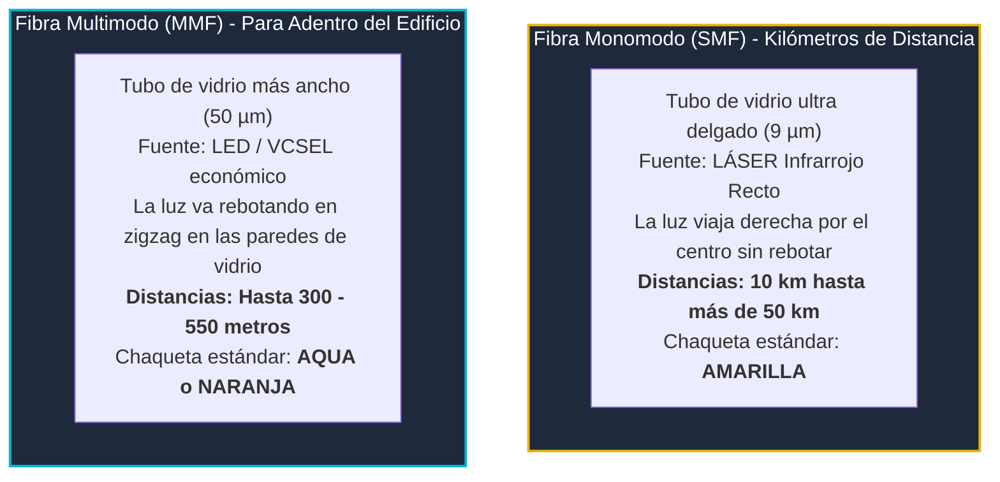

# Módulo 3: Cableado Estructurado
## Tema 3.4: Medios Físicos de Red (Cobre UTP vs. Fibra Óptica Explicado Fácil)

---

### 📖 Mini Diccionario para Empezar

* **Atenuación:** La pérdida natural de fuerza que sufre una señal conforme viaja lejos por un cable (como cuando gritas: quien está a 5 metros te escucha fuerte, pero quien está a 150 metros no escucha nada).
* **Diafonía (Crosstalk):** El ruido o interferencia que un cable eléctrico le mete al cable que tiene pegado al lado.
* **Fibra Óptica:** Hilos de vidrio puro tan delgados como un cabello que transmiten pulsos de luz en lugar de electricidad.
* **Módulo SFP (Transceiver):** El cartucho metálico pequeño que se mete en una ranura especial del switch Cisco para poder enchufar el cable de fibra óptica.

---

### 1. Las Categorías de Cable de Cobre (UTP)

En las tiendas te venderán diferentes tipos de cable UTP. Para tu examen debes conocer estas tres:

| Categoría | Frecuencia | Velocidad Máxima a 100 Metros | ¿Para qué se usa en la vida real? |
| :---: | :---: | :---: | :--- |
| **Cat 5e** | 100 MHz | **1 Gbps** (1,000 Mbps) | Redes residenciales básicas o instalaciones viejas. |
| **Cat 6** | 250 MHz | **1 Gbps** a 100 metros *(10 Gbps hasta 37-55m)* | **El estándar actual de oficinas.** Trae una cruceta plástica en el centro para separar los pares y reducir el ruido. |
| **Cat 6A** | 500 MHz | **10 Gbps a los 100 metros completos** | **Cableado vertical entre pisos** y cuartos de servidores (es más grueso y pesado). |

---

### 2. Fibra Óptica: Monomodo vs. Multimodo (La Gran Analogía)

La fibra óptica transmite fotones de luz. Es inmune al ruido electromagnético, no le afectan los rayos y no conduce electricidad. Existen dos tipos:

#### Comparativa Sencilla:
* **Monomodo (Single-Mode - SMF):**
  * Imagina un puntero láser disparado a través de una pajilla ultra fina.
  * La luz viaja recta como una flecha por el centro, sin rebotar en las paredes.
  * **Alcanza distancias gigantescas:** Desde 10 km hasta más de 50 km (se usa para cruzar ciudades o conectar edificios muy lejanos en un campus universitario).
  * El cable casi siempre tiene la cubierta exterior de color **Amarillo**.
* **Multimodo (Multi-Mode - MMF):**
  * Imagina un tubo más ancho donde enciendes un foco LED.
  * La luz entra en varios ángulos y viaja **rebotando en zigzag** contra las paredes de vidrio.
  * Debido a los rebotes continuos, la luz se dispersa y pierde fuerza más rápido.
  * **Solo alcanza distancias cortas:** Hasta 300 o 550 metros. Es perfecta para conectar los pisos de un mismo edificio o cuartos técnicos cercanos.
  * El cable casi siempre tiene la cubierta exterior de color **Aqua (Turquesa)** o **Naranja**.

---

### 3. El Código de 12 Colores de Fibra Óptica (Norma TIA-598-C)

En un cable de fibra con 12 hilos de vidrio por dentro, como los hilos son transparentes y microscópicos, vienen pintados con 12 colores en un orden estandarizado:

* **Pregunta Típica de Examen:**
  * *¿De qué color es la fibra número 4?* $\rightarrow$ **Marrón**.
  * *¿De qué color es la fibra número 2?* $\rightarrow$ **Naranja**.
  * *¿De qué color es la fibra número 12?* $\rightarrow$ **Aqua**.

---

### 4. Preguntas Típicas de Examen

**P1: ¿Por qué la fibra óptica monomodo alcanza distancias mucho mayores que la multimodo?**
> **R:** Porque tiene un núcleo microscópico (9 µm) por el cual la luz láser viaja en línea recta en un solo haz, eliminando completamente la dispersión modal (los rebotes contra las paredes que limitan a la multimodo).

**P2: ¿Qué categoría de cable de cobre garantiza una velocidad de 10 Gbps a los 100 metros completos?**
> **R:** La **Categoría 6A (Cat 6A)** a 500 MHz.

**P3: ¿Qué color de chaqueta identifica comúnmente a un cable de fibra óptica monomodo?**
> **R:** El color **Amarillo**.
