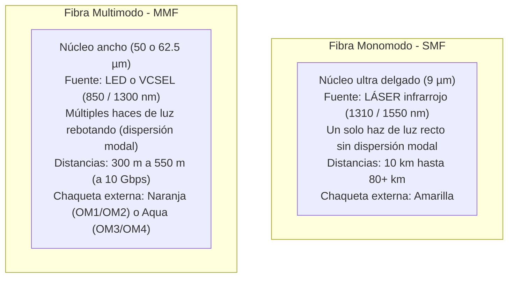

# Módulo 3: Cableado Estructurado
## Tema 3.4: Medios Físicos de Transmisión (Par Trenzado y Fibra Óptica)

---

### 1. Cables de Par Trenzado de Cobre (Twisted Pair)
El par trenzado de cobre es el medio universal para redes LAN. El trenzado helicoidal de los pares cancela el ruido electromagnético externo y la interferencia mutua entre pares adyacentes (*crosstalk* o diafonía).

#### Tipos de Apantallamiento y Blindaje (Clasificación ISO/IEC):
* **UTP (Unshielded Twisted Pair):** Sin ningún tipo de blindaje metálico. El más económico, flexible y fácil de instalar. Estándar en oficinas sin fuentes extremas de interferencia.
* **F/UTP o FTP (Foiled UTP):** Cuenta con una lámina de aluminio global que envuelve a los 4 pares juntos. Reduce interferencias externas.
* **S/FTP (Shielded Foiled Twisted Pair):** Cada par individual está envuelto en su propia lámina de aluminio y, además, los 4 pares están cubiertos por una malla metálica trenzada global. Máxima protección contra EMI (interferencia electromagnética), ideal para ambientes industriales o centros de datos de alta densidad.

---

### 2. Categorías de Rendimiento en Par Trenzado de Cobre

| Categoría | Ancho de Banda Máximo (Frecuencia) | Velocidad Máxima Soportada | Distancia Máxima a Velocidad Máxima | Aplicación Típica |
| :---: | :---: | :---: | :---: | :--- |
| **Cat 5e** | 100 MHz | **1 Gbps** (1000BASE-T) | 100 metros | Redes antiguas o residenciales básicas. |
| **Cat 6** | 250 MHz | **1 Gbps** (1000BASE-T) *10 Gbps (10GBASE-T)* | 100 metros a 1 Gbps *37 a 55 metros a 10 Gbps* | **Estándar comercial de diseño actual** en edificios y oficinas. |
| **Cat 6A** *(Augmented)* | **500 MHz** | **10 Gbps** (10GBASE-T) | **100 metros a 10 Gbps** | Cableado vertical (Backbone), cuartos de servidores y centros de cómputo. |
| **Cat 7 / 7A** | 600 / 1000 MHz | 10 Gbps | 100 metros | Redes industriales (requiere conectores especiales Tera/GG45). |
| **Cat 8** | 2000 MHz (2 GHz) | **25 Gbps / 40 Gbps** | 30 metros | Enlaces internos entre servidores y switches en Centros de Datos. |

---

### 3. Fibra Óptica: Monomodo (SMF) vs. Multimodo (MMF)

La fibra óptica transmite pulsos de luz en lugar de señales eléctricas. Ofrece tres ventajas fundamentales:
1. **Inmunidad absoluta** a la interferencia electromagnética (EMI) y por radiofrecuencia (RFI).
2. **Aislamiento eléctrico total** (no transmite descargas atmosféricas ni diferencias de potencial de tierra entre edificios).
3. **Ancho de banda masivo y distancias kilométricas**.

#### Tabla Comparativa de Fibra Óptica para Examen:

| Característica | Fibra Óptica Monomodo (SMF) | Fibra Óptica Multimodo (MMF) |
| :--- | :--- | :--- |
| **Diámetro del Núcleo (Core)** | **9 micrómetros ($\mu m$)** | **50 o 62.5 micrómetros ($\mu m$)** |
| **Diámetro del Revestimiento (Cladding)** | **125 micrómetros** | **125 micrómetros** |
| **Fuente de Emisión de Luz** | **Láser semiconductor (Diodo Láser)** | **LED o VCSEL (Vertical-Cavity Surface-Emitting Laser)** |
| **Longitudes de Onda** | 1310 nm y 1550 nm | 850 nm y 1300 nm |
| **Dispersión Modal** | Ninguna (un solo rayo viaja recto por el centro) | Presente (múltiples ángulos de entrada causan dispersión) |
| **Distancia Máxima** | Desde **10 km hasta más de 80 km** | Típicamente **300 m a 550 m** a alta velocidad |
| **Costo de Transceivers (SFP)** | Elevado (los láseres son costosos) | Moderado / Accesible |
| **Color estándar de chaqueta** | **Amarillo** | **Naranja (OM1/OM2) / Aqua o Turquesa (OM3/OM4)** |
| **Uso Típico** | Redes WAN de telecomunicaciones, enlaces inter-edificios largos en campus | **Backbone vertical entre pisos** y conexiones dentro del Centro de Datos |

---

### 4. Conectores de Fibra Óptica y Módulos SFP

* **Conector LC (Lucent Connector / Little Connector):** Conector pequeño de forma cuadrada con pestillo de empuje similar a un RJ-45. **Es el estándar moderno dominante** en switches Cisco mediante módulos transceptores **SFP / SFP+** (Mini-GBIC).
* **Conector SC (Subscriber Connector / Square Connector):** Conector cuadrado de inserción directa (*push-pull*). Muy común en bandejas de fibra (ODF) y cajas de terminación óptica de pared.
* **Conector ST (Straight Tip):** Conector redondo con cierre de bayoneta (giro de media vuelta). Común en instalaciones antiguas con fibra OM1/OM2.

---

### 5. Preguntas Clave de Examen (Tipo UMG)

**P1: ¿Cuál es el diámetro típico del núcleo de una fibra óptica monomodo frente a una multimodo?**
> **R:** Monomodo tiene un núcleo de **9 $\mu m$**, mientras que la multimodo tiene un núcleo de **50 o 62.5 $\mu m$**. Ambas comparten el mismo revestimiento exterior de **125 $\mu m$**.

**P2: ¿Por qué la fibra óptica monomodo alcanza distancias muchísimo más largas que la multimodo?**
> **R:** Porque al tener un núcleo microscópico de 9 $\mu m$, la luz láser viaja en un solo modo o haz en línea recta, **eliminando completamente la dispersión modal** que limita a la fibra multimodo.

**P3: ¿Qué categoría de cable de par trenzado garantiza una velocidad de 10 Gbps a los 100 metros completos de canal?**
> **R:** La **Categoría 6A (Cat 6A)** a 500 MHz. (Cat 6 estándar solo soporta 10 Gbps hasta 37-55 metros).
