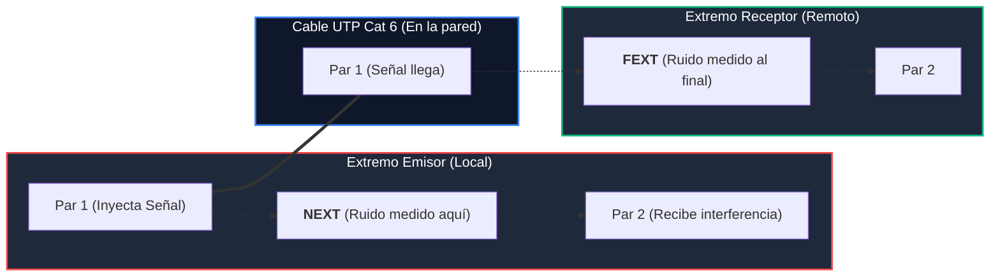

# Módulo 3: Cableado Estructurado
## Tema 3.5: Cálculos Métricos, Presupuesto y Certificación Fluke (Explicado con Manzanas)

---

### 📖 Mini Diccionario para Empezar

* **Certificación de Red:** Pasar una máquina especial y costosa (como un *Fluke CableAnalyzer*) por cada cable instalado para que emita un reporte que diga *"APROBADO"* o *"REPROBADO"*, garantizando que el cable realmente soporte 1 Gbps o 10 Gbps sin errores.
* **Wire Map (Mapa de Cableado):** La prueba que verifica que los 8 hilitos de cobre estén conectados en los pines correctos de ambos extremos sin estar cruzados ni rotos.
* **Holgura (Slack):** El cable extra de reserva que dejas enrollado con cuidado (un 10% adicional) para que el cable no quede tirante como cuerda de guitarra y puedas peinarlo bonito dentro del rack.
* **Bobina de Cable UTP:** La caja de cartón con carrete donde viene el cable. En todo el mundo miden exactamente **305 metros** (que equivale a 1,000 pies).

---

### 1. Fórmulas de Cálculo Métrico de Cables (Para tu Examen Práctico)

En el examen te darán el croquis o medidas de un edificio (ejemplo: 30 metros de largo por 20 metros de ancho y 4 metros de alto por piso). Para calcular cuántos metros de cable y cuántas cajas necesitas, sigues estos 6 pasos lógicos:

#### Paso 1: Distancia más cercana ($D_{\text{mín}}$)
* Es la computadora que está pegadita al cuarto técnico. Por norma se asume siempre entre **5 y 6 metros**.

#### Paso 2: Distancia más lejana ($D_{\text{máx}}$)
* Es la computadora que está en la esquina más lejana del edificio:
  * Si el rack está al centro del plano:
    $$D_{\text{máx}} = \frac{\text{Largo}}{2} + \frac{\text{Ancho}}{2} + \text{Altura del piso (4m)}$$
  * *Ejemplo con edificio de 30m x 20m:*
    $$D_{\text{máx}} = \frac{30}{2} + \frac{20}{2} + 4 = 15 + 10 + 4 = \mathbf{29 \text{ metros}}$$

#### Paso 3: Distancia Promedio ($D_{\text{prom}}$)
* Como no vas a medir con cinta métrica los 60 cables uno por uno, sumas la mínima y la máxima y divides entre 2:
  $$D_{\text{prom}} = \frac{D_{\text{mín}} + D_{\text{máx}}}{2} = \frac{5 + 29}{2} = \mathbf{17 \text{ metros}}$$

#### Paso 4: Añadir el 10% de Holgura ($D_{\text{holgura}}$)
* Multiplicas el promedio por **1.10** para tener cable de sobra para esquinas, bajadas en canaleta y peinado en el rack:
  $$D_{\text{holgura}} = 17 \times 1.10 = \mathbf{18.70 \text{ metros por cada punto}}$$

#### Paso 5: Metros Totales del Edificio
* Multiplicas la distancia con holgura por el número total de computadoras/tomas del edificio (ejemplo: 120 puntos):
  $$\text{Total Metros} = 18.70\text{ m} \times 120\text{ tomas} = \mathbf{2,244 \text{ metros}}$$

#### Paso 6: ¿Cuántas Cajas/Bobinas de Cable Comprar?
* Como cada caja trae **305 metros**, divides el total entre 305 y **siempre redondeas hacia arriba** (porque en la ferretería no te venden medias cajas):
  $$\text{Cajas} = \frac{2,244}{305} = 7.35 \longrightarrow \mathbf{8 \text{ Cajas de 305 metros}}$$

---

### 2. Parámetros de Prueba del Certificador Fluke

Cuando conectas el certificador en una toma de pared, evalúa estos parámetros físicos:

1. **NEXT (Near-End Crosstalk - Diafonía Cercana):** El ruido que el par transmisor le mete al par de al lado en la misma punta donde se enchufa. **Entre más alto sea el número en decibelios (dB), mejor** (significa que está mejor aislado).
2. **FEXT (Far-End Crosstalk - Diafonía Lejana):** La interferencia medida en la punta lejana del cable.
3. **Pérdida de Retorno (Return Loss):** La señal eléctrica que "rebota" hacia atrás por culpa de dobleces bruscos en el cable o por destrenzar más de 1.3 cm al armar el conector RJ-45.
4. **Wire Map (Mapa de Cables):**
   * **Abierto (*Open*):** Un alambre cortado o que no hace contacto.
   * **Cortocircuito (*Short*):** Dos alambres pelados haciéndose contacto entre sí.
   * **Invertido (*Reversed*):** Pusiste el blanco-naranja en el naranja y el naranja en el blanco-naranja.
   * **Pares Divididos (*Split Pairs*):** ¡La pregunta trampa! Usaste hilos de parejas diferentes. El probador barato enciende los foquitos 1-2-3-4-5-6-7-8 como si estuviera bien, pero desarmaste la trenza y el cable se llena de interferencia insoportable.

---

### 3. Presupuesto de Referencia en Quetzales (GTQ)

Para tu entrega del examen, se utiliza esta tabla limpia de cotización oficial:

| Subsistema | Descripción del Material / Equipo | Cant | Unidad | Precio Unitario | Subtotal |
| :--- | :--- | :---: | :---: | :---: | :---: |
| **Área de Trabajo** | Faceplate superficial con caja | 60 | Pieza | Q 18.00 | Q 1,080.00 |
| **Área de Trabajo** | Jack RJ-45 Keystone Categoría 6 | 120 | Pieza | Q 25.00 | Q 3,000.00 |
| **Área de Trabajo** | Patch Cord UTP Cat 6 de 3 metros (usuario) | 120 | Pieza | Q 35.00 | Q 4,200.00 |
| **Cableado Horizontal**| Bobina de Cable UTP Cat 6 (Caja 305m) | 8 | Caja | Q 1,150.00 | Q 9,200.00 |
| **Canalización** | Canaleta plástica adhesiva 20*12 mm (Tramo 2m) | 180 | Tramo | Q 18.00 | Q 3,240.00 |
| **Cableado Vertical** | Cable UTP Cat 6A para subida entre pisos | 40 | Metro | Q 12.00 | Q 480.00 |
| **Cuarto de Piso (IDF)**| Gabinete de pared de 9U | 2 | Pieza | Q 950.00 | Q 1,900.00 |
| **Cuarto Central (MDF)**| Rack abierto de piso de 19 pulgadas (42U) | 1 | Pieza | Q 2,200.00 | Q 2,200.00 |
| **Cuartos Técnicos** | Patch Panel modular 24 puertos Cat 6 | 6 | Pieza | Q 450.00 | Q 2,700.00 |
| **Cuartos Técnicos** | Patch Cord de 1 metro para el gabinete | 120 | Pieza | Q 22.00 | Q 2,640.00 |
| **Cuartos Técnicos** | Regleta de energía para Rack (PDU) | 3 | Pieza | Q 280.00 | Q 840.00 |
| **Equipos Activos** | Switch Administrable de 24 puertos Gigabit | 5 | Pieza | Q 2,800.00 | Q 14,000.00 |
| **Equipos Activos** | Router Empresarial Gigabit Multi-Interfaz | 1 | Pieza | Q 1,950.00 | Q 1,950.00 |
| **Administración** | Kit de etiquetas térmicas TIA-606 | 1 | Kit | Q 350.00 | Q 350.00 |
| **TOTAL** | **Presupuesto Total de Materiales e Infraestructura** | | | | **Q 47,780.00** |
